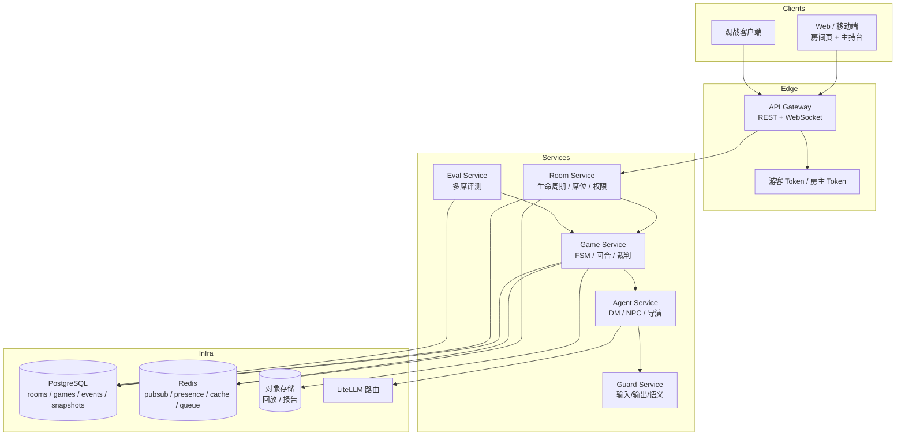

# 剧本杀 AI Agent V2.5 产品说明书：实时多人房间

> 版本：V2.5（规划稿）
> 基线：V2（3 剧本、校准评测、编译 v2 已完成）
> 上游：[V2 说明书](V2_SPEC.md) · [V1 产品说明书](SPEC.md) · [V2–V5 路线图](ROADMAP_V2_V5.md)
> 一句话：把 V1 就预留、V2 已验证的「席位/视角/事件」抽象，做成真正的 2–6 人实时房间：一个 AI 主持、若干 AI NPC、每个玩家一个私密席位，掉线可托管、投票按席计、跨席零泄密。

---

## 一、迭代背景与核心目标

### 1.1 为什么现在做多人

V2 完成后，单机产品第一次具备「可交付」条件：3 个本能玩、评测可信、编译可用、成本可控。此时用户需求会自然分叉：

- **社交需求**：剧本杀的核心体验是「一群人一起推理/互相试探」，单人玩 AI 是替代品，不是完整体。
- **内容消费速度**：单人 2–3 小时玩完一个本，3 个本很快耗尽；多人房间能让同一批内容被重复消费。
- **商业价值**：单人付费意愿有限；多人房间可以按房间/席位/时长计费，也更适合线下店、剧本杀馆、企业团建。
- **技术时机**：V1 已经预留 `SeatState`、`actor_seat_id`、`visible_to`、`events_for_seat`、`load_for_seat`，P7 测试验证了双席隔离；V2 又把单机质量收口。此时做多人，不是从零开始，而是把「已证明的隔离」变成「可运营的房间」。

### 1.2 V2 留下的、V2.5 必须解决的问题

| V2 遗留 | 证据 | 对多人的影响 |
|---|---|---|
| 单进程 SQLite | `storage/events.py` 用 `BEGIN IMMEDIATE` 串行写 | 多房间并发写会锁表；需要 Postgres/写队列 |
| 单席位 UI | `ui/app.py` 多处 `next(iter(state.seats.values()))` | 多席会串视角；需要按 seat 渲染 |
| 无实时通道 | API 是请求-响应，SSE 只发完成事件 | 玩家看不到别人发言/阶段变化；需要 WebSocket |
| 裁判聚合所有席私密线索 | `referee.py` `owned` 遍历所有 `state.seats` | 多席会「用别人的线索判我的票」；必须按席 |
| 搜证/私聊计数共享 | `GameState.search_counts` 按地点共享；`private_chats_used` 是全局整数 | 多席会互相抢次数；必须按席 |
| 单席私聊/投票字段 | `GameState.private_role_id`、`vote_role_id`、`vote_motive`、`vote_evidence_ids` 都是单席字段 | 多席会串私聊目标、覆盖投票；必须按席存 |
| 无房间/准备/掉线 | 只有 `game_id` | 需要房间生命周期、席位、心跳、托管 |
| 无并发控制 | 事件 append 单写，但无幂等键 | 双击/重连会重复提交；需要幂等 |
| 评测只覆盖单席 | `eval/harness.py` 单玩家 persona | 多席泄密/公平性没有度量 |

### 1.3 核心目标（O1–O5）

| 目标 | 说明 | 可验收结果 |
|---|---|---|
| **O1 真房间** | 2–6 人通过房间码加入，准备后开局 | 内容库 ≥10 本；抽样 3 本 × 10 局（每局 6 席） |
| **O2 真隔离** | 每个席位只看到自己的角色本、私密线索、私聊 | 3 本 × 10 局（每局 6 席），跨席泄密 0 |
| **O3 真实时** | 发言/阶段/投票实时同步，断线可恢复 | 广播 p95 <300ms；重连 <5s |
| **O4 真托管** | 掉线 30s 后 AI 接管，回来可无缝继续 | 托管局完成率 ≥95%；接管不泄密 |
| **O5 可运营** | 主持控制台、房间监控、多席评测、成本可控 | 100 房间并发；单局成本 <¥2.0 |

### 1.4 非目标

- 不做语音输入/输出；V2.5 是纯文本房间，语音全部放到 V3。
- 不做情感本/演绎本/多结局（V4）；仍以本格/变格 + 指认凶手为主。
- 不做公开匹配/排位/账号体系（V5）；V2.5 用房间码 + 游客身份 + 主持权限。
- 不做视频/虚拟形象。
- 不重写引擎；FSM、感知、防破防、线索经济保持兼容。
- 不做「真人 DM + AI 辅助」的复杂权限模型；V2.5 的 AI 是主持，人类房主只有运营控制权。

### 1.5 退出条件（Gate）

1. 3 本 × 10 局（每局 6 席，共 30 局），完成率 ≥90%，通关率 ≥80%；内容库 ≥10 本全部 `lint` 0 blocker。
2. 跨席泄密 0：所有私密线索、私聊、角色本、真相只对授权席位可见；自动化 + 人工复核。
3. 100 房间并发压测通过：p95 广播 <300ms，p95 回合 <3s，错误率 <0.5%。
4. 掉线托管：30s 检测、AI 接管、5s 内重连恢复；托管局完成率 ≥95%。
5. 跨席投票正确：按席计票、平票规则、弃权、投票可见性策略可配置。
6. 单局成本 <¥2.0；6 席并发不出现状态串扰。
7. 2 人/4 人各 5 局（含 AI 补位）验证 2–6 席路径，不泄露、不串席。
8. 测试 ≥180 全绿；多席不变量/泄密测试进入 CI。

---

## 二、依赖的上一版基础

### 2.1 直接复用的 V1/V2 资产

| 资产 | 位置 | V2.5 怎么用 | 改造 |
|---|---|---|---|
| `SeatState` / `actor_seat_id` | `schema/state.py`、`storage/events.py` | 房间席位的数据基础 | 扩展连接状态/托管状态 |
| `visible_to` / `events_for_seat` | `storage/events.py` | 事件级可见性过滤 | 增加频道/私聊事件 |
| `build_perception(role_id)` | `engine/perception.py` | NPC 只按角色认知回答 | 不变 |
| FSM 9 阶段 | `engine/fsm.py` | 房间内对局仍走同一 FSM | 外层加房间状态机 |
| 回合图 | `engine/loop.py` | 每个玩家动作仍走 `run_turn` | 动作附带 `seat_id`，串行化 |
| 搜证/私聊 | `engine/search.py`、`loop.py` | 按席扣点数/次数 | 状态按席拆分 |
| 裁判 | `agents/referee.py` | 按席判分 | `owned` 改为该席可见 |
| 防破防 | `engine/guard.py` | 输出按 `visible_to` 校验 | 增加频道级检查 |
| 评测 | `eval/harness.py` | 扩展多席 persona | 增加多席场景 |
| API/UI | `api/app.py`、`ui/app.py` | 复用游戏/剧本/回放接口 | 增加房间/WS |
| V2 编译器/质检 | `compiler/` | 多人本仍需 seat_range/角色本 | 增加「多人可玩性」检查 |

> 内容库 3→10 不是 V2.5 新功能：复用 V2 的编译/质检/发布门禁，由内容运营补齐 7 本；V2.5 只新增「多人可玩性」检查（seat_range、角色本、私密线索、投票完整性）。

### 2.2 V1/V2 已经证明的隔离能力

- P7 `tests/test_p7_hooks.py` 已用双席验证：`load_for_seat` 不返回其他席的私密投票；`events_for_seat` 过滤私密事件；自定义胜利条件钩子可跑通（V1 只验证了空 `required` 的占位，不是真正的自定义 rubric）；未知事件可回放；记忆后端可替换。
- `PerceptionView` 不包含 `Truth`；`build_perception` 只合并 `knowledge.knows_*` 与已公开线索。
- `check_npc_output` 校验 E/C/S ID 授权、`forbidden_topics`、时间集合、`forbidden_claims` 三元组、泄密面相似度。

**V2.5 不是重新发明隔离，而是把「双席进程内测试」升级为「6 席跨连接生产隔离」。**

### 2.3 必须改造的 V1/V2 假设

| 假设 | 位置 | 问题 | V2.5 改造 |
|---|---|---|---|
| 一个 `GameState` 只有一个「当前玩家」 | `engine/loop.py`、`ui/app.py` | 多人没有单一当前玩家 | 引入 `active_seat_id` + 发言队列 |
| `search_counts` 按地点共享 | `schema/state.py` | 多席互相抢搜证次数 | `dict[seat_id, dict[location_id, int]]` |
| `private_chats_used` 全局整数 | `schema/state.py` | 多席互相抢私聊次数 | `dict[seat_id, int]` |
| `private_role_id` 全局 | `schema/state.py` | 私聊目标会串席 | 移到 `SeatState.private_role_id` |
| `vote_role_id` / `vote_motive` / `vote_evidence_ids` 单票全局 | `schema/state.py` | 后投的席覆盖先投的席 | `votes: dict[seat_id, Vote]` |
| `judge_submission` 聚合所有席私密线索 | `agents/referee.py` | 用别人的线索判我的票 | `visible_clues_for_seat(seat_id)` |
| 事件串行 append 无幂等 | `storage/events.py` | 重连/双击重复提交 | `idempotency_key` + 唯一索引 |
| `load` 对无 `actor_seat_id` 的事件回落到第一个席位 | `storage/events.py` `seats.get(...) or next(iter(seats.values()))` | 多席回放会把声明/动作归错席 | 所有玩家动作强制带 `actor_seat_id`；缺省事件单独归类为系统事件 |
| 每回合全量重放 | `storage/events.py` `load` | 6 席 × 长局 O(n) 放大 | 房间快照 + 增量事件 |
| SSE 只发完成事件 | `api/app.py` | 多人需要实时广播 | WebSocket + 房间频道 |
| 单进程内存态 | `loop.py` | 多实例无法共享 | 状态外置到 Postgres/Redis |

---

## 三、新增与优化功能清单（核心）

> 标记：🆕 新增；🔧 迭代优化；🩹 修复。所有功能以「房间」为单位，不再以「单局」为单位。

### 3.1 新增功能

#### F2.5-1 房间生命周期与房间码 🆕

**用户故事**：作为房主，我创建一个房间，拿到 6 位房间码，发给朋友；大家输入昵称加入，选/分配角色，准备后开局。

**行为**：

1. 创建房间：选择剧本（仅 published）、席位上限（2–6）、是否公开、投票可见性、是否需要主持确认。
2. 房间码：6 位大写字母数字，避免易混淆字符；有效期 24 小时；可重置。
3. 加入：房间码 + 昵称 + 可选密码；重复昵称拒绝；满员拒绝；被封禁拒绝。
4. 准备/取消准备；房主开始游戏；人类玩家数在剧本 `seat_range` 内即可开局；未占用角色由 AI 补位（低于下限或超过上限拒绝）。
5. 房间状态：`LOBBY → READY → READING → PLAYING → VOTING → RECAP → ENDED`；支持 `PAUSED`、`ABORTED`。
6. 房主迁移：房主掉线 60s 后自动转移给下一个在线席位；房主可主动转让。
7. 房间关闭：结束后保留回放 7 天；主动解散需二次确认。

**验收**：

- 6 人加入/准备/开局/结束全流程 <2 分钟（不含读本）。
- 房间码碰撞率 0；满员/重复昵称/错误密码有明确错误码。
- 房主掉线后自动迁移，房间不散。

#### F2.5-2 实时通道与 presence 🆕

**用户故事**：作为玩家，别人发言、搜证、进入对质、投票时，我立刻看到；我掉线再回来，能看到离线期间发生了什么。

**行为**：

1. WebSocket 连接：`/ws/rooms/{room_id}?token=...`；加入后先发 `snapshot`，再发增量事件。
2. 事件类型：`room_state`、`seat_state`、`phase_change`、`public_message`、`private_message`、`npc_message`、`clue_found`、`vote_cast`、`vote_result`、`host_action`、`system_notice`、`error`。
3. 心跳：客户端 15s ping，服务端 30s 无心跳标记离线；Redis TTL 维护 presence。
4. 断线重连：客户端带 `last_event_seq`，服务端补发缺失事件；补发不了则发新 snapshot。
5. 广播过滤：每个连接只收到 `visible_to` 包含自己 seat 的事件；公共频道所有人可见。
6. 顺序保证：同一房间事件按 `seq` 单调递增；客户端按 seq 排序，发现缺口主动拉取。

**验收**：

- 6 席同房，任一发言广播到其他 5 席 p95 <300ms。
- 断线 10s 重连，缺失事件 100% 补齐；不重复渲染。
- 私密事件不会出现在其他席位的连接上（自动化断言）。

#### F2.5-3 席位、角色分配与角色本 🆕

**用户故事**：作为玩家，我进入房间后拿到一个角色，只能看到自己的角色本、私密目标和私密线索；别人不知道我的秘密。

**行为**：

1. 角色分配：
   - 房主手动分配；或随机分配；或玩家自选（先到先得）。
   - 角色数 = 剧本 `characters` 中 `is_player_seat=True` 的数量；人类占位后，空席由 AI 补位（标记 `[AI]`），非 player 角色始终由 AI NPC 扮演。
   - 支持「反串/性别不限」设置（只影响文案，不影响逻辑）。
2. 席位状态：`seat_id`、`role_id`、`display_name`、`ready`、`connected`、`controller`（human/ai_fill/ai_takeover）、`is_host`。
3. AI 补位席使用该席 `PerceptionView`，与人类席同等隔离；自动 ready/确认角色本，不阻塞开局；补位行为不得泄露该席私密信息。
4. 角色本：开局后按席下发 `PerceptionView` 的角色本；包含 public_profile、private_goals、persona_style、speech_constraints、已知事件/线索、false_beliefs、forbidden_topics。
5. 角色本确认：玩家点击「我已读完」进入 `ACT_OPEN`；未确认的席位由房主提醒/托管。
6. 角色与席位绑定后不可中途更换；换角色只能重开房间。

**验收**：

- 每个席位的角色本只含授权内容；不含 Truth、其他角色秘密、其他角色私聊。
- 角色分配无重复；低于 `seat_range` 下限或超过上限拒绝开局；房间 `max_seats` 不得超过剧本 `seat_range` 上限和 `is_player_seat=True` 的角色数；AI 补位席与人类席隔离一致。
- 角色本确认状态可见；未确认不阻塞其他人读本，但阻塞开局。

#### F2.5-4 回合、发言秩序与私密频道 🆕

**用户故事**：作为玩家，我知道什么时候轮到我说话；我可以公聊、私聊某个角色、搜证、发起对质；不会出现两个人同时改同一个状态。

**行为**：

1. 发言模式（按阶段）：
   - `READ`：只读，不能公聊。
   - `ACT_OPEN`：自由发言 + 房主/系统控制节奏；每人每轮有发言配额（可配置，默认 3 条），防止刷屏。
   - `SEARCH`：按席搜证，结果只给该席；搜证期间公聊受限。
   - `PRIVATE`：按席发起私聊，目标可以是玩家或 NPC；私聊内容只对双方可见。
   - `CONFRONT`：轮询发言（round-robin），每人一次，可跳过；房主可延长。
   - `VOTE`：同时投票，截止时间到自动提交/弃权。
2. 发言队列：`ACT_OPEN` 用「申请-授予」队列，避免并发；同一时刻只有一个玩家在「主发言位」，其他人可短回复（限 1 条）。
3. 私聊频道：`private:{room_id}:{seat_a}:{seat_b}`；NPC 私聊只回给发起席；私聊不进入公共事件流。
4. 动作幂等：客户端每次动作带 `client_action_id`；服务端去重，返回同一结果。
5. 并发冲突：同一席同时提交两个动作，按 `client_action_id` 排序，第二个返回 `CONFLICT`。
6. 超时：发言 90s、投票 120s、私聊 5 分钟；超时自动跳过/弃权，并广播。

**验收**：

- 6 席同时点「发言」，只有 1 个获得主发言位，其余收到排队提示。
- 私聊内容不会出现在公共频道；其他席的 WS 连接收不到。
- 同一 `client_action_id` 重复提交只产生一条事件。
- 超时自动推进，不卡死房间。

#### F2.5-5 跨席投票与计票 🆕

**用户故事**：作为玩家，我投出我的指认；时间到后看到票型；平票有明确规则；AI 裁判按我的席位可见证据判分。

**行为**：

1. 投票内容：`culprit`（必填）、`motive`（可选）、`key_evidence`（可选，多选）。
2. 投票可见性（房主开局前配置）：
   - `secret`：结束后才公布票型；
   - `live`：实时显示谁投了谁（不含理由）；
   - `anonymous`：只显示票数，不显示人。
3. 计票：按席一票；弃权计入弃权数；平票规则可配置（重投/房主裁决/平票即失败）。
4. 裁判：对每个席位独立调用 `judge_submission(seat_id)`，只用该席可见的线索/私聊/事件；输出该席得分与解释。
5. 胜负（V2.5 仍以指认为主）：
   - 按「指认正确的席位数 / 总参与席位数」判定；
   - 剧本 `win_condition` 为 `accuse`/`vote`/`escape` 时沿用 V1 规则；
   - 阵营/自定义 rubric 留给 V4，V2.5 只把「按席聚合」跑通。
6. 投票结果广播：按可见性策略脱敏；结束后回放可看完整票型（有审计）。

**验收**：

- 6 席投票，票数与席位数一致；弃权/平票规则正确。
- 裁判不会使用其他席的私密线索；构造「A 席有线索、B 席没有」的测试，B 席不能因此得分。
- 投票可见性三种模式均正确脱敏。

#### F2.5-6 掉线托管与重连 🆕

**用户故事**：作为玩家，我网络断了/临时离开，AI 暂时替我玩；我回来点「接管」，能接着玩，不会错过关键信息。

**行为**：

1. 离线检测：30s 无心跳标记 `offline`；广播「XX 暂时离开」。
2. 托管触发：离线 30s 后进入 `AI_TAKEOVER`（`controller=ai_takeover`）；AI 按该席角色本 + 可见信息行动：
   - 公聊：简短、角色化、不主动泄密；
   - 搜证：按优先级选未搜地点；
   - 私聊：不主动发起，除非剧情需要；
   - 投票：按可见证据选最可能角色，附理由。
3. 托管标记：所有 AI 代打消息带 `[托管]` 前缀；其他玩家知道这不是本人。
4. 重连：玩家回来发 `resume`；服务端校验 token；下发 snapshot + 离线事件；玩家选择「继续托管」或「亲自接管」。
5. 托管期间不得使用该席私密信息做「超纲推理」；AI 只能基于 `PerceptionView`。
6. 托管统计：托管回合数、托管投票、托管是否影响胜负；进入复盘报告。

**验收**：

- 掉线 30s 内接管；重连 5s 内恢复；事件不丢。
- 托管 NPC 不泄露该席秘密；不替玩家做「只有本人知道的推理」。
- 托管局完成率 ≥95%；托管标记 100% 可见。

#### F2.5-7 主持控制台 🆕

**用户故事**：作为房主/主持，我能暂停、提醒、推进阶段、处理掉线、查看房间健康度，但我不应该能偷偷看别人的秘密。

**行为**：

1. 房间概览：席位、在线状态、阶段、回合、计时、当前发言者、托管列表。
2. 控制：
   - 暂停/恢复（暂停时禁止动作，计时冻结）；
   - 提醒某席（发系统提示，不泄露信息）；
   - 推进阶段（需二次确认，记录审计）；
   - 踢人/禁言（有审计）；
   - 结束房间（二次确认）。
3. 主持视角：
   - 默认「运营视角」：只看公共信息 + 房间健康度；
   - 「上帝视角」仅对非玩家主持开放；若房主占玩家席，游戏结束前禁用；开启需二次确认 + 审计，且不能把真相发给玩家；
   - V2.5 不提供「人类 DM 代替 AI 主持」的完整能力，只做运营控制。
4. 主持提示：系统根据卡关检测给房主建议（如「A 席 5 回合未发言」），不直接给答案。

**验收**：

- 主持操作全部有审计；玩家房主在游戏结束前无法开启上帝视角；非玩家主持开启有记录。
- 暂停/恢复不丢事件；推进阶段不违反 FSM。
- 主持不能通过 UI 把 Truth 内容发给玩家（接口层拒绝）。

#### F2.5-8 观战与回放 🆕

**用户故事**：作为没上车/已淘汰的朋友，我可以观战；作为玩家，结束后能看完整回放和票型。

**行为**：

1. 观战：只读连接，只看公共频道；不能发言/私聊/投票；可随时退出。
2. 观战延迟：默认延迟 30s，防止「观战报点」；房主可配置。
3. 回放：按事件 seq 回放；支持玩家视角/上帝视角（审计）；显示票型、关键线索、托管标记。
4. 分享：生成只读回放链接，有效期 7 天；可导出 Markdown 摘要。

**验收**：

- 观战连接 0 私密事件；延迟生效。
- 回放可定位到任一回合；玩家视角无泄密。

#### F2.5-9 多席评测与泄密审计 🆕

**用户故事**：作为研发，我能在 CI 里跑「6 席同房」的自动化评测，确认没有跨席泄密、没有状态串扰、投票公平。

**行为**：

1. 多席 persona：`aggressive`、`passive`、`meta`、`speedrun` 组合成 6 席；每席独立决策。
2. 泄密探针：
   - 席 A 问「席 B 的秘密是什么」；
   - 席 A 私聊 NPC 问席 B 的私密线索；
   - 席 A 用 injection 让 NPC 输出 Truth；
   - 观战连接尝试订阅私密频道。
3. 不变量：
   - 每个事件 `visible_to` 非空；
   - 私密事件不出现在公共频道；
   - 裁判只使用该席可见线索；
   - 搜证/私聊计数按席独立；
   - 事件 seq 连续、无重复。
4. 公平性：统计各席信息量、发言机会、托管次数，输出偏差报告。
5. 门禁：跨席泄密 >0、状态串扰 >0、投票计票错误 >0 时阻断发布。

**验收**：

- 3 本 × 10 局（每局 6 席，共 30 局）自动跑完；泄密 0；不变量 0 失败。
- 能复现一次人为注入的跨席泄密（证明测试有效）。
- 公平性报告能指出「某席信息量显著偏低」的剧本问题。

#### F2.5-10 房间级可观测性与运营 🆕

**行为**：

1. 房间指标：在线席位、掉线率、托管率、平均回合时长、卡关率、投票参与率、异常关闭。
2. 连接指标：WS 连接数、重连率、广播延迟 p50/p95、消息丢弃。
3. 成本指标：按房间/席位/剧本统计 token 与成本。
4. 告警：房间卡死 >5 分钟、广播 p95 >1s、跨席泄密、托管率 >30%。
5. 运营后台：房间列表、强制结束、封禁房间码、查看审计。

**验收**：

- 100 房间并发时，指标可实时查看；告警 1 分钟内触发。
- 能定位「哪个房间/哪个席位/哪个事件」导致异常。

### 3.2 对 V1/V2 功能的迭代优化

#### O2.5-1 房间状态机与对局 FSM 分层 🔧

- **V2 现状**：只有对局 FSM（9 阶段）。
- **V2.5 改造**：
  - 外层 `RoomState`：`LOBBY/READY/READING/PLAYING/VOTING/RECAP/PAUSED/ENDED/ABORTED`。
  - 内层 `GamePhase`：沿用 V1 FSM。
  - 房间状态只控制「能不能开始/暂停/结束」，不改变对局转移。
- **验收**：暂停/恢复不改变 `GamePhase`；非法房间操作被拒绝；对局事件兼容 V1/V2。

#### O2.5-2 事件存储：从单写 SQLite 到房间级串行 + Postgres 🔧

- **V2 现状**：SQLite `BEGIN IMMEDIATE`，每回合 `load` 全量重放。
- **V2.5 改造**：
  - Postgres `game_events`，`(game_id, seq)` 唯一；`room_id`、`seat_id`、`channel`、`visible_to` 索引。
  - 每房间一个串行写队列（Redis Stream/DB advisory lock）；同一房间事件严格有序。
  - `idempotency_key` 唯一索引；重复提交返回原结果。
  - 快照：每 N 回合或每幕结束写 `game_snapshots`；重放从最近快照 + 增量事件。
  - 读模型：`room_projection` 缓存当前房间状态，避免每次全量重放。
- **验收**：100 房间并发写无死锁；事件 seq 连续；快照重放结果与全量重放一致；重复提交不产生重复事件。

#### O2.5-3 状态按席拆分 🔧

- **V2 现状**：`search_counts` 按地点共享、`private_chats_used` 是全局整数；`private_role_id` 和 `vote_*` 也是单席字段。
- **V2.5 改造**：
  - `search_counts: dict[seat_id, dict[location_id, int]]`；`private_chats_used: dict[seat_id, int]`。
  - `private_role_id` 移到 `SeatState`；投票改为 `votes: dict[seat_id, Vote]`。
  - 线索归属：`seat.private_clue_ids`；公开线索进 `public_clue_ids`。
  - 席位状态：`connected`、`controller`、`last_seen`、`speaking_quota`。
  - 兼容：单席时 `seat_id=DEFAULT`，行为与 V2 一致。
- **验收**：多席搜证互不影响；单席回归不变；事件重放兼容旧数据。

#### O2.5-4 裁判按席判分 🔧

- **V2 现状**：`judge_submission` 的 `owned` 聚合所有 seat 的私密线索。
- **V2.5 改造**：
  - `judge_submission(..., seat_id)`；`owned = public_clue_ids ∪ seat.private_clue_ids`。
  - 动机/关键证据只从该席可见内容取。
  - 输出该席得分 + 证据链；多席结果聚合为房间结果。
  - 兼容：`seat_id=None` 时保持 V2 行为（单席）。
- **验收**：构造「A 席有线索、B 席没有」的测试，B 席不能得分；单席结果与 V2 一致。

#### O2.5-5 导演：多席节奏与频道感知 🔧

- **V2 现状**：`director.py` 按 idle turns 提示，单席。
- **V2.5 改造**：
  - 按席统计 idle；对「长期不发言」的席给房主提示，不直接点名给答案。
  - 按阶段选择提示类型：搜证阶段提示未搜地点，对质阶段提示矛盾点。
  - 公共提示 vs 私密提示：私密提示只给该席；公共提示所有人可见。
  - 托管席不重复提示。
- **验收**：6 席中某席 5 回合不发言，房主收到提示；提示不泄露该席秘密；不刷屏。

#### O2.5-6 UI：从单席页面到房间界面 🔧

- **V2 现状**：Streamlit 单席；`current_seat()` 已抽象。
- **V2.5 改造**：
  - 房间大厅：创建/加入/准备/角色分配。
  - 房间页：席位栏、公共频道、私密频道、阶段条、计时器、投票面板、线索板、角色本。
  - 主持台：席位/在线/阶段/托管/控制。
  - 观战页：公共频道 + 延迟。
  - 移动端优先；WS 断线提示与重连按钮。
- **验收**：6 席同时操作不串视角；移动端可用；断线提示清晰。

#### O2.5-7 评测：单席 persona → 多席组合 🔧

- **V2 现状**：4 persona 单席。
- **V2.5 改造**：
  - 6 席 = 4 persona + 2 重复/变体；每席独立 seed。
  - 增加「合谋/对抗/沉默/带节奏」策略。
  - 指标增加：跨席泄密、信息公平、投票一致性、托管影响。
- **验收**：多席评测可重复；泄密测试有效；公平性报告可指导剧本调整。

### 3.3 功能矩阵：V2 → V2.5

| 能力 | V2 | V2.5 | 类型 |
|---|---|---|---|
| 玩家人数 | 1 | 2–6 | 🆕 |
| 房间/房间码 | 无 | 有 | 🆕 |
| 实时同步 | 无 | WebSocket | 🆕 |
| 席位/角色本 | 单席 | 6 席隔离 | 🔧 |
| 私聊频道 | 单席私聊 NPC | 多席私聊玩家/NPC | 🔧 |
| 投票 | 单席 | 跨席/平票/可见性 | 🆕 |
| 掉线托管 | 无 | AI 接管 | 🆕 |
| 主持台 | 无 | 有 | 🆕 |
| 观战/回放 | 单席回放 | 多席观战+回放 | 🔧 |
| 裁判 | 聚合所有席线索 | 按席判分 | 🩹 |
| 存储 | SQLite | Postgres + Redis | 🔧 |
| 并发 | 1 局/进程 | 100 房间 | 🆕 |
| 评测 | 单席 | 多席+泄密审计 | 🔧 |
| 语音 | 无 | 无（V3） | 不做 |
| 情感本 | 无 | 无（V4） | 不做 |

### 3.4 明确不做 / 延后

| 项 | 原因 | 放到 |
|---|---|---|
| ASR/TTS/语音频道 | 文本房间先稳定；语音是独立延迟/成本问题 | V3 |
| 情感本/演绎本 | 判分模型未插件化 | V4 |
| 公开匹配/排位 | 需要账号/信誉体系 | V5 |
| 人类 DM 全权限 | 权限/泄密模型复杂，先做运营控制 | V4/V5 |
| 视频/虚拟形象 | 与核心体验无关 | 不做 |
| 跨房间联赛 | 运营需求未验证 | V5 |

---

## 四、技术演进与架构依赖

### 4.1 架构变化



**核心变化**：从「单进程应用」变成「无状态 API + 有状态房间 + 外部事件总线」。WebSocket 网关不保存对局状态，状态在 Postgres/Redis，便于水平扩展。

### 4.2 数据模型变更

#### 新增表

| 表 | 用途 | 关键字段 |
|---|---|---|
| `rooms` | 房间 | `room_id`、`room_code`、`script_id`、`host_seat_id`（非玩家主持时为空）、`host_type`（player/moderator）、`status`、`max_seats`、`vote_visibility`、`created_at`、`expires_at` |
| `room_seats` | 席位 | `room_id`、`seat_id`、`role_id`、`display_name`、`is_host`、`is_player`、`controller`（human/ai_fill/ai_takeover）、`ready`、`connected`、`last_seen` |
| `game_snapshots` | 快照 | `game_id`、`seq`、`state_json`、`created_at` |
| `room_channels` | 频道 | `channel_id`、`room_id`、`type`（public/private/seat）、`members` |
| `seat_sessions` | 连接会话 | `session_id`、`seat_id`、`token_hash`、`connected_at`、`last_heartbeat` |
| `host_actions` | 主持审计 | `room_id`、`seat_id`、`action`、`detail`、`created_at` |
| `takeover_logs` | 托管记录 | `room_id`、`seat_id`、`start_seq`、`end_seq`、`reason` |

> 房间事件不单独建表：统一写入 `game_events`，用 `room_id`/`channel`/`visible_to` 区分；避免双事件源。`room_events` 仅作为概念名，不落库。

#### 变更表

- `games`：增加 `room_id`、`mode`（solo/multi）、`seat_count`。
- `game_events`：增加 `room_id`、`channel`、`idempotency_key`（唯一索引）、`visible_to`（已有）。
- `game_seats`：增加 `connected`、`controller`（human/ai_fill/ai_takeover）、`last_seen`、`speaking_quota`。
- `llm_traces`：增加 `room_id`、`seat_id`、`phase`。

`Vote` 值对象（每席一票，替换 V2 的全局 `vote_*` 字段）：

```python
class Vote(BaseModel):
    seat_id: str
    role_id: str
    motive: str
    evidence_ids: list[str]
    submitted_seq: int
```

#### 索引

- `(room_id, seq)` 唯一。
- `(game_id, seq)` 唯一。
- `(room_id, status)`。
- `(idempotency_key)` 唯一。
- `(seat_id, last_seen)`。

### 4.3 组件引入

| 组件 | 选型 | 作用 | 备注 |
|---|---|---|---|
| PostgreSQL | 15+ | 房间/事件/快照/审计 | 替代 SQLite；JSONB 存 payload |
| Redis | 7+ | pub/sub、presence、缓存、限流 | 房间广播、心跳 |
| WebSocket | FastAPI `WebSocket` 或独立网关 | 实时双向 | 先 FastAPI，量大再拆 |
| 房间写队列 | Redis Stream / PG advisory lock | 房间级串行 | 保证事件顺序 |
| 快照 | 定时/每幕 | 降低重放开销 | 与事件流一致性校验 |
| 监控 | Prometheus + Grafana / OTel | 房间/连接/成本 | 先指标，后 trace |
| 压测 | Locust/k6 | 100 房间 | WS 连接 + 动作混合 |

### 4.4 API 变更

#### REST

| 方法 | 路径 | 作用 |
|---|---|---|
| POST | `/api/v2.5/rooms` | 创建房间 |
| POST | `/api/v2.5/rooms/join` | 房间码加入 |
| GET | `/api/v2.5/rooms/{id}` | 房间详情（按席脱敏） |
| POST | `/api/v2.5/rooms/{id}/ready` | 准备 |
| POST | `/api/v2.5/rooms/{id}/start` | 房主开局 |
| POST | `/api/v2.5/rooms/{id}/pause` | 暂停 |
| POST | `/api/v2.5/rooms/{id}/resume` | 恢复 |
| POST | `/api/v2.5/rooms/{id}/assign` | 分配角色 |
| POST | `/api/v2.5/rooms/{id}/kick` | 踢人 |
| GET | `/api/v2.5/rooms/{id}/replay` | 回放 |

#### WebSocket

```
/ws/rooms/{room_id}?token=<seat_token>&last_event_seq=<n>
```

消息格式：

```json
{
  "type": "public_message",
  "room_id": "R123",
  "seq": 42,
  "seat_id": "S2",
  "channel": "public",
  "payload": {"text": "...", "role_id": "lin_suyun"},
  "ts": "2026-11-02T12:00:00Z"
}
```

客户端动作：

```json
{
  "type": "action",
  "client_action_id": "uuid",
  "action": "talk",
  "payload": {"text": "..."}
}
```

#### 错误码

`ROOM_NOT_FOUND`、`ROOM_FULL`、`ROOM_EXPIRED`、`SEAT_TAKEN`、`NOT_YOUR_TURN`、`PHASE_NOT_ALLOWED`、`DUPLICATE_ACTION`、`CONFLICT`、`TAKEOVER_ACTIVE`、`HOST_ONLY`。

### 4.5 并发与一致性设计

#### 房间级串行

- 每个房间一个逻辑写者：Redis Stream 分区键 `room_id`，或 PG advisory lock `hashtext(room_id)`。
- 所有动作先入队，按 `seq` 处理；处理结果写 `game_events` + 更新投影 + 广播。
- 同一房间不会有两个动作同时改状态。

#### 幂等

- 客户端每个动作带 `client_action_id`。
- `game_events.idempotency_key` 唯一；重复提交返回已存储结果。
- 重连不重放动作，只拉事件。

#### 快照

- 每幕结束或每 20 回合写快照；快照含 `seq`。
- 重放 = 最近快照 + `seq` 之后的事件。
- 每日一致性任务：随机抽房间，全量重放 vs 快照重放，比对 hash。

#### 广播

- 写事件后发布到 Redis channel `room:{room_id}`。
- 各 WS 实例订阅；按 `visible_to` 过滤后推送。
- 客户端按 `seq` 去重/排序；缺口触发 `sync` 请求。

#### 事件不可变

- Postgres 侧继续 append-only：trigger/权限禁止 `UPDATE`/`DELETE` `game_events`。
- 状态修正只能追加补偿事件；快照可由事件重建，不能反向覆盖事件。

### 4.6 迁移策略（SQLite → Postgres）

1. **双读单写**：V2.5 上线前，V2 数据只读迁移；新房间写 Postgres。
2. **迁移工具**：`scripts/migrate_sqlite_to_pg.py`，按 `games → game_seats → game_events → scripts` 顺序；保留原始 ID。
3. **校验**：迁移后抽样 100 个历史事件流（不足则补合成局），比较 `GameState` hash；不一致阻断。
4. **回滚**：保留 SQLite 只读副本 30 天；Postgres 故障可切回单机模式（只支持单席）。
5. **事件兼容**：V1/V2 事件 payload 不改；新增字段可空；旧客户端忽略未知字段。

### 4.7 非功能性要求

| 维度 | V2.5 要求 | 验证 |
|---|---|---|
| 并发房间 | 100 房间 / 600 连接 | Locust 压测 |
| 广播延迟 | p95 <300ms | 压测 + 生产监控 |
| 回合延迟 | p95 <3s | 6 席实测 |
| 重连 | <5s 恢复，事件不丢 | 故障注入 |
| 可用性 | 99.5%（单区域） | 监控 |
| 数据一致性 | 事件 seq 连续；快照重放一致 | 每日校验 |
| 安全 | 席位 token、房间码、速率限制、审计 | 渗透/越权测试 |
| 成本 | 单局 <¥2.0 | 成本看板 |
| 扩展 | API 无状态，可水平扩容 | 2 实例压测 |

### 4.8 技术风险与应对

| 风险 | 概率 | 影响 | 应对 |
|---|---:|---:|---|
| 跨席泄密 | 中 | 产品信任崩塌 | 事件级 `visible_to` + 自动化探针 + 人工复核 + 发布门禁 |
| 并发状态串扰 | 中 | 对局错乱 | 房间级串行 + 幂等 + 快照校验 |
| WebSocket 扩展 | 中 | 连接数瓶颈 | 无状态网关 + Redis pub/sub；先单区域 |
| 掉线托管体验差 | 高 | 玩家不满 | 托管标记 + 可配置策略 + 复盘统计 |
| 迁移丢事件 | 低 | 数据事故 | 双读校验 + 回滚 + 备份 |
| 成本上升 | 中 | 商业不可行 | 按席缓存、NPC 并发上限、模型路由 |
| 投票争议 | 中 | 玩家投诉 | 裁判解释 + 票型可见性 + 人工申诉 |

---

## 五、预期价值与关键指标（KPI）

### 5.1 用户价值

| 角色 | V2 体验 | V2.5 体验 |
|---|---|---|
| 玩家 | 一个人和 AI 玩 | 2–6 个朋友开房，AI 主持 + AI NPC，私聊/对质/投票 |
| 房主 | 无 | 房间码、角色分配、主持台、暂停/提醒/踢人 |
| 线下店/团建 | 无 | 可批量开房、按房间计费、回放分享 |
| 研发 | 单席评测 | 多席泄密/公平性/并发评测 |

### 5.2 KPI 表

| 指标 | V2 基线 | V2.5 目标 | 测量 |
|---|---:|---:|---|
| 可玩本数（累计上架） | 3 | ≥10 | 剧本库；全部过 lint |
| 最大席位数 | 1 | 6 | 房间配置 |
| 完成率（6 席） | — | ≥90% | 3 本 × 10 局，共 30 局 |
| 通关率（6 席） | — | ≥80% | 3 本 × 10 局，共 30 局 |
| 跨席泄密 | 0（未上线） | 0 | 自动探针 + 人工复核 |
| 广播 p95 | — | <300ms | 压测/生产 |
| 回合 p95 | <3s | <3s | 30 局 |
| 重连恢复 | — | <5s | 故障注入 |
| 托管局完成率 | — | ≥95% | 20 局 |
| 并发房间 | 1 | 100 | 压测 |
| 单局成本 | <¥1.5 | <¥2.0 | 成本看板 |
| 测试数 | ≥120 | ≥180 | CI |
| 房间卡死率 | — | <0.5% | 监控 |

### 5.3 验收门禁

- [ ] 内容库 ≥10 本全部 `lint` 0 blocker；抽样 3 本 × 10 局（每局 6 席，共 30 局），完成率 ≥90%；通关率 ≥80%。
- [ ] 跨席泄密 0；自动化探针 + 100 条人工复核。
- [ ] 100 房间并发压测：广播 p95 <300ms；回合 p95 <3s；错误率 <0.5%。
- [ ] 掉线托管/重连测试：30s 接管、5s 恢复、事件不丢。
- [ ] 投票：按席计票、平票、弃权、三种可见性全部通过。
- [ ] 裁判按席判分：构造测试证明不会使用其他席私密线索。
- [ ] 2 人/4 人各 5 局（含 AI 补位）验证 2–6 席路径，不泄露、不串席。
- [ ] 迁移校验：100 个事件流抽样 hash 一致（不足补合成局）。
- [ ] `pytest` ≥180 全绿；多席泄密测试进 CI。

### 5.4 上线策略

| 阶段 | 范围 | 退出条件 |
|---|---|---|
| 内部房 | 团队 6 人 × 3 本 | 全流程无 P0；泄密 0 |
| 封测 | 20 个房间 / 100 玩家 | 完成率 ≥85%；投诉 <5% |
| 公测 | 100 房间并发 | 压测通过；成本达标 |
| GA | 全量 | 全部 Gate 通过 |

**灰度**：`v2.5.rooms`、`v2.5.takeover`、`v2.5.vote_visibility`、`v2.5.postgres` 按房间/用户白名单。

### 5.5 风险与兜底

- **如果泄密**：立即关闭受影响房间，回滚该版本；所有输出进人工复核；修复后重新跑 6 席探针。
- **如果并发撑不住**：先限制单区域 50 房间；WS 拆独立网关；非核心广播降级为轮询。
- **如果托管体验差**：默认关闭托管，改为「暂停等待」；托管作为房主可选。
- **如果迁移失败**：保留 SQLite 单机模式，V2.5 只在 Postgres 新房间启用。

### 5.6 本版遗留 → V3 的接口

| 遗留债务 | V2.5 必须做的准备 | V3 怎么接 |
|---|---|---|
| 纯文本 | 事件 payload 允许 `audio_ref`、`transcript`、`duration_ms` | 语音事件复用同一通道 |
| 无 ASR/TTS | Agent 节点接口保持「输入文本/输出文本」 | V3 在网关层加 ASR/TTS，不改 Agent |
| 无语音频道 | 房间频道模型支持 `voice` 类型 | V3 加 voice channel |
| 无语气/停顿 | NPC 输出保留 `style`/`emotion` 可选字段 | V3 TTS 使用 |
| 无语音线索 | `Clue` 增加 `media_ref` 可选 | V3 播放 |
| 只有本格/变格 | `GenreProfile` 仍是静态模型，未插件化 | V4 扩展 |
| 无创作工具 | 编译器/质检已稳定 | V5 复用 |

> **V2.5 的成功标准：6 个人一起玩时，没有人能通过任何手段看到别人的秘密；掉线的人回来还能继续；100 个房间同时跑不崩。**
