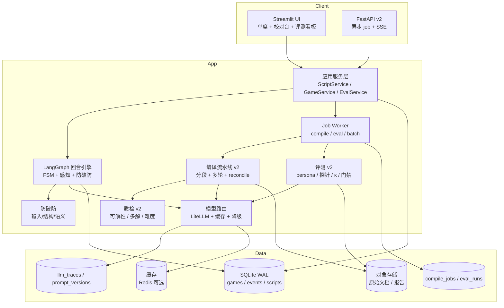

# 剧本杀 AI Agent V2 产品说明书：质量闭环与内容规模化

> 版本：V2.0（规划稿）
> 基线：V1（2026-11-02，工程闭环可运行、质量验收未通过）
> 上游：[V1 产品说明书](SPEC.md) · [V1 状态](V1_STATUS.md) · [V1 决策记录](DECISIONS.md) · [V2–V5 路线图](ROADMAP_V2_V5.md)
> 一句话：V2 不发明新玩法，而是把 V1 已经跑通的单机闭环，做成「三个本能稳定玩、作者能导入、效果能被量化」的可交付产品，并为 V2.5 多人房间补齐并发与隔离的地基。

---

## 一、迭代背景与核心目标

### 1.1 V1 实际交付了什么

V1 不是一个 demo，而是一条完整的单机链路：

| 能力 | V1 实现 | 代码位置 |
|---|---|---|
| 结构化剧本 | Pydantic `Script`，角色/幕/真相事件/线索/秘密/地点/关系/泄密面 | `src/jubensha/schema/ir.py` |
| 三层世界模型 | `Truth` / `Public` / `Perception[role]`，NPC 只能看到自己的认知切片 | `src/jubensha/engine/perception.py` |
| 事件溯源 | SQLite `game_events` append-only，trigger 禁止 UPDATE/DELETE，状态由重放得到 | `src/jubensha/storage/events.py` |
| 回合编排 | LangGraph `StateGraph` + 自定义 `SQLiteCheckpointer`，10 个节点 | `src/jubensha/engine/loop.py` |
| 阶段机 | `ENTRY → READ → ACT_OPEN → {SEARCH, PRIVATE, CONFRONT} → VOTE → RECAP → END` | `src/jubensha/engine/fsm.py` |
| 线索经济 | 搜证点数、地点容量、前置线索、公开/私密、红鲱鱼 | `src/jubensha/engine/search.py` |
| 防破防 | 输入闸、结构闸（ID/时间/三元组/相似度）、语义闸 | `src/jubensha/engine/guard.py` |
| NPC | `grounded` 默认（模型只选 source_id）、`freeform` 实验；ClaimJournal 一致性 | `src/jubensha/agents/npc.py` |
| 导演/裁判 | 确定性提示节奏；`culprit/motive/key_evidence` rubric | `src/jubensha/agents/director.py`、`referee.py` |
| 编译 | txt/md/docx/pdf/json → 15 字段 LLM 抽取 → JSON repair → lint → 校对 → 发布 | `src/jubensha/compiler/` |
| 评测 | 4 persona × 5 局、41 探针、LLM-as-judge、不变量、门禁 | `src/jubensha/eval/` |
| 接口 | Streamlit 单机 UI + FastAPI 单机 API（可选 Bearer） | `src/jubensha/ui/`、`src/jubensha/api/` |

单看工程完整度，这是一套可以继续演进的底座；单看质量，它还没有达到「可以对外说 V1 完成」的标准。

### 1.2 V1 验收结论：工程通过，质量未通过

`docs/V1_STATUS.md` 的实测结果：

| 指标 | V1 实测 | SPEC 验收线 | 结论 |
|---|---:|---:|---|
| 自动化测试 | 63 passed | 全绿 | ✅ |
| 完成局数 | 20/20 | 20/20 | ✅ |
| 通关率 | 14/20 = 70% | >80% | ❌ |
| 正常策略通关率 | 10/15 = 66.7% | >80% | ❌ |
| 凶手指认 | 14/20 = 70% | 参考项 | ⚠️ |
| 二级卡关 | 0 | 0 | ✅ |
| 事件不变量失败 | 0 | 0 | ✅ |
| 主动发言不足两次 | 0 | 0 | ✅ |
| 探针最终回复命中 | 0/41 | 0 | ✅ |
| 输出闸拦截 | 7/41 = 17.1% | 记录项 | ⚠️ 需人工复核误杀 |
| Judge 均分 | 4.4625 | 参考项 | ⚠️ 未与人工标定 |
| 平均回合 | 16.8 | 参考项 | ✅ |
| Tokens | 225,819 输入 / 12,288 输出 | 成本目标 | ⚠️ 未折算目标模型 |
| p95 延迟 | 2,746ms | <3s | ⚠️ 仅本地 4B |
| 可玩完整剧本 | 1 个 | 3 个 | ❌ |
| 陌生剧本编译 | 2 份材料未过门禁 | 2 个本、<15 分钟 | ❌ |
| Judge κ | 未计算 | >0.6 | ❌ |
| 记忆压缩 | 未证明省钱 | 成本降 >50% | ❌ |

**结论：V1 是「可运行的工程基线」，不是「可交付的产品版本」。** V2 的第一使命是把这张表里的 ❌ 变成 ✅。

### 1.3 为什么 V2 先做质量，而不是直接做多人

V1 SPEC 原计划 V2 做多人房间。但多人房间会把单机缺陷按席位数放大：

- 一个本、70% 通关率 → 6 个玩家里有 2 个可能遇到「线索不够、推不出来」。
- 裁判未校准 → 多人投票争执时，AI 裁判的判分会被玩家质疑，且没有人工基线可解释。
- 编译链未跑通 → 多人房间上线后没有新内容可玩，房间会空转。
- 单进程 SQLite → 多人并发写入会直接撞 `BEGIN IMMEDIATE` 锁。
- 单席位 UI 假设 → `ui/app.py` 多处 `next(iter(state.seats.values()))`，多席会串视角。

**所以 V2 的定义是「质量门禁版」：先把单机做到可交付、可评测、可换本，再把席位/事件/存储抽象成 V2.5 能直接接房间服务的样子。** 这是链式依赖的要求，不是功能缩水。

### 1.4 核心目标（O1–O5）

| 目标 | 说明 | 可验收结果 |
|---|---|---|
| **O1 内容规模化** | 从 1 个本到 3 个完整本；作者导入 + 校对 <15 分钟 | 3 个本均能完整玩通，lint 0 blocker |
| **O2 体验达标** | 正常策略通关率 ≥80%，二级卡关 0，一般卡关 <10%，泄密 <2% | 3 剧本 × 20 局评测通过 |
| **O3 评测可信** | Judge 与人工标签 κ >0.6；探针人工复核误杀率 <10% | 20 组双人标注 + 复核报告 |
| **O4 成本与延迟可控** | 单局 <¥1.5；7B 级模型 p95 <3s | 目标模型实测报告 |
| **O5 可回归可运营** | 一条命令跑回归；成本/延迟/质量看板；prompt 版本化 | CI 门禁 + 看板 + 版本记录 |

### 1.5 非目标（V2 明确不做）

- 不做实时多人房间、WebSocket、席位同步（V2.5）。
- 不做 ASR/TTS/语音线索（V3）。
- 不做情感本/演绎本/多结局（V4）。
- 不做 AI 生成剧本、作者社区、UGC 分发（V5）。
- 不重写引擎；IR、事件流、感知隔离、FSM 保持兼容。
- 不追求「任意剧本零校对」；V2 的目标是「陌生本 15 分钟内可校对完成」，不是全自动。

### 1.6 V2 退出条件（Gate）

> 以下条件全部满足，才允许把版本号标记为 V2.0 正式版；否则只能叫 V2.0-beta。

1. 3 个完整剧本（1 个内置 + 2 个外部授权本）通过 `lint_script`，0 blocker。
2. 每个本 20 局（4 persona × 5 局），共 60 局；其中 normal persona 每本 5 局（共 15 局），正常策略通关率 ≥80%；二级卡关 0；一般卡关率 <10%；不变量失败 0。
3. 跨角色泄密率 <2%（人工复核 100 条 NPC 输出 + 全部探针）。
4. Judge 与人工 20 组标签的 Cohen's κ >0.6；探针误杀率 <10%。
5. 2 个陌生本从上传到可发布，人工校对中位数 <15 分钟。
6. 目标部署模型（7B 级或 API）单局成本 <¥1.5，p95 回合延迟 <3s。
7. 单进程 10 局并行不串状态；事件 seq 连续、内存隔离通过压测。
8. `uv run pytest -q` 全绿，测试数 ≥120；回归门禁可一键执行。

---

## 二、依赖的上一版基础

### 2.1 直接复用的 V1 资产

| V1 资产 | 位置 | V2 怎么用 | 改造程度 |
|---|---|---|---|
| `Script` IR | `schema/ir.py` | 保持字段兼容，新增可选字段；`ir_version` 升 1.1 | 小 |
| `GameState` / `EventStore` | `storage/events.py` | 继续 append-only；新增 `compile_jobs`、`eval_labels` 等表，不改事件语义 | 中 |
| `build_perception` | `engine/perception.py` | 原样复用；V2 只增加「线索来源/可信度」字段 | 小 |
| `check_npc_output` / `semantic_leak_check` | `engine/guard.py` | 保留三道闸；增加人工复核样本导出与误杀统计 | 中 |
| FSM + 回合图 | `engine/fsm.py`、`engine/loop.py` | 保留阶段与节点；把阈值、幕配置、模型路由参数化 | 中 |
| 搜证经济 | `engine/search.py` | 保留点数/容量/前置；增加「可解性预算检查」联动 | 小 |
| 编译器 | `compiler/pipeline.py` | 从「单字段单次抽取」升级为「分段 + 多轮 + 交叉校验」 | 大 |
| 质检器 | `compiler/lint.py` | 保留 blocker/warning；增加多解、难度、红鲱鱼审计 | 大 |
| 剧本库 | `storage/scripts.py` | 保留 draft/version/review/publish；增加批量导入、标签、版本 diff | 中 |
| 评测 | `eval/harness.py`、`simulator.py`、`probes.py` | 保留 4 persona/探针/不变量；扩展到 3 剧本、人工标签、回归门禁 | 大 |
| FastAPI/Streamlit | `api/app.py`、`ui/app.py` | 保留端点和页面；新增异步任务、成本看板、校对工作台 v2 | 中 |
| 测试 | `tests/` 17 个文件 | 保留 63 个用例；新增编译器、成本、评测、内容安全用例 | 中 |

### 2.2 V1 留下的技术债（V2 必须逐项处理）

| 债务 | V1 证据 | 对 V2 的影响 | V2 处理方式 |
|---|---|---|---|
| **只有 1 个完整本** | `fixtures/wugang_01.json` 是唯一可玩 IR | 无法证明通用性；评测结论不成立 | 引入 2 个外部授权本，走完整编译/校对/发布 |
| **编译器是 15 次单字段抽取** | `pipeline.py` `EXTRACT_FIELDS`，每字段 3 次重试、`_select_excerpt` 最多 14k 字符 | 长文档会漏段；跨字段引用容易不一致 | 分段抽取 + 全局 reconcile + 引用闭合校验 + 置信度校准 |
| **测试只 mock 了自然语言抽取** | `tests/test_p4_compiler.py` | 真实模型路径未被测试覆盖 | 增加真实模型 smoke test（可选跳过）+ 固定样本回归 |
| **Judge 未校准** | `referee.py` 只有 rubric 打分，没有人工基线 | 70% 通关率无法判断是剧本难还是裁判严 | 20 组双人标注 + κ + 混淆矩阵 + rubric 迭代 |
| **记忆压缩未证明** | `V1_STATUS.md`：分层摘要 2595 tokens vs 全量 2050，默认 `full` | 长局成本会线性上涨 | A/B 实验；按 token 预算而非字符数；未证明前不默认开启 |
| **Token 估算用字符数/2** | `engine/context.py` | 中文/英文/JSON 误差大 | 接入 tokenizer；预算按真实 token |
| **单席位 UI 假设** | `ui/app.py` 多处 `next(iter(state.seats.values()))` | V2 仍单席，但会阻碍 V2.5 | V2 抽 `current_seat()`，去掉隐式假设；为 V2.5 留接口 |
| **SQLite 单进程** | `storage/events.py` `BEGIN IMMEDIATE` | 并发写会锁；V2.5 必须换 | V2 做 repository 抽象 + WAL + 写队列；V2.5 迁 Postgres |
| **无异步任务** | 编译/评测在请求内同步执行 | 大文档会超时；UI 卡住 | 引入 `compile_jobs` + worker；API 返回 job_id |
| **内容安全只有 4 条关键词规则** | `compiler/content.py` 的 `content_tags()` 只有恐怖/血腥/性内容/自伤 4 条规则；内容安全相关 review item 只有 `content_rating` 一种冲突类型；`Script` 没有 `content_tags` 字段 | 无法做分级/版权/PII | 增加内容分级、PII 扫描、版权指纹、上传授权 |
| **单席全局字段** | `GameState.private_role_id`、`vote_role_id`、`vote_motive`、`vote_evidence_ids` 都是单席字段；`private_chats_used` 是全局整数；`search_counts` 按地点共享 | V2 仍单席，但 V2.5 会串席 | V2 抽 `current_seat()`/`vote` 接口，先保持单席行为，V2.5 再按席拆分 |
| **fixture 注册不更新** | `storage/scripts.py` `register_fixture` 用 `INSERT OR IGNORE` | 改了 fixture 但库里仍是旧 IR | V2 增加 `ir_version`/`content_hash` 校验；版本变化时提示重新注册 |
| **无 prompt 版本化** | prompt 散落在 agents/compiler | 改了 prompt 无法复现旧局 | prompt registry + hash 写入 `llm_traces` |
| **无模型路由** | `llm/gateway.py` 单模型 | 成本/延迟不可控 | 小模型做抽取/选择，大模型做裁判/修复；缓存 |
| **评测不是 CI 门禁** | `harness.py` 可手动跑 | 回归靠人 | 一键 `make eval-gate`，失败阻断发布 |
| **可玩类型只支持本格/变格** | `referee.profile_for` 只接受本格/变格；`judge_submission` 只计算 `culprit/motive/key_evidence`；`WinCondition.rubric_id` 字段存在但未被使用 | V4 才能扩展，V2 不处理 | V2 明确记录为 V4 债务，不在 V2 偷做 |

### 2.3 不可依赖的 V1 假设

- **不能假设「任意剧本都能编译」**：V1 只证明了 JSON IR 能玩，没有证明自然语言能稳定编译。
- **不能假设「70% 通关率是模型问题」**：也可能是线索预算/裁判 rubric/导演提示的问题；V2 必须用消融实验区分。
- **不能假设「输出闸拦截 = 安全」**：7/41 拦截里可能包含误杀；V2 必须人工复核。
- **不能假设「本地 4B 的数字能代表线上」**：V2 的所有 KPI 必须在目标模型上重测。

---

## 三、新增与优化功能清单（核心）

> 标记：🆕 新增；🔧 对 V1 已有功能的迭代优化；🩹 缺陷修复。每个功能都给「用户可见行为 + 验收条件」，避免只写概念。

### 3.1 新增功能

#### F2-1 批量剧本导入与编译 v2 🆕

**用户故事**：作为作者，我上传一份 2–8 万字的剧本（含角色本、线索表、主持手册），系统在 15 分钟内给我一份可校对的 IR 草稿，并告诉我哪些字段不确定、哪些引用对不上。

**行为**：

1. 支持 `.txt/.md/.docx/.pdf/.json`；上传后先做文档结构识别（标题、角色本、线索表、时间线、主持手册）。
2. 按结构分段，而不是整篇截断；每段带 `source_span`（文件、页码/段落、字符区间）。
3. 分两轮抽取：
   - 第一轮：按段抽「实体」（角色、地点、事件、线索、秘密、关系）。
   - 第二轮：按全局 schema 组装 `Script`，做跨字段引用闭合（线索→事件、秘密→角色、关系→角色、幕→事件）。
4. 每个字段输出 `confidence` + `source_span` + `raw_value`；低置信字段进入校对队列。
5. JSON repair 后仍失败，保留原始响应和错误，不允许静默丢字段。
6. 支持批量：一次上传多个文件，生成多个 draft，汇总报告。

**验收**：

- 2 个陌生本，人工校对中位数 <15 分钟，0 blocker。
- 抽取字段的 source_span 可点击回原文；≥90% 的关键字段（角色、线索、真相事件）能定位到原文。
- 长文档（>5 万字）不因截断丢失角色本或线索表；分段覆盖率 100%。

#### F2-2 质检报告 v2 🆕

**用户故事**：作为作者/运营，我在发布前看到一份「这个本能不能玩、难在哪、哪里可能死本」的报告，而不是只有一堆 blocker。

**行为**：

1. 结构校验：沿用 `lint.py` 的 blocker/warning，输出可读的中文解释和修复建议。
2. 可解性图：以「线索→事件→秘密→指认」建图，计算：
   - 关键证据链的最小成本 vs 单幕预算；
   - 是否存在至少一条可解路径；
   - 是否存在多解（多个角色都能被指认）；
   - 红鲱鱼是否过多/过少；
   - 每个角色的「有效信息量」是否均衡。
3. 难度评分：基于线索数量、干扰项、跨幕依赖、需要的推理跳数，给出 1–5 星，并与 20 局模拟结果对齐。
4. 时间线冲突：沿用 V1 的 `timeline_conflict`，增加「角色主观时间线 vs 客观时间线」区分。
5. 输出机器可读 JSON + 人读 Markdown；发布门禁读取同一份结果。

**验收**：

- 对《雾港谜案》能复现 V1 的 `KEY_CHAIN_RESOURCE_RISK`（9 点 vs 3 点），并给出「可解子路径」建议。
- 3 个本各人工标注 10 个质检项，系统与人工一致率 ≥80%。
- 多解检测能识别「两个角色都满足 culprit 条件」的构造样本。

#### F2-3 校对工作台 v2 🆕

**用户故事**：作为作者，我不需要手改 JSON；我在网页上逐字段看「原文 → 抽取结果 → 置信度 → 关联引用」，一键接受/修改/标记待定。

**行为**：

1. 三栏：原文高亮 / IR 字段树 / 校验与引用面板。
2. 字段级 diff：`raw_value` vs `normalized_value`，支持接受、编辑、忽略。
3. 引用面板：点线索看它关联的事件/秘密/地点；点角色看它的秘密/关系/认知切片；断引用红色标记。
4. 批量操作：按置信度排序、批量接受高置信字段、批量重抽单字段。
5. 保存即生成新 `script_version`，支持版本 diff 与回滚。
6. 发布前必须解决所有 `review_items`（`by_design` 除外），与 V1 `ScriptStore.publish` 的门禁一致。

**验收**：

- 2 个陌生本，人工校对 <15 分钟；操作步数比 V1 的纯表单减少 ≥50%。
- 任一字段修改后，引用面板与 lint 结果实时更新。
- 版本 diff 能显示「哪些字段改了、影响了哪些线索/事件」。

#### F2-4 评测中心 v2 🆕

**用户故事**：作为研发/产品，我能在页面上选剧本、选 persona、选模型，跑一轮评测，看到通关率、卡关点、泄密、成本、延迟，并与上一版对比。

**行为**：

1. 评测集：3 剧本 × 4 persona × 5 局 = 60 局（normal persona 每本 5 局，共 15 局）；支持按剧本/模型/prompt 版本筛选。
2. 指标：完成率、通关率、正常策略通关率、凶手指认率、平均回合、卡关率、不变量失败、探针命中、输出闸拦截、误杀率、token、成本、p50/p95 延迟、judge 分。
3. 人工标签：20 组「judge 分 vs 人工分」，计算 κ、混淆矩阵、偏差（过严/过松）。
4. 回归门禁：与 baseline 比较，通关率下降 >5pp、泄密率上升 >1pp、成本上升 >20% 时阻断发布。
5. 报告导出：JSON + Markdown；每次评测记录 `git_sha`、`prompt_hash`、`model`、`ir_version`。

**验收**：

- 一键跑完 60 局；失败局可复现（同一 seed/事件流）。
- κ >0.6；误杀率 <10%；回归门禁能拦住一次人为注入的退化。
- 报告能定位到具体失败局和失败原因（卡关/泄密/裁判/模型错误）。

#### F2-5 模型路由与成本中心 🆕

**用户故事**：作为运营，我知道每一局的钱花在哪，并能通过路由/缓存把成本压到目标线。

**行为**：

1. 路由策略：
   - 抽取/字段修复：便宜模型 + 低温度；
   - NPC 选择/短回复：便宜模型；
   - 裁判/语义泄密判定/复杂复盘：强模型；
   - 失败重试：升级模型，最多 1 次。
2. 缓存：相同 `script_id + ir_version + prompt_hash + 输入 hash` 的抽取/判定结果可复用；NPC 相同 probe 复用 `ClaimJournal`。
3. 成本看板：按局/剧本/模型/节点统计 token、单价、总成本、p50/p95 延迟。
4. 预算保护：单局超过阈值时降级（缩短上下文/换小模型/减少 NPC 并发），并记录降级事件。

**验收**：

- 目标模型单局 <¥1.5；p95 <3s。
- 缓存命中率 ≥30%（编译重复字段、重复探针）。
- 降级不导致不变量失败；降级局单独标记，不混入主指标。

#### F2-6 内容安全与版权 v1 🆕

**用户故事**：作为平台方，我能对上传剧本做分级、PII 扫描、版权指纹和授权确认，避免上线即下架。

**行为**：

1. 内容分级：按暴力、恐怖、性暗示、毒品、自杀等维度打标签，输出建议年龄分级。
2. PII 扫描：手机号、身份证、真实姓名、地址等；支持作者确认「虚构声明」。
3. 版权指纹：V2 先用 SimHash/MinHash 对上传文本与库内/公开样本比对，命中则进入人工审核；向量指纹作为 V2.5 增强。
4. 上传授权：作者必须勾选「拥有改编/使用授权」，记录授权时间、来源、联系人。
5. 发布门禁：高风险内容未处理、版权命中未解决、授权未确认时禁止发布。

**验收**：

- 3 个本的分级标签与人工一致率 ≥80%。
- 构造 5 个 PII/版权样本，全部能命中并进入审核。
- 发布门禁能阻断未授权上传。

#### F2-7 回放与复盘 v2 🆕

**用户故事**：作为玩家，我复盘时能看懂「我为什么没推出来」；作为作者，我能看到玩家在哪个线索卡住。

**行为**：

1. 时间轴：按回合展示公聊/搜证/私聊/对质/投票，标注关键事件。
2. 证据链：从最终指认反推「需要哪些线索、玩家实际拿到哪些、缺哪一环」。
3. 视角回放：玩家视角只显示自己可见内容；作者/运营视角可看真相，但必须显式切换并记录审计。
4. 卡点分析：统计每个线索的首次发现回合、未被发现次数、指向的真相事件。
5. 导出：Markdown 复盘 + JSON 事件流。

**验收**：

- 任一局能在 10 秒内生成复盘；证据链缺失项可定位到具体线索。
- 玩家视角回放 0 泄密；作者视角切换有审计日志。

#### F2-8 剧本库 v2 🆕

**用户故事**：作为运营，我能按类型、难度、人数、状态、评分管理剧本，而不是只看一个列表。

**行为**：

1. 列表/搜索/筛选：genre、difficulty、seat_range、status、content_rating、tags。
2. 版本管理：draft/published/archived；版本 diff；回滚。
3. 上架/下架：下架不影响已开局，但新局不可选。
4. 统计：游玩局数、完成率、通关率、平均时长、卡关线索 TopN、玩家评分。
5. 权限：作者只能看自己的 draft；运营可发布/下架；审计日志。

**验收**：

- 100 个剧本的列表 <500ms；筛选组合可用。
- 下架后新局不可选，已开局可继续。
- 所有发布/下架操作有审计记录。

#### F2-9 API v2 🆕

**用户故事**：作为前端/第三方，我能异步提交编译/评测任务、订阅 token 流、拿到结构化错误。

**行为**：

1. `POST /api/v2/scripts` 上传；`POST /api/v2/compile-jobs` 创建任务；`GET /api/v2/compile-jobs/{id}` 查询进度/结果。
2. `POST /api/v2/eval-runs` 创建评测；`GET /api/v2/eval-runs/{id}` 查询。
3. `POST /api/v2/games/{id}/turns?stream=true` 支持 SSE 逐 token/逐节点事件，而不是只发完成事件。
4. 统一错误码：`VALIDATION_ERROR`、`LLM_UNAVAILABLE`、`QUOTA_EXCEEDED`、`SCRIPT_NOT_PUBLISHED`、`GUARD_BLOCKED`。
5. 幂等键：编译/评测/开局支持 `Idempotency-Key`。

**验收**：

- 大文档编译不阻塞 HTTP 请求；轮询能看到进度。
- SSE 能收到 `node_start/node_end/token/done` 事件；断线可重连。
- 同一幂等键重复提交只产生一个任务。

#### F2-10 观测与回归门禁 🆕

**用户故事**：作为研发，我能在一次改动后 10 分钟内知道「有没有变差、差在哪」。

**行为**：

1. 结构化日志：`game_id/turn/node/model/prompt_hash/latency/tokens/cost/guard_result`。
2. Trace：一局一条 trace，节点级 span；失败可定位到节点。
3. Prompt registry：每个 prompt 有 id/version/hash/变更说明；`llm_traces` 记录 hash。
4. 回归门禁：`make eval-gate` 跑固定 20 局 smoke + 全量 60 局 nightly；失败输出对比报告。
5. 告警：不变量失败、泄密、成本超阈值、p95 超阈值。

**验收**：

- 任一失败局能在 5 分钟内定位到节点和 prompt 版本。
- 回归门禁在 CI 中可运行；一次人为退化能被拦截。
- 成本/延迟看板可按天/剧本/模型聚合。

### 3.2 对 V1 功能的迭代优化

#### O2-1 NPC 生成：grounded 默认，freeform 仅实验 🔧

- **V1 现状**：`grounded` 已默认；模型只输出 `source_id`，代码呈现授权事实；`freeform` 拦截率 56.1%。
- **V2 优化**：
  - grounded 支持多来源组合（一个回答引用 1–3 条授权事实），减少「机械复读」。
  - 对「不知道」类问题，返回角色化的回避，而不是空回答。
  - `ClaimJournal` 增加「同一 probe 的多次回答一致性」检查；不一致进入 review。
  - freeform 仅在作者显式开启 + 输出闸全开时可用，并在评测中单独统计，不混入主指标。
- **验收**：grounded 回答的相关性人工评分 ≥4/5；同一 probe 重复回答一致率 ≥95%；freeform 不进入默认路径。

#### O2-2 导演节奏：从固定阈值到按幕配置 🔧

- **V1 现状**：`director.py` 写死 idle ≥8/12/16 回合分级提示；只在 `ACT_OPEN`。
- **V2 优化**：
  - 阈值写入 `Act` 可选字段（`director_proactive_after`、`director_hint_after`、`director_critical_after`），默认 8/12/16。
  - 按「玩家最近是否获得新线索」「是否在私聊」「是否多人（为 V2.5 预留）」调整提示类型。
  - 提示内容从模板改为「引用当前可见线索」的动态提示。
- **验收**：不同幕可配置不同节奏；提示相关性人工评分 ≥4/5；不增加泄密。

#### O2-3 记忆：分层摘要从「实验」到「可证明」 🔧

- **V1 现状**：`CONTEXT_MODE=full` 默认；分层摘要 2595 tokens vs 全量 2050，未省钱。
- **V2 优化**：
  - 用真实 tokenizer 计算预算，不用字符数/2。
  - 分层摘要只压缩「已结束幕」和「非当前角色相关」的事件；当前幕全量。
  - A/B：full vs layered，比较通关率、一致性、成本；只有「成本降 >30% 且通关率降 <3pp」才允许默认开启。
  - 增加「摘要可追溯」：摘要保留来源事件 ID，可展开。
- **验收**：长局（≥25 回合）成本降 ≥30%，通关率降 <3pp；摘要可追溯到事件；未达标则继续默认 full，并在 V2 报告中如实说明。

#### O2-4 裁判：rubric 可解释 + 人工校准 🔧

- **V1 现状**：`judge_submission` 按 `culprit/motive/key_evidence` 判分；motive 用词片交集；`owned` 聚合所有 seat 的私密线索（V2.5 必须改）。
- **V2 优化**：
  - 输出每项得分 + 证据引用 + 缺失项，而不是只给总分。
  - motive 从「词片交集」升级为「LLM 判定 + 关键词约束」，并保留确定性兜底。
  - key_evidence 要求「指向真凶事件/秘密且已获得」，输出证据链。
  - 20 组人工标签校准；按剧本/角色分析偏差。
  - **为 V2.5 预留**：`owned` 改为按 `seat_id` 计算，V2 先加参数但保持单席行为不变。
- **验收**：κ >0.6；裁判解释能让玩家看懂「为什么这票算/不算」；单席行为与 V1 兼容。

#### O2-5 阶段机：幕配置化，但转移规则不变 🔧

- **V1 现状**：`TRANSITIONS` 写死；`Act.allowed_phases` 字段存在但未强校验。
- **V2 优化**：
  - 在进入每个动作前校验 `act.allowed_phases`，不允许的动作返回结构化错误。
  - 幕切换时清理/保留哪些状态（搜证次数、私聊次数）由 `Act` 配置。
  - 不改变 9 个阶段和转移表，避免影响 V1 事件兼容。
- **验收**：非法阶段动作 100% 被拦截；多幕剧本（≥2 幕）能完整跑通；V1 单幕事件重放不变。

#### O2-6 UI：单席体验打磨，为多席留接口 🔧

- **V1 现状**：Streamlit 单席；多处 `next(iter(state.seats.values()))`；页面包括开场/读本/公聊/搜证/私聊/对质/投票/复盘/回放/线索板。
- **V2 优化**：
  - 抽 `current_seat()`，所有页面显式取当前席位，去掉隐式假设。
  - 增加「关系图」「时间线」「证据链」三个可视化。
  - 校对工作台独立页面；评测看板支持对比。
  - 移动端适配（至少不崩）。
- **验收**：单席全流程无回归；所有页面不直接假设 `seats` 只有一个；V2.5 接多席时只需替换 `current_seat()` 实现。

#### O2-7 数据模型：IR 1.1 向后兼容 🔧

- **V1 现状**：`ir_version=1.0`；`Script` 无 difficulty/content_rating/parser_meta。
- **V2 优化**：
  - 新增可选字段：`difficulty`、`content_rating`、`parser_meta`、`tags`、`director_config`。
  - `ir_version` 升 `1.1`；1.0 剧本自动补默认值，不要求作者迁移。
  - `scripts` 表增加 `ir_version`、`content_hash`、`published_at`、`archived_at`。
- **验收**：1.0 fixture 无需修改即可加载；1.1 新字段可被编译器/质检/UI 使用；迁移脚本可回滚。

#### O2-8 评测：从「跑分」到「归因」 🔧

- **V1 现状**：`harness.py` 输出聚合指标；失败局缺少归因。
- **V2 优化**：
  - 每局记录「卡关点/泄密点/裁判分歧/模型错误」四类归因。
  - 失败局自动保存事件流、prompt、模型输出，支持一键复现。
  - 增加「同一剧本不同模型」矩阵，区分内容问题 vs 模型问题。
- **验收**：≥90% 失败局有归因标签；复现成功率 100%；模型矩阵能指导路由。

### 3.3 功能矩阵：V1 → V2

| 能力 | V1 | V2 | 类型 |
|---|---|---|---|
| 完整剧本 | 1 | 3 | 🆕 内容 |
| 自然语言编译 | 单字段抽取，未验收 | 分段+多轮+交叉校验 | 🔧 |
| 质检 | blocker/warning | 可解性/多解/难度/红鲱鱼 | 🔧+🆕 |
| 校对 | 表单式 | 三栏工作台+diff+引用 | 🔧+🆕 |
| 评测 | 单剧本 20 局 | 3 剧本 60 局+人工 κ+门禁 | 🔧+🆕 |
| 成本 | 未测 | 路由+缓存+看板 | 🆕 |
| 内容安全 | 标签 | 分级+PII+版权+授权 | 🆕 |
| 回放 | 事件列表 | 时间轴+证据链+卡点 | 🔧+🆕 |
| API | 同步+完成事件 | 异步 job+SSE+错误码 | 🔧+🆕 |
| 观测 | `llm_traces` | trace+prompt registry+告警 | 🆕 |
| 多人 | 无 | 无（V2.5） | 不做 |
| 语音 | 无 | 无（V3） | 不做 |
| 情感本 | 无 | 无（V4） | 不做 |

### 3.4 明确不做 / 延后

| 项 | 原因 | 放到 |
|---|---|---|
| WebSocket/房间/席位同步 | 单机质量未收口，做了也没有内容可玩 | V2.5 |
| Postgres/Redis 迁移 | V2 单机 10 局/进程，SQLite WAL 足够；先做 repository 抽象 | V2.5 |
| ASR/TTS | 与质量门禁无关 | V3 |
| 情感本/演绎本 | 依赖 `GenrePlugin` 插件化，V2 只记录债务 | V4 |
| AI 生成剧本 | 编译器还没稳定，先做「抽取」再做「生成」 | V5 |
| 公开匹配/账号体系 | 多人房间先做房间码，账号放 V5 | V2.5/V5 |

---

## 四、技术演进与架构依赖

### 4.1 架构变化



**关键原则**：V2 不把 SQLite 换掉，而是把「存储访问」收进 repository 接口，让 V2.5 能替换为 Postgres 而不改引擎。

### 4.2 数据模型变更

#### IR 1.1（向后兼容）

```python
class Script(IRModel):
    # V1 字段保持不变
    ...
    # V2 新增，全部可选
    ir_version: str = "1.1"
    difficulty: int | None = None          # 1-5
    content_rating: str | None = None      # all/12+/16+/18+
    tags: list[str] = []
    parser_meta: ParserMeta | None = None  # 来源/置信度/分段信息
    director_config: DirectorConfig | None = None
```

- `ParserMeta`：`source_files`、`segments`、`field_confidence`、`reconcile_warnings`。
- `DirectorConfig`：`proactive_after`、`hint_after`、`critical_after`、`max_proactive`，默认 8/12/16/2。
- 1.0 → 1.1：加载时补默认值；保存时写 1.1；提供 `scripts/migrate_ir.py`。

#### 新增表

| 表 | 用途 | 关键字段 |
|---|---|---|
| `compile_jobs` | 异步编译任务 | `job_id`、`script_id`、`status`、`progress`、`error`、`created_at`、`finished_at` |
| `compile_segments` | 分段与抽取结果 | `job_id`、`segment_id`、`source_span`、`raw_text_hash`、`extracted_json`、`confidence` |
| `prompt_versions` | prompt 注册表 | `prompt_id`、`version`、`hash`、`content`、`changelog`、`created_at` |
| `eval_labels` | 人工标签 | `run_id`、`game_id`、`labeler`、`human_score`、`judge_score`、`notes` |
| `eval_attributions` | 失败归因 | `run_id`、`game_id`、`category`、`detail`、`event_seq` |
| `content_fingerprints` | 版权指纹 | `script_id`、`algorithm`、`hash`、`source`、`matched_script_id` |
| `content_reviews` | 内容安全审核 | `script_id`、`risk_type`、`level`、`status`、`reviewer`、`notes` |
| `script_tags` | 标签 | `script_id`、`tag` |
| `audit_log` | 审计 | `actor`、`action`、`target`、`detail`、`created_at` |

#### 表变更

- `scripts`：增加 `ir_version`、`content_hash`、`difficulty`、`content_rating`、`published_at`、`archived_at`。
- `script_versions`：增加 `parent_version`、`diff_summary`、`created_by`。
- `llm_traces`：增加 `prompt_id`、`prompt_hash`、`node`、`route_reason`、`cache_hit`。
- `guard_cases`：增加 `review_status`、`reviewer`、`false_positive`（用于误杀统计）。

### 4.3 组件引入

| 组件 | 选型 | 引入版本 | 作用 | 风险/替代 |
|---|---|---|---|---|
| Job Worker | `arq` + Redis（或 SQLite 队列 + 独立进程） | V2 | 编译/评测异步化 | 若不想引入 Redis，先用 `compile_jobs` + 轮询 worker |
| 缓存 | Redis（可选） | V2 | 抽取/判定缓存、限流 | 单机可用内存 LRU |
| Tokenizer | `tiktoken` 或模型自带 tokenizer | V2 | 真实 token 预算 | 无网络时用近似但标注误差 |
| 版权指纹 | SimHash/MinHash（V2）+ 向量指纹（V2.5） | V2 | 上传查重 | V2 先 SimHash；向量需额外 embedding 服务 |
| 内容安全 | 规则 + 分类模型/LLM | V2 | 分级/PII | 先用规则+LLM，后续接审核 API |
| 观测 | OpenTelemetry + 结构化日志 | V2 | trace/指标 | 先 JSON 日志，再接 OTel |
| Prompt Registry | 文件 + DB 注册 | V2 | 版本化/复现 | 先 YAML + hash，后 DB |

### 4.4 API 变更

| 端点 | V1 | V2 | 兼容策略 |
|---|---|---|---|
| `POST /api/scripts/upload` | 同步返回 draft | 保留，内部转 job | V1 客户端可用 |
| `POST /api/v2/compile-jobs` | 无 | 新建异步任务 | 新增 |
| `GET /api/v2/compile-jobs/{id}` | 无 | 查询进度/结果 | 新增 |
| `POST /api/v2/eval-runs` | 无 | 新建评测 | 新增 |
| `GET /api/v2/eval-runs/{id}` | 无 | 查询报告 | 新增 |
| `POST /api/games/{id}/turns?stream=true` | 只发完成事件 | 发 `node_start/node_end/token/done` | 旧客户端忽略未知事件 |
| `GET /api/v2/scripts` | 无 | 列表/筛选 | 新增 |
| `GET /api/v2/scripts/{id}/versions` | 无 | 版本列表/diff | 新增 |
| `POST /api/v2/scripts/{id}/publish` | 有同步发布 | 保留，增加门禁详情 | 兼容 |

**错误码统一**：

```json
{
  "error": {
    "code": "SCRIPT_NOT_PUBLISHED",
    "message": "剧本尚未发布，不能开局",
    "detail": {"script_id": "wugang_01", "status": "draft"},
    "request_id": "..."
  }
}
```

### 4.5 非功能性要求

| 维度 | V2 要求 | 验证方式 |
|---|---|---|
| 编译时延 | 2–8 万字，p95 <15 分钟 | 2 个陌生本实测 |
| 回合时延 | 目标模型 p95 <3s | 60 局评测 |
| 并发 | 单进程 10 局并行不串状态 | 压测 + 不变量 |
| 成本 | 单局 <¥1.5 | 成本看板 |
| 可靠性 | 编译任务可重试；评测任务可断点续跑 | 故障注入 |
| 可复现 | 同 IR/事件/prompt hash 可重放 | 回放测试 |
| 安全 | 上传授权、PII、版权、内容分级 | 审核样本 |
| 隐私 | 原始文档与日志保留策略；作者可删除 | 数据管理接口 |
| 可观测 | 每局 trace、每任务日志、成本指标 | 看板 |

### 4.6 迁移与兼容策略

1. **IR 迁移**：启动时检测 `ir_version`；1.0 自动补默认值；保存时写 1.1；保留 1.0 读取能力至少两个版本。
2. **数据库迁移**：新增表用 `CREATE TABLE IF NOT EXISTS`；`scripts` 加列用 `ALTER TABLE`；迁移脚本幂等；迁移前自动备份。
3. **Prompt 迁移**：旧 prompt 注册为 `v1`，新 prompt 为 `v2`；评测必须记录 hash；回滚只改注册表，不改代码。
4. **API 迁移**：V1 端点保留；V2 端点独立命名空间；废弃端点提前一个版本标注。
5. **评测基线**：V2 开始时用 V1 代码 + 3 剧本重跑一次 baseline；所有对比以同一模型/prompt 为准。

### 4.7 技术风险与应对

| 风险 | 概率 | 影响 | 应对 |
|---|---:|---:|---|
| 外部剧本拿不到授权/不完整 | 高 | 3 剧本目标失败 | 提前准备 3–5 个候选；允许「作者提供 + 人工补全」；实在不行用自制第二本 |
| 编译器长文档漏段 | 高 | 校对超时 | 分段 + 覆盖率检查 + source_span 回链；先保证「不漏」再保证「准」 |
| Judge κ 达不到 0.6 | 中 | 评测不可信 | rubric 细化 + 双人标注 + 分歧仲裁；κ 不达标就明确写「评测仍以人工为准」 |
| 通关率 80% 达不到 | 中 | Gate 失败 | 先做消融：剧本难度 vs 裁判 vs 导演 vs 模型；必要时调整剧本线索预算，不通过泄密提分 |
| 成本超 ¥1.5 | 中 | 商业不可行 | 路由 + 缓存 + 上下文裁剪；先保证质量再压成本 |
| SQLite 并发瓶颈 | 低（V2） | V2.5 迁移成本 | V2 做 repository 抽象 + 写队列，V2.5 直接换 Postgres |
| 内容安全误判 | 中 | 作者体验差 | 人工复核 + 申诉；高风险才阻断，低风险提示 |

---

## 五、预期价值与关键指标（KPI）

### 5.1 用户价值

| 角色 | V1 体验 | V2 体验 |
|---|---|---|
| 玩家 | 只有 1 个本能玩；70% 能通关；卡住时提示有限 | 3 个本；80% 正常策略通关；卡点可解释；复盘能看到缺哪条证据 |
| 作者 | 上传后要手改 JSON；不知道本能不能玩 | 15 分钟校对；质检报告告诉可解性/难度/红鲱鱼/预算风险 |
| 研发 | 改了 prompt 不知道有没有变差 | 一键回归；失败可复现；成本/延迟可见 |
| 运营 | 只有 1 个本，无法排期 | 剧本库、版本、上架/下架、内容分级、成本看板 |

### 5.2 KPI 表

| 指标 | V1 基线 | V2 目标 | 测量方式 | 负责人 |
|---|---:|---:|---|---|
| 可玩完整剧本 | 1 | 3 | 3 本各 20 局完成 | 内容 |
| 正常策略通关率 | 66.7% | ≥80% | 3 本 × 5 局 normal（共 15 局） | 算法 |
| 总通关率 | 70% | ≥80% | 60 局（4 persona） | 算法 |
| 二级卡关率 | 0% | 0% | 严重卡关/局 | 算法 |
| 一般卡关率 | 未统计 | <10% | 任一卡关点/局 | 算法 |
| 跨角色泄密率 | 0（单席） | <2% | 人工复核 100 条 + 全部探针 | 安全 |
| 探针误杀率 | 未统计 | <10% | 人工复核 41 探针拦截 | 安全 |
| Judge κ | 未计算 | >0.6 | 20 组双人标注 | 评测 |
| 编译+校对耗时 | 未验收 | <15 分钟 | 2 个陌生本计时 | 内容 |
| Lint blocker | 0 blocker / 2 个 warning（证据链预算、秘密未暴露） | 0 blocker；warning 均有作者确认或修复 | `lint_script` | 内容 |
| 单局成本 | 未测 | <¥1.5 | 目标模型 token × 单价 | 平台 |
| 回合 p95 | 2.7s（4B 本地） | <3s（7B 级/API） | 60 局压测 | 平台 |
| 并发 | 1 局/进程 | 10 局/进程不串状态 | 压测 + 不变量 | 平台 |
| 测试数 | 63 | ≥120 | `pytest` | 研发 |
| 回归门禁 | 无 | 一键执行，退化阻断 | CI | 研发 |

### 5.3 验收门禁（发布前必须全过）

- [ ] 3 个剧本 `lint` 0 blocker；《雾港谜案》的 2 个 warning（证据链预算、秘密未暴露）有作者确认/处理记录。
- [ ] 3 × 20 局完成；normal persona 15 局正常策略通关率 ≥80%；二级卡关 0；一般卡关 <10%；不变量失败 0。
- [ ] 100 条 NPC 输出人工复核；泄密 <2%；探针误杀 <10%。
- [ ] 20 组 judge vs 人工标签；κ >0.6；报告含混淆矩阵。
- [ ] 2 个陌生本编译+校对 <15 分钟；source_span 可回链。
- [ ] 目标模型单局成本 <¥1.5；p95 <3s。
- [ ] 单进程 10 局并行不串状态；事件 seq 连续。
- [ ] `pytest` ≥120 全绿；`make eval-gate` 可运行。
- [ ] 内容分级/PII/版权/授权门禁可用。

### 5.4 上线策略

| 阶段 | 范围 | 时长 | 退出条件 |
|---|---|---|---|
| Alpha | 内部 + 3 名作者 | 2 周 | 3 本可玩；编译流程跑通 |
| Beta | 20 名玩家 + 5 名作者 | 4 周 | 通关率 ≥75%；无 P0 泄密 |
| GA | 公开 | — | 全部 Gate 通过 |

**灰度开关**：`v2.compiler_v2`、`v2.model_router`、`v2.content_safety`、`v2.eval_gate`，按剧本/用户白名单开启。

### 5.5 风险与兜底

- **如果 3 个本凑不齐**：V2 延期，不降低 Gate；宁可少一个本，也不要用「未校对的本」充数。
- **如果 80% 通关率达不到**：先修剧本线索预算/裁判 rubric/导演提示，不允许通过「泄露真相」或「降低裁判标准」提分；若仍达不到，如实把目标改为「≥75% + 卡点可解释」，并在 V2 报告里说明。
- **如果 κ 达不到 0.6**：评测结论降级为「人工评审为主，judge 为辅」；V2.5 前必须补上。
- **如果成本超**：先降级非关键节点（NPC 短回复、导演提示），裁判/防破防不降级。

### 5.6 本版遗留 → V2.5 的接口

V2 结束时必须留下这些「可被房间服务直接使用」的接口，否则 V2.5 会返工：

| 遗留债务 | V2 必须做的准备 | V2.5 怎么接 |
|---|---|---|
| 单进程/SQLite | repository 接口、写队列、事件 seq 不变 | 换 Postgres + Redis，不改引擎 |
| 单席位 UI | `current_seat()` 抽象；所有页面不假设单席 | 房间页按 seat 渲染 |
| 无实时 | 事件类型保留 `visible_to`/`actor_seat_id`；SSE 基础设施 | WebSocket 广播同一事件 |
| 裁判聚合所有席私密线索 | `judge_submission` 增加 `seat_id` 参数，单席默认 None | 按席判分 |
| 搜证/私聊计数是全局 | 计数改为「按 seat 可选」的数据结构 | 按席隔离 |
| 无房间概念 | 不引入 `room`，但 `game_id` 语义保持「一局」 | `room_id` 1:N `game_id`，或 game 增加 room_id |
| 无并发控制 | 事件 append 保持单写；加 idempotency key | 房间级串行队列 |
| 无语音 | 事件 payload 允许 `audio_ref` 扩展位 | V3 加音频事件 |

> **V2 的成功不是「功能多」，而是「把 V1 的 ❌ 变成 ✅，并且没有把单机债务带进多人」。**
