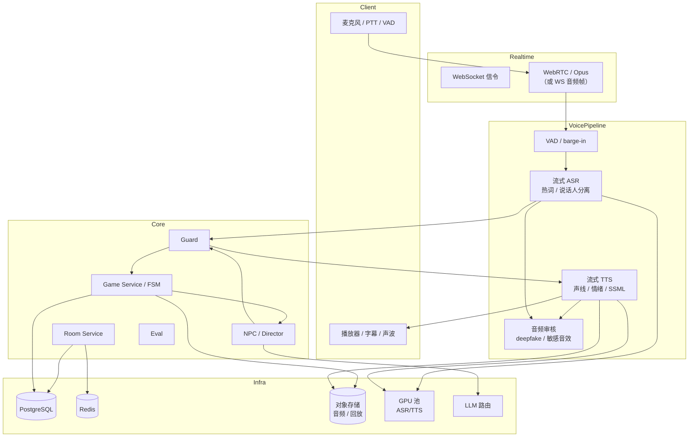

# 剧本杀 AI Agent V3 产品说明书：语音与沉浸式主持

> 版本：V3.0（规划稿）
> 基线：V2.5（2–6 人实时房间、WebSocket、按席隔离、掉线托管已完成）
> 上游：[V2.5 说明书](V2.5_SPEC.md) · [V2 说明书](V2_SPEC.md) · [V2–V5 路线图](ROADMAP_V2_V5.md)
> 一句话：让剧本杀从「打字聊天」变成「开口说话」：玩家用语音发言，AI 角色有独立声线、语气和停顿，语音线索能播放，AI 主持能抢话、控场、压节奏，同时不破坏 V2.5 已经建立的席位隔离。

---

## 一、迭代背景与核心目标

### 1.1 为什么现在做语音

V2.5 解决了「多人同房」，但文本房间仍有一个根本性体验缺口：

- **剧本杀是表演型社交**：玩家要演角色、压语气、试探、抢话；打字会丢失语气、停顿、情绪和临场感。
- **移动端场景**：朋友聚会时手机打字不现实；语音是唯一自然的交互方式。
- **AI 的差异化**：文本 NPC 只能「说对话」；有独立声线、语气、停顿的 NPC 才能「像一个人」。
- **内容形态**：剧本里本来就有电话录音、广播、留声机、监控音频等「语音线索」，文本只能描述，语音可以直接播放。
- **技术时机**：V2.5 的 WebSocket 通道、房间频道、事件模型已经支持扩展；V3 只需在网关层加音频管线，不需要重写 Agent 或 FSM。

### 1.2 V2.5 留下的、V3 必须解决的问题

| V2.5 遗留 | 证据 | V3 影响 |
|---|---|---|
| 纯文本交互 | 所有 `talk/private_talk/npc_message` 都是字符串 | 需要音频输入输出、转写、对齐 |
| 无语音频道 | `room_channels` 只有 public/private/seat | 需要 voice channel、麦克风权限、静音 |
| 无实时音频传输 | WebSocket 只传 JSON | 需要 WebRTC/Opus/抖动缓冲 |
| 无语气/情绪 | `PersonaStyle` 只有文字风格 | 需要 TTS 的 emotion/prosody/SSML |
| 无语音线索 | `Clue` 只有 `surface_text` | 需要 `media_ref`、播放器、字幕 |
| 无抢话/打断 | 回合是「申请-授予」文本队列 | 需要 VAD、barge-in、半双工/全双工策略 |
| 无语音安全 | 只做文本内容安全 | 需要声纹授权、深度伪造检测、录音留存 |
| 评测只有文本指标 | `eval/harness.py` 文本 persona | 需要 ASR WER、TTS MOS、端到端延迟、打断成功率 |

### 1.3 核心目标（O1–O5）

| 目标 | 说明 | 可验收结果 |
|---|---|---|
| **O1 能说** | 玩家按住/免提说话，系统转写并进入现有回合 | ASR WER <10%；语音动作成功率 >98% |
| **O2 能听** | AI 角色有独立声线、语气、停顿；主持有主持腔 | TTS MOS >4.0；角色可辨识度 >90% |
| **O3 能抢话** | 玩家可打断 NPC/主持；NPC 不抢玩家关键发言 | barge-in 响应 <300ms；误打断 <5% |
| **O4 能沉浸** | 语音线索、环境音、主持控场、情绪曲线 | 语音线索识别率 >90%；沉浸感评分 >4/5 |
| **O5 可控** | 端到端延迟、成本、内容安全、声纹合规 | 端到端 <1.5s；单局成本 <¥3.0；0 声音侵权事故 |

### 1.4 非目标

- 不做视频/虚拟形象/口型同步。
- 不做实时变声器/玩家声纹克隆（只做 AI 角色固定声线）。
- 不做多语言实时翻译（V3 只做中文；英文/方言作为后续）。
- 不做情感本/演绎本判分（V4）；V3 只提供语音表现力，不改变胜负规则。
- 不做「真人 DM 语音替身」；AI 主持仍是系统角色。
- 不做离线端侧 ASR/TTS；V3 以云端/局域网 GPU 为主，端侧作为降级。

### 1.5 退出条件（Gate）

1. 3 本 × 10 局（每局 6 席，共 30 局），完成率 ≥85%，语音动作成功率 >98%；内容库 ≥20 本全部 `lint` 0 blocker。
2. ASR 在剧本杀领域词表（角色名、地点名、线索名）上的 WER <10%；通用 WER <15%。
3. TTS MOS >4.0；6 个角色声线可辨识度 >90%；主持声线与角色声线可区分。
4. 端到端延迟（玩家说完 → NPC 开始出声）p95 <1.5s；barge-in 响应 <300ms。
5. 语音线索播放/识别率 >90%；字幕与音频对齐误差 <300ms。
6. 0 声音侵权/深度伪造事故；所有 AI 声线有授权记录；玩家录音有留存策略与删除入口。
7. 单局成本 <¥3.0；测试 ≥230 全绿；语音不变量进 CI。

---

## 二、依赖的上一版基础

### 2.1 直接复用的 V2.5 资产

| 资产 | 位置 | V3 怎么用 | 改造 |
|---|---|---|---|
| 房间/席位/频道 | `rooms`、`room_seats`、`room_channels` | 增加 `voice` 频道类型 | 小 |
| WebSocket 事件通道 | `/ws/rooms/{id}` | 增加音频信令/转写事件 | 中 |
| 事件模型 | `game_events` | 增加 `voice_segment`、`audio_clue`、`tts_chunk` | 中 |
| 回合/发言队列 | `loop.py`、房间服务 | 保留队列；语音作为输入方式 | 中 |
| Agent 节点 | `agents/npc.py`、`director.py` | 输入仍是文本；输出增加 `style/emotion` | 小 |
| 防破防 | `guard.py` | 文本闸不变；增加语音转写后的文本闸 | 小 |
| 评测 | `eval/harness.py` | 增加音频指标 | 大 |
| 回放 | 事件回放 | 增加音频轨/字幕轨 | 中 |

> 内容库 10→20 不是 V3 新增创作功能：主体仍复用 V2/V2.5 的编译/质检/发布；V3 只新增「语音适配」制作项（声线、音频线索、字幕），由内容运营补齐 10 本。

### 2.2 V2.5 已经打好的基础

- **房间频道模型**：`public/private/seat` 已支持按席过滤；V3 加 `voice` 只是新频道类型。
- **事件溯源**：语音转写文本作为事件落库，音频作为对象存储引用；回放可只放文本或带音频。
- **席位隔离**：私聊语音仍按 `visible_to` 过滤；不会因为走音频就绕过权限。
- **掉线托管**：托管时 AI 可用 TTS 代打，但必须标记 `[托管]`。
- **幂等/顺序**：语音动作带 `client_action_id`，与文本动作同一套去重。

### 2.3 必须改造的假设

| 假设 | 问题 | V3 改造 |
|---|---|---|
| 输入是完整文本 | 语音是流式、可能不完整、有口音 | ASR 流式 + 最终文本确认 + 可编辑 |
| 输出是完整文本 | TTS 需要分句、流式、可打断 | 分句合成 + 流式播放 + 可取消 |
| 回合是「申请-授予」 | 语音可以随时插话 | VAD + barge-in + 半双工策略 |
| 一个玩家一个文本流 | 语音有多人同时说话 | 说话人分离 + 焦点说话人 |
| 音频不需要存储 | 回放/审核需要 | 对象存储 + 生命周期 |
| 内容安全只看文本 | 语音有语气/背景音/录音 | 文本闸 + 音频审核 + 声纹授权 |

---

## 三、新增与优化功能清单（核心）

> 标记：🆕 新增；🔧 迭代优化；🩹 修复。

### 3.1 新增功能

#### F3-1 实时语音输入（ASR） 🆕

**用户故事**：作为玩家，我按住说话或免提说话，系统把我的话转成文字发到房间；我说错了可以改，别人看到的是文字 + 可选语音。

**行为**：

1. 两种模式：
   - **按住说话（PTT）**：按下开始、松开结束；适合嘈杂环境/防误触。
   - **免提（VAD）**：检测到说话自动开始，静音 700ms 结束；适合安静环境。
2. 流式 ASR：边说边出 partial 文本；结束后出 final 文本；玩家可编辑 final 再发送。
3. 领域词表：角色名、地点名、线索名、剧本专有名词注入 ASR 热词，降低专名错误。
4. 说话人分离：多人同时说话时，按声纹/频道/焦点说话人区分；声纹只用于分离，不用于克隆；无法区分时提示「检测到多人说话，请一个一个来」。
5. 转写事件：`voice_segment`（音频引用、partial/final、语言、置信度、时长）；final 文本进入正常 `talk/private_talk` 流程。
6. 失败降级：ASR 超时/失败 → 提示改用文字；不阻塞回合。
7. 隐私：音频默认不长期保存；仅保留 final 文本与可选 7 天音频；玩家可删除。

**验收**：

- 6 席语音房，语音动作成功率 >98%；ASR 领域 WER <10%。
- partial 到 final 的修正可编辑；编辑后事件只发一次。
- 多人同时说话有提示；不串到错误席位。
- 断网/ASR 失败可降级文字。

#### F3-2 角色声线与 TTS 🆕

**用户故事**：作为玩家，每个 AI 角色有符合人设的声音；主持有主持腔；我闭着眼睛也能听出谁在说话。

**行为**：

1. 声线库：每个角色绑定 `voice_profile`（音色、语速、音高、情绪范围、口头禅停顿）。
2. TTS 流式：按句合成，边合成边播放；支持取消/打断。
3. 情绪/语气：`emotion`（平静/紧张/愤怒/悲伤/嘲讽/恐惧）、`speed`、`pause`、`emphasis`；由角色人设 + 当前情境决定。
4. SSML/标记：支持重音、停顿、低声、笑声、叹息等；不支持时降级为纯文本。
5. 主持声线：独立于角色，稳重、清晰、控场；与角色声线明显区分。
6. 托管声线：托管时使用原角色声线，但加 `[托管]` 提示音/前缀。
7. 声线一致性：同一角色跨局使用同一 `voice_profile`；换声线需作者/运营配置。
8. 可访问性：所有语音输出附字幕；可关闭 TTS 只看文字。

**验收**：

- TTS MOS >4.0；6 角色可辨识度 >90%；主持与角色可区分。
- 情绪切换自然；不出现「所有角色一个腔」。
- TTS 失败降级文字，不阻塞回合。
- 所有声线有授权记录；玩家可举报不当声线。

#### F3-3 抢话、打断与回合控制 🆕

**用户故事**：作为玩家，我可以打断 NPC 的长篇大论；NPC 不会在我说话时抢话；主持可以在冷场时插话控场。

**行为**：

1. VAD + barge-in：玩家开始说话 → 立即降低/暂停当前 TTS → 进入「玩家发言」；NPC 停止输出并记录被打断。
2. 打断策略（按角色/场景配置）：
   - 主持：可被玩家打断，但会在玩家结束后补一句「你刚才说到…」；
   - NPC：默认让玩家说完；被连续打断 2 次后，角色化表达不满；
   - 关键剧情：不可打断（如真相揭示），但显示「正在播放关键语音」。
3. 半双工/全双工：默认半双工（一人说，其他人听）；房主可开全双工（多人同时说，ASR 分离）。
4. 发言权：语音不取消 V2.5 的发言队列；语音只是输入方式，仍受阶段/配额限制。
5. 误触发：咳嗽/背景音/键盘声不触发；连续误触发 3 次提示切换 PTT。
6. 打断审计：记录谁打断了谁、在哪个事件、是否影响剧情。

**验收**：

- barge-in 响应 <300ms；误打断 <5%。
- NPC 被连续打断后角色化反应，不崩人设。
- 关键剧情不可打断时有明确提示。
- 打断不破坏事件顺序/不变量。

#### F3-4 语音线索与音频场景 🆕

**用户故事**：作为玩家，我搜到一盘录音带/一段电话录音/一则广播，能直接播放；声音里有线索，文字字幕可选。

**行为**：

1. `Clue` 增加 `media_ref`（音频 URL/对象存储 key）、`transcript`、`duration_ms`、`play_once`、`noise_level`。
2. 播放器：搜证后自动/手动播放；支持暂停、重播、字幕开关、音量。
3. 音频线索类型：
   - 电话录音（可能失真/变声）；
   - 广播/电视（背景音干扰）；
   - 留声机/磁带（噪声、转速）；
   - 监控音频（多人对话、脚步）；
   - 环境音（雨声、钟声、关门声）。
4. 线索与文本一致：音频内容与 `surface_text`/`transcript` 一致；不允许「音频里藏了文本没写的关键信息」，除非作者显式配置 `audio_only_clue` 并在质检中标注。
5. 可访问性：默认显示字幕；听障玩家可只看文本；字幕不泄露未授权信息。
6. 质检：检测音频线索是否可被 ASR 识别、是否有版权、是否含真实人声 PII。

**验收**：

- 语音线索播放/识别率 >90%；字幕与音频对齐误差 <300ms。
- 音频线索不绕过 `visible_to`；未搜到不能播放。
- 版权/PII 检查覆盖所有音频线索。

#### F3-5 语音主持与导演 🆕

**用户故事**：作为玩家，AI 主持像真人 DM 一样控场：开场、分幕、提醒、压节奏、总结、复盘；声音有权威感但不机械。

**行为**：

1. 主持语音：开场白、读本提示、搜证指令、对质引导、投票提醒、复盘 narration。
2. 节奏控制：
   - 冷场 >60s：主持提示「现在可以聊聊…」；
   - 某席长期不发言：主持点名提醒（不泄露秘密）；
   - 讨论跑题：主持拉回「我们还是回到…」；
   - 关键线索被发现：主持给反应音/短评。
3. 情绪曲线：按幕配置 `tension`（0–1），主持的语速/音量/停顿随 tension 变化。
4. 与 V2 导演的关系：V2 的确定性提示逻辑保留；V3 只把提示「说出来」，不改变提示内容决策。
5. 主持不可泄露 Truth；主持语音也走 `check_npc_output` + 音频审核。
6. 主持可被房主静音/切换「仅字幕」。

**验收**：

- 主持语音不泄密；提示内容与 V2 导演一致。
- 冷场 60s 内触发提示；不刷屏。
- 情绪曲线与幕配置一致；玩家可感知但不突兀。

#### F3-6 语音复盘与回放 🆕

**用户故事**：作为玩家，结束后我能听一段「广播剧式复盘」，把关键事件、误导、真相串起来；也能回放某段语音。

**行为**：

1. 复盘脚本：基于事件流生成「起因—经过—误导—真相—关键证据」结构。
2. 多声线复盘：主持旁白 + 关键角色原声片段；可切换纯文字。
3. 回放：按事件 seq 播放音频/字幕；支持跳转到某回合/某线索。
4. 分享：生成音频/文字复盘链接；有效期 7 天。
5. 审计：复盘内容不包含未公开的玩家私聊，除非该玩家授权。

**验收**：

- 复盘 30 秒内生成；关键事件覆盖 ≥90%。
- 回放音画/字幕同步；玩家私聊默认不出现。
- 分享链接可撤销。

#### F3-7 语音安全与合规 🆕

**用户故事**：作为平台，我确保 AI 声线有授权、玩家录音可删除、不会被用来伪造真人声音。

**行为**：

1. 声线授权：每个 `voice_profile` 记录来源、授权类型（自研/授权/合成）、有效期、可商用范围。
2. 声纹克隆禁止：V3 不提供「上传一段真人录音克隆声线」功能；只允许预置声线库。
3. 深度伪造检测：对上传音频线索做 AI 生成检测；高风险进入人工审核。
4. 录音留存：默认只存 final 文本；音频 7 天可配置；玩家可一键删除；删除有审计。
5. 内容审核：ASR 文本走 V2 内容安全；音频本身做辱骂/骚扰/敏感音效检测。
6. 未成年人：分级 + 默认关闭语音上传/下载。
7. 反骚扰：屏蔽/举报/房主禁言；录音可作为证据，但需双方同意/平台规则。

**验收**：

- 所有声线有授权记录；无授权不能上线。
- 玩家删除录音后 24h 内从对象存储清除。
- 构造 deepfake 样本能命中检测。
- 语音骚扰举报有处理流程。

#### F3-8 音频设备与网络自适应 🆕

**行为**：

1. 设备检测：麦克风权限、输入电平、回声消除、降噪。
2. 网络自适应：根据 RTT/丢包调整码率、Opus 参数、TTS 码率；弱网降级为「文字 + 低码率语音」。
3. 回声/啸叫：多人外放时提示戴耳机；AEC 失败时自动切换 PTT。
4. 静音/ deafen：玩家可静音自己/屏蔽某人。
5. 字幕优先：弱网/听障时字幕为主。

**验收**：

- 弱网（200ms RTT/5% 丢包）下语音仍可用；自动降级。
- 回声场景有提示；不产生持续啸叫。
- 静音/屏蔽生效且可恢复。

### 3.2 对 V2.5 功能的迭代优化

#### O3-1 事件模型：文本事件 → 多模态事件 🔧

- **V2.5 现状**：`public_message`/`private_message`/`npc_message` 只有文本。
- **V3 改造**：
  - 新增 `voice_segment`（音频、转写、说话人、置信度）。
  - `npc_message` 增加 `audio_ref`、`emotion`、`duration_ms`、`interruptible`。
  - `clue_found` 增加 `media_ref`、`transcript`。
  - 兼容：旧客户端忽略音频字段，只看文本。
- **验收**：文本客户端可完整玩；音频客户端体验增强；事件回放兼容。

#### O3-2 延迟管线：串行 → 流式并行 🔧

- **V2.5 现状**：文本请求-响应，回合 p95 <3s。
- **V3 改造**：
  - ASR partial → 意图/安全预检 → LLM 首句 → TTS 首句 → 播放，流水线并行。
  - 首句优先：NPC 先出短句（「等等，你刚才说…」），后续句子继续生成/合成。
  - 缓存：固定开场/主持提示/常见反应预合成。
  - 降级：TTS 慢时先出字幕，音频后补。
- **验收**：端到端 p95 <1.5s；首句 <800ms；降级不阻塞。

#### O3-3 NPC 输出：从「一段话」到「可表演的台词」 🔧

- **V2.5 现状**：grounded 模式输出授权事实，偏短、偏平。
- **V3 改造**：
  - 输出结构：`speech` + `emotion` + `pause` + `emphasis` + `gesture`（可选）。
  - 角色化口头禅/停顿/语气词；但事实仍受 grounded 约束。
  - 长台词分句，支持打断点；关键句标记 `interruptible=false`。
- **验收**：角色可辨识度 >90%；不增加泄密；打断后语义连贯。

#### O3-4 评测：文本指标 → 语音指标 🔧

- **V2.5 现状**：完成率/通关率/泄密/延迟/成本。
- **V3 改造**：
  - 增加 ASR WER、TTS MOS、端到端延迟、barge-in 成功率、语音线索识别率、字幕对齐误差。
  - 增加「语音泄密」探针：私密语音是否被其他席听到；TTS 是否读出未授权内容。
  - 人工听测：每版本 20 条样本，评分声线/语气/自然度。
- **验收**：语音指标进 CI；人工听测有记录；不达标阻断发布。

#### O3-5 UI：房间页 → 语音房 🔧

- **V2.5 现状**：文本房间页。
- **V3 改造**：
  - 语音房布局：席位头像/声波、麦克风状态、发言焦点、字幕区、线索音频播放器。
  - 主持台：主持语音开关、情绪曲线、冷场提示、禁麦。
  - 移动端：PTT 大按钮、蓝牙耳机支持、来电中断处理。
- **验收**：6 席语音房可用；移动端 PTT 顺手；字幕清晰。

### 3.3 功能矩阵：V2.5 → V3

| 能力 | V2.5 | V3 | 类型 |
|---|---|---|---|
| 输入 | 文本 | 语音 + 文本 | 🆕 |
| 输出 | 文本 | TTS + 字幕 | 🆕 |
| 角色声线 | 无 | 每角色独立 | 🆕 |
| 抢话/打断 | 无 | VAD + barge-in | 🆕 |
| 语音线索 | 无 | 音频 + 字幕 | 🆕 |
| 主持语音 | 无 | 有 | 🆕 |
| 语音复盘 | 无 | 有 | 🆕 |
| 语音安全 | 文本安全 | 声线授权 + deepfake + 录音留存 | 🆕 |
| 事件模型 | 文本 | 多模态 | 🔧 |
| 延迟 | <3s | <1.5s 端到端 | 🔧 |
| 评测 | 文本 | 语音指标 | 🔧 |
| 情感本 | 无 | 无（V4） | 不做 |

### 3.4 明确不做 / 延后

| 项 | 原因 | 放到 |
|---|---|---|
| 玩家声纹克隆 | 合规/滥用风险高 | 不做 |
| 视频/虚拟形象 | 与核心体验无关 | 不做 |
| 多语言实时翻译 | 需求未验证 | V5 之后 |
| 情感本判分 | 依赖 V4 rubric | V4 |
| 真人 DM 语音 | 权限/责任复杂 | V4/V5 |
| 离线端侧 ASR/TTS | 成本/效果不成熟 | 后续 |

---

## 四、技术演进与架构依赖

### 4.1 架构变化



### 4.2 数据模型变更

#### IR 1.2（向后兼容）

- `Clue` 增加可选字段：`media_ref`、`transcript`、`audio_only`、`noise_level`、`play_once`。
- `Character` 增加可选字段：`voice_id`、`speech_rate`、`pitch`、`emotion_range`。
- `ir_version` 从 1.1 升到 1.2；1.1 剧本加载时自动补默认值，不要求作者迁移。

#### 新增表

| 表 | 用途 | 关键字段 |
|---|---|---|
| `voice_profiles` | 声线库 | `voice_id`、`name`、`provider`、`license_type`、`license_expires`、`sample_url`、`status` |
| `voice_segments` | 语音片段 | `segment_id`、`room_id`、`seat_id`、`audio_ref`、`transcript`、`confidence`、`duration_ms`、`created_at` |
| `audio_assets` | 音频资产 | `asset_id`、`kind`（clue/recap/tts）、`object_key`、`mime`、`duration_ms`、`hash`、`status`（active/deleted）、`retention_until`、`deleted_at` |
| `audio_reviews` | 音频审核 | `asset_id`、`risk_type`、`level`、`status`、`reviewer` |
| `voice_consents` | 声线授权 | `voice_id`、`consent_type`、`evidence_url`、`valid_from`、`valid_to` |
| `interrupt_logs` | 打断审计 | `room_id`、`interrupter_seat`、`interrupted_seat`、`event_seq`、`reason` |

#### 变更表

- `Script.clues`（IR JSON）：增加 `media_ref`、`transcript`、`audio_only`、`noise_level`、`play_once`。
- `game_events`：增加 `modality`（text/voice）、`audio_ref`、`emotion`、`interruptible`。
- `Script.characters`（IR JSON）：增加 `voice_id`、`speech_rate`、`pitch`、`emotion_range`。
- `rooms`：增加 `voice_enabled`、`voice_mode`（ptt/vad/full_duplex）、`voice_codec`。
- `llm_traces`：增加 `asr_model`、`tts_model`、`voice_id`、`audio_latency_ms`。

### 4.3 组件引入

| 组件 | 选型建议 | 作用 | 备注 |
|---|---|---|---|
| ASR | FunASR / Whisper / 云 ASR | 流式转写、热词 | 中文优先；支持热词/说话人分离 |
| TTS | CosyVoice / GPT-SoVITS / 云 TTS | 角色声线、情绪、流式 | 需授权声线；支持 SSML |
| VAD | Silero VAD / WebRTC VAD | 端点检测、barge-in | 端侧优先，降延迟 |
| 传输 | WebRTC（Opus）或 WS 音频帧 | 低延迟音频 | 先 WS 音频帧，量大再 WebRTC |
| 音频处理 | FFmpeg / libsox | 重采样、降噪、AEC | 端侧 AEC 优先 |
| GPU 池 | 自建/云 GPU | ASR/TTS 推理 | 按并发弹性 |
| 对象存储 | S3/MinIO | 音频/回放 | 生命周期策略 |
| 音频审核 | 分类模型 + ASR 文本 | 敏感音效/辱骂/deepfake | 先文本+规则，后模型 |

### 4.4 API/协议变更

#### REST

| 方法 | 路径 | 作用 |
|---|---|---|
| POST | `/api/v3/voice/sessions` | 创建语音会话/ICE 配置 |
| GET | `/api/v3/voice/profiles` | 可用声线 |
| POST | `/api/v3/voice/segments` | 上传音频片段（非 WebRTC 模式） |
| GET | `/api/v3/audio/{asset_id}` | 获取音频（鉴权/有效期） |
| DELETE | `/api/v3/audio/{asset_id}` | 删除录音 |
| POST | `/api/v3/voice/consents` | 声线授权登记（运营） |

#### WebSocket 事件

```json
{
  "type": "voice_segment",
  "room_id": "R123",
  "seat_id": "S2",
  "seq": 43,
  "payload": {
    "segment_id": "seg_1",
    "audio_ref": "s3://...",
    "transcript": "我昨晚在书房",
    "confidence": 0.93,
    "duration_ms": 1800,
    "final": true
  }
}
```

```json
{
  "type": "tts_chunk",
  "room_id": "R123",
  "seat_id": "S1",
  "seq": 44,
  "payload": {
    "audio_ref": "s3://...",
    "text": "你刚才说，你在书房？",
    "emotion": "suspicious",
    "interruptible": true,
    "duration_ms": 1200
  }
}
```

#### 信令

- `voice_join` / `voice_leave`
- `mute` / `deafen`
- `speaking_start` / `speaking_end`
- `barge_in`
- `tts_cancel`
- `audio_device_changed`

### 4.5 延迟预算

| 阶段 | 目标 p95 | 说明 |
|---|---:|---|
| 端侧 VAD 检测 | 150ms | 端侧 |
| 音频上行 | 100ms | 局域网/同城 |
| ASR partial | 300ms | 流式 |
| 安全预检 | 100ms | 文本/规则 |
| LLM 首句 | 400ms | 小模型/首句模板 |
| TTS 首句 | 250ms | 流式 |
| 下行 + 播放 | 100ms | 缓冲 |
| **端到端** | **≤1.4s** | 玩家说完 → NPC 出声；各段 p95 相加 = 1.4s，发布门禁 <1.5s 留 100ms 缓冲；典型路径目标 ≤1.2s |

**降级策略**：LLM 首句超时 → 先出「嗯…」/角色化停顿；TTS 超时 → 先字幕；ASR 超时 → 提示文字。任一环节超过预算 300ms 即触发降级，保证端到端 p95 不突破 1.4s，发布门禁 <1.5s。

### 4.6 迁移与兼容

1. **文本房兼容**：`voice_enabled=false` 时完全走 V2.5 文本路径。
2. **事件兼容**：新增字段可空；旧客户端忽略；回放支持纯文本模式。
3. **声线迁移**：V3 前没有声线；新角色需绑定 `voice_id`，未绑定用默认声线。
4. **数据留存**：音频默认 7 天；文本永久（按账号策略）；删除接口幂等。
5. **删除语义**：删除音频资产不删除 `game_events`，也不得 UPDATE 历史事件；事件保留 `transcript`，在 `audio_assets.status` 标记 `deleted` 并追加 `AUDIO_DELETED` 审计事件，`audio_ref` 解析时返回占位/410。若 transcript 含 PII，追加脱敏事件，不物理删除历史事件。
6. **降级开关**：`v3.voice`、`v3.tts`、`v3.barge_in` 按房间/用户白名单。

### 4.7 非功能性要求

| 维度 | V3 要求 | 验证 |
|---|---|---|
| ASR WER | 领域 <10%，通用 <15% | 测试集 |
| TTS MOS | >4.0 | 20 人听测 |
| 端到端延迟 | p95 <1.5s | 6 席实测 |
| barge-in | <300ms | 故障注入 |
| 并发语音房 | 50 房间 / 300 音频流 | 压测 |
| 音频可用性 | 99.5% | 监控 |
| 存储 | 音频生命周期；删除 <24h | 审计 |
| 合规 | 声线授权、deepfake 检测、未成年人保护 | 审核 |

### 4.8 技术风险与应对

| 风险 | 概率 | 影响 | 应对 |
|---|---:|---:|---|
| ASR 专名错误 | 高 | 推理体验差 | 热词表 + 可编辑 final + 角色名/线索名注入 |
| TTS 不自然/出戏 | 高 | 沉浸感差 | 声线库 + 情绪/停顿 + 人工听测 + 降级字幕 |
| 端到端延迟超标 | 中 | 对话卡顿 | 流式 + 首句优先 + 缓存 + 降级 |
| 多人同时说话 | 中 | 转写串席 | 说话人分离 + 半双工默认 + 提示 |
| 音频泄密 | 中 | 信任崩塌 | 频道隔离 + 音频审核 + 探针 |
| 声线侵权 | 低 | 法律风险 | 授权登记 + 预置声线 + 禁止克隆 |
| 成本上升 | 高 | 商业不可行 | 缓存 + 小模型 + 按需 TTS + 码率自适应 |
| 弱网 | 高 | 体验差 | 自适应码率 + 字幕优先 + 文字降级 |

---

## 五、预期价值与关键指标（KPI）

### 5.1 用户价值

| 角色 | V2.5 体验 | V3 体验 |
|---|---|---|
| 玩家 | 打字发言，容易出戏 | 开口演角色，能听、能抢话、能听线索 |
| 房主 | 文本主持台 | 语音控场、冷场提示、禁麦 |
| 线下店 | 文本房，氛围弱 | 语音房 + 音频线索，接近线下体验 |
| 作者 | 文本线索 | 音频线索/广播剧式复盘，内容表现力更强 |
| 平台 | 文本成本低 | 语音差异化，但需控制 GPU/带宽成本 |

### 5.2 KPI 表

| 指标 | V2.5 基线 | V3 目标 | 测量 |
|---|---:|---:|---|
| 可玩本数（累计上架） | ≥10 | ≥20 | 剧本库；全部过 lint |
| 语音动作成功率 | — | >98% | 3 本 × 10 局（每局 6 席） |
| ASR 领域 WER | — | <10% | 领域测试集 |
| ASR 通用 WER | — | <15% | 通用测试集 |
| TTS MOS | — | >4.0 | 20 人听测 |
| 角色可辨识度 | — | >90% | 盲听测试 |
| 端到端延迟 p95 | <3s（文本） | <1.5s | 6 席实测 |
| barge-in 响应 | — | <300ms | 故障注入 |
| 误打断率 | — | <5% | 标注 |
| 语音线索识别率 | — | >90% | 测试集 |
| 字幕对齐误差 | — | <300ms | 抽检 |
| 语音泄密 | — | 0 | 探针 + 人工 |
| 单局成本 | <¥2.0 | <¥3.0 | 成本看板 |
| 并发语音房 | — | 50 房间 | 压测 |
| 测试数 | ≥180 | ≥230 | CI |

### 5.3 验收门禁

- [ ] 内容库 ≥20 本全部 `lint` 0 blocker；抽样 3 本 × 10 局（每局 6 席，共 30 局）完成；完成率 ≥85%；语音动作成功率 >98%。
- [ ] ASR 领域 WER <10%；TTS MOS >4.0；角色可辨识度 >90%。
- [ ] 端到端 p95 <1.5s；barge-in <300ms；误打断 <5%。
- [ ] 语音线索识别率 >90%；字幕对齐 <300ms。
- [ ] 语音泄密 0；私密语音不串席；TTS 不读未授权内容。
- [ ] 声线授权 100%；deepfake 样本命中；删除录音 <24h。
- [ ] 单局成本 <¥3.0；50 房间并发压测通过。
- [ ] `pytest` ≥230 全绿；语音指标进 CI。

### 5.4 上线策略

| 阶段 | 范围 | 退出条件 |
|---|---|---|
| 内部语音房 | 团队 6 人 × 1 本 | 延迟/打断可用；无 P0 |
| 封测 | 10 房间 / 50 玩家 | 完成率 ≥80%；MOS ≥3.8 |
| 公测 | 50 房间并发 | 压测/成本/合规通过 |
| GA | 全量 | 全部 Gate 通过 |

**灰度**：`v3.voice`、`v3.tts`、`v3.barge_in`、`v3.audio_clues` 按房间/用户/剧本开启。

### 5.5 风险与兜底

- **ASR 太差**：默认 PTT + final 可编辑；专名热词；必要时退回文字。
- **TTS 出戏**：先只给主持和关键 NPC 开语音；其他角色字幕；人工听测迭代。
- **延迟超标**：首句模板 + 缓存 + 降级字幕；限制长台词。
- **成本超**：TTS 按需合成、缓存固定台词、低码率；非关键 NPC 只字幕。
- **合规风险**：只使用预置授权声线；禁止克隆；音频留存可删除；未成年人保护。

### 5.6 本版遗留 → V4 的接口

| 遗留债务 | V3 必须做的准备 | V4 怎么接 |
|---|---|---|
| 只有本格/变格 | `GenreProfile` 仍是静态模型，未插件化 | V4 加类型插件 |
| 胜负只认指认 | 裁判 rubric 仍是 `culprit/motive/key_evidence` | V4 加表演/情感 rubric |
| 无情感曲线 | 主持有 `tension`，但只用于语气 | V4 扩展为情感 beat |
| 无多结局 | 只有单一胜负 | V4 加结局引擎 |
| 语音表现力已具备 | TTS 支持情绪/停顿 | V4 用语音演情感本 |
| 评分为文本指标 | 有语音指标，但无表演评分 | V4 加表演 rubric |
| 创作工具未做 | 编译器/质检稳定 | V5 复用 |

> **V3 的成功标准：玩家愿意一直开着麦玩；AI 角色一开口就能听出是谁；线索不用读，可以直接听；打断自然，不像在等机器人。**
