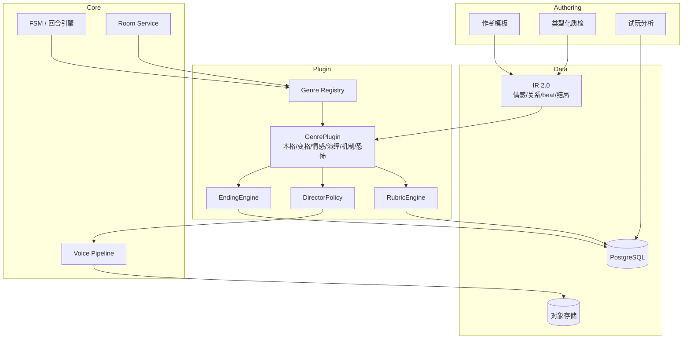

# 剧本杀 AI Agent V4 产品说明书：情感本、演绎本与多类型

> 版本：V4.0（规划稿）
> 基线：V3（语音房、角色声线、抢话、语音线索、语音主持已完成）
> 上游：[V3 说明书](V3_SPEC.md) · [V2.5 说明书](V2.5_SPEC.md) · [V2 说明书](V2_SPEC.md) · [V2–V5 路线图](ROADMAP_V2_V5.md)
> 一句话：把「只能玩本格/变格、只能指认凶手」的引擎，升级成能主持情感本、演绎本、机制本的多类型平台（恐怖本为 preview）：类型是插件，胜负是 rubric，表演可评分，结局可分支，AI 主持能演、能压、能催泪。

---

## 一、迭代背景与核心目标

### 1.1 为什么现在做多类型

V1–V3 的产品能力一直围绕一个隐含假设：**剧本杀 = 找出凶手**。

- `referee.profile_for` 只接受 `本格`/`变格`。
- `judge_submission` 只认 `culprit/motive/key_evidence` 三项。
- `WinCondition` 已有 `custom` 类型和 `rubric_id` 字段，但 `judge_submission` 只计算 `culprit/motive/key_evidence`；自定义 `required` 维度恒为 false，`custom` 实际不可用（空 `required` 除外，会恒真）。
- 导演/主持的提示围绕「推进推理」，不围绕「推进情感/表演」。
- 评测指标是通关率/凶手指认率，无法衡量「玩家有没有被感动」「角色有没有演出来」。

但真实剧本杀市场远不止本格：

| 类型 | 核心体验 | 胜负 | V1–V3 能否支持 |
|---|---|---|---|
| 本格 | 推理、诡计、证据链 | 指认凶手 | ✅ |
| 变格 | 超自然/心理/设定推理 | 指认/还原 | ✅（仅指认） |
| 情感本 | 人物关系、遗憾、抉择、催泪 | 情感结局/沉浸 | ❌ |
| 演绎本 | 角色扮演、剧场感、即兴 | 表演评分/剧情走向 | ❌ |
| 机制本 | 阵营、资源、博弈 | 阵营胜负 | ❌ |
| 恐怖本 | 氛围、惊吓、生存 | 生存/逃脱 | ❌ |

V3 的语音能力恰好为情感/演绎本提供了表现力基础：角色有独立声线、语气、停顿，主持能控场、压节奏。**V4 是把「能演」变成「能判」的一版。**

### 1.2 V3 留下的、V4 必须解决的问题

| V3 遗留 | 证据 | V4 影响 |
|---|---|---|
| 可玩类型只有本格/变格 | `referee.profile_for` 硬编码 | 情感/演绎/机制/恐怖本无法开局 |
| 胜负只认三项 | `judge_submission` 硬编码 | 情感本的核心不是指认凶手，无法判 |
| 无情感状态 | `GameState` 只有阶段/线索/投票 | 无法表达「信任/怀疑/愧疚/爱」 |
| 无表演评分 | 评测只有通关/泄密/延迟 | 演绎本无法评价 |
| 无多结局 | `WinCondition.type` 单一 | 情感本需要分支/多结局 |
| 主持只会推进推理 | `director.py` 提示围绕线索 | 情感本需要情绪节奏/ spotlight |
| 编译只抽推理字段 | `pipeline.py` 15 字段 | 情感本的角色关系/信件/情感线抽不出来 |
| 语音只服务推理 | TTS 情绪是装饰 | V4 要让情绪成为玩法 |

### 1.3 核心目标（O1–O5）

| 目标 | 说明 | 可验收结果 |
|---|---|---|
| **O1 类型插件化** | 新增类型不改引擎核心，只加 `GenrePlugin` | 至少 2 种新类型可玩（情感/演绎）；GA 目标 3 种新类型（含机制）；核心 FSM 不变 |
| **O2 胜负通用化** | `RubricEngine` 支持任意评分维度；指认只是其中一种 | 情感/演绎/机制本都能判 |
| **O3 情感可建模** | 关系图、情感 beat、抉择、结局 | 情感本玩家满意度 ≥4/5 |
| **O4 表演可评分** | 沉浸度、角色一致性、情绪表达、互动贡献 | judge-人工 κ >0.6 |
| **O5 作者可生产** | 情感本模板、质检、试玩分析 | 作者 1 天出可玩情感本 |

### 1.4 非目标

- 不做 AI 生成完整剧本（V5）。
- 不做 UGC 分发/商业化（V5）。
- 不做真人 DM 替代；AI 仍是主持。
- 不做视频/虚拟形象。
- 不做多语言。
- 不重写 V1–V3 的 FSM/事件/房间/语音；V4 是「插件 + 扩展字段 + 新 rubric」。

### 1.5 退出条件（Gate）

1. 6 种类型（本格/变格/情感/演绎/机制/恐怖）中至少 4 种可完整玩（本格/变格/情感/演绎）；GA 目标 5 种（加机制），恐怖为 preview。
2. 内容库 ≥40 本全部 `lint` 0 blocker；情感本 20 局：完成率 ≥85%，玩家满意度 ≥4/5，情感 beat 覆盖率 ≥80%。
3. 演绎本 20 局：表演评分与人工评分 κ >0.6；角色一致性 ≥85%。
4. 机制本（GA 目标之一；首发最低 4 种时可延后）：阵营胜负判定 0 错误；资源结算 0 错误。
5. 多结局：每本至少 3 个结局可触发；结局判定可解释。
6. 编译：情感本角色关系/情感线/信件字段抽取准确率 ≥80%；校对 <20 分钟。
7. 类型插件不破坏 V1–V3：4 种上线类型各 20 局（共 80 局），正常策略通关率 ≥75%；本格/变格回归 0 退化；语音房正常。机制本 GA 时补 20 局。
8. 100 房间 / 600 连接并发压测通过（语音房 ≤50，沿用 V3 容量），p95 回合 <2s；单局成本 <¥3.5。
9. 测试 ≥280 全绿；类型/ rubric/结局不变量进 CI。

---

## 二、依赖的上一版基础

### 2.1 直接复用的 V1–V3 资产

| 资产 | 位置 | V4 怎么用 | 改造 |
|---|---|---|---|
| `Script` IR | `schema/ir.py` | 增加情感/关系/结局字段，升 IR 2.0 | 大 |
| `GenreProfile` 钩子 | `schema/genre.py` | 已有 `GenreProfile` 数据模型；`profile_for` 只支持本格/变格；V4 新增运行时 `GenrePlugin` 协议与注册表 | 大 |
| `WinCondition` | `schema/ir.py` | 已有 `type/required/partial_credit/rubric_id`；V4 接入 RubricEngine，只新增可选 `params` | 大 |
| `judge_submission` | `agents/referee.py` | 拆成通用 `RubricEngine` + 类型 rubric | 大 |
| `director.py` | `agents/director.py` | 增加情感节奏/ spotlight/结局引导 | 中 |
| 语音/TTS | V3 | 情感语气、停顿、音乐提示 | 小 |
| 房间/席位 | V2.5 | 情感本私聊/抉择/多结局 | 小 |
| 编译器/质检 | V2 | 增加情感字段抽取/校验 | 中 |
| 评测 | V2/V3 | 增加情感/表演/结局指标 | 大 |
| 回放 | V2.5/V3 | 情感曲线/关键抉择/结局回放 | 中 |

> 内容库 20→40 不是 V4 新建内容工厂：V4 提供情感/演绎模板、关系图、beat 编辑器与编译器字段，作者/运营基于这些工具生产；V4 只对新增类型做质检与验收。

### 2.2 V1–V3 已经打好的基础

- **`GenreProfile` 已有数据模型**：V1 的 `schema/genre.py` 定义了 `GenreProfile`（`genre`/`win_condition`/`dm_tone`/`rubric`/`parser_expectations`），但它是可序列化的 Pydantic 模型，不是运行时插件；`agents/referee.py` 的 `profile_for` 只实现了本格/变格。
- **`WinCondition` 已有 `type`/`required`/`partial_credit`/`rubric_id`**：`rubric_id` 字段在 V1 已预留但未被裁判使用；V4 实现 `RubricEngine` 并接入，而不是新增字段。
- **事件溯源**：情感状态可以作为事件（`EMOTION_CHANGE`、`CHOICE_MADE`、`BEAT_REACHED`）落库，不破坏现有重放。
- **语音表现力**：V3 的 `emotion`/`pause`/`emphasis` 可直接用于情感本演出。
- **多人房间**：情感本需要私聊/抉择/结局，V2.5 的私密频道和按席状态已具备。
- **评测框架**：V2 的 persona/探针/κ 可扩展到情感/表演维度。

### 2.3 必须改造的假设

| 假设 | 位置 | 问题 | V4 改造 |
|---|---|---|---|
| 每个本都有「凶手」 | `referee.py`、`win_condition` | 情感本的核心不是指认凶手 | 胜负由 rubric 决定，不假设 culprit |
| 胜负是二元的 | `judge_submission` | 情感本需要「遗憾/圆满/隐藏结局」 | 多结局 + 连续评分 |
| 角色目标只有自由文本 | `Character.private_goals` | 情感本目标是「保护/告白/牺牲」，无法判定 | 目标类型化 + 情感目标 |
| 关系只是标签 | `relationships` | 情感本关系会变化 | 关系状态 + 动态 |
| 主持只推进推理 | `director.py` | 情感本需要情绪节奏 | 情感 beat + spotlight |
| 评测只看输赢 | `harness.py` | 演绎本看表演 | 表演 rubric + 人工 |
| 线索只有事实 | `Clue` | 情感本有信件/信物/回忆 | `media_ref`/`emotional_weight` |

---

## 三、新增与优化功能清单（核心）

> 标记：🆕 新增；🔧 迭代优化；🩹 修复。

### 3.1 新增功能

#### F4-1 GenrePlugin 插件体系 🆕

**用户故事**：作为开发者/作者，我新增一个类型（情感/演绎/机制/恐怖），不需要改引擎核心，只写一个 profile + rubric + 主持策略。

**行为**：

1. 保留 V1 的 `GenreProfile`（Pydantic 数据模型，可序列化）；新增运行时 `GenrePlugin` 协议：
   ```python
   class GenrePlugin(Protocol):
       profile: GenreProfile
       def validate_script(self, script: Script) -> list[LintIssue]: ...
       def initial_state(self, script: Script) -> dict: ...
       def allowed_phases(self, act: Act) -> set[Phase]: ...
       def win_condition(self, script: Script) -> WinConditionEvaluator: ...
       def director_policy(self) -> DirectorPolicy: ...
       def rubric(self) -> Rubric: ...
       def content_rating(self, script: Script) -> ContentRating: ...
   ```
2. 内置 plugin：`本格`、`变格`、`情感`、`演绎`、`机制`；`恐怖`以同构样例 plugin 提供，标记为 preview，不进入 GA 质量门禁。`WinConditionEvaluator`/`DirectorPolicy` 是运行时接口（分别由 `RubricEngine` 和 Director 实现），不是 IR 模型。
3. 注册表：`GENRE_REGISTRY`；启动时加载内置 + 插件包；未知类型拒绝开局，并给出可用类型。
4. 兼容：V1–V3 的本格/变格行为不变；`profile_for` 保留为兼容入口。
5. 类型能力矩阵：每个 profile 声明支持的能力（语音、私聊、投票、多结局、表演评分）。
6. 作者可选「混合类型」：主类型 + 副类型（如情感+推理），rubric 加权。

**验收**：

- 新增一个类型 plugin（以恐怖为样例）只需新增文件，不改 `engine/`。
- 6 种类型都能通过 `validate_script` 并开局；恐怖标记 preview，不进入 GA 验收。
- 本格/变格回归 0 退化。
- 未知类型返回明确错误。

#### F4-2 情感状态与关系动力学 🆕

**用户故事**：作为玩家，我对其他角色的信任/怀疑/愧疚/爱会随剧情变化；我的选择会影响关系和结局。

**行为**：

1. 情感状态（按席/按角色对）：
   - `trust`（信任）、`suspicion`（怀疑）、`guilt`（愧疚）、`affection`（好感）、`fear`（恐惧）、`grief`（悲伤）。
   - 取值 -100..100；初始由角色关系/秘密决定。
2. 关系动力学：
   - `RelationshipState`：`from_role`、`to_role`、`type`、`intensity`、`visibility`（公开/私密），与 IR 的 `Relationship` 字段对齐。
   - 事件触发变化：对话、线索、抉择、背叛、牺牲。
   - 变化必须可解释：记录 `reason_event_id`。
3. 情感事件：`EMOTION_CHANGE`、`RELATIONSHIP_CHANGE`、`CHOICE_MADE`、`BEAT_REACHED`。
4. NPC 行为：NPC 的语气/态度受情感状态影响；但事实仍受 grounded 约束。
5. 展示：玩家能看到自己的情感状态（可选），不能看到别人的私密情感。
6. 不破坏推理：本格本可以关闭情感系统；情感本是核心。

**验收**：

- 情感变化有事件、有原因、可回放。
- 玩家视角不泄露他人私密情感。
- 情感状态影响 NPC 语气，但不导致泄密。
- 本格本关闭情感系统后行为与 V3 一致。

#### F4-3 情感 beat 与剧情节奏 🆕

**用户故事**：作为玩家，情感本有明显的起承转合：铺垫、冲突、反转、抉择、结局；主持会在正确的时候压节奏、给 spotlight。

**行为**：

1. `EmotionalBeat`：
   - `beat_id`、`act_id`、`type`（setup/conflict/reveal/choice/climax/resolution）、`tension`（0–1）、`target_roles`（角色 ID，开局后映射到席位）、`trigger`（事件/线索/回合）、`required`。
2. beat 图：按幕排列；允许分支；每个 beat 有进入/完成条件。
3. 主持策略：
   - setup：介绍关系/氛围；
   - conflict：挑矛盾、点名；
   - reveal：放线索/音乐/停顿；
   - choice：给选项、倒计时；
   - climax：压语速/降音量/长停顿；
   - resolution：复盘/结局。
4. spotlight：主持按席分配关注；长期沉默的席给私密提示/点名。
5. 音乐/音效：V3 音频能力；按 beat 触发 BGM/音效（可关闭）。
6. 质检：beat 覆盖、节奏过慢/过快、某席无 spotlight、结局不可达。

**验收**：

- 情感本 20 局，beat 覆盖率 ≥80%；玩家能感知「有起承转合」。
- 主持在 reveal/climax 有可感知的语气变化。
- 质检能指出「某幕没有 conflict beat」或「某席全程无 spotlight」。

#### F4-4 通用 RubricEngine 与多类型胜负 🆕

**用户故事**：作为作者，我可以定义「这个本怎么算赢」：指认凶手、完成情感目标、拿到最多资源、生存到最后、表演得分最高；系统按 rubric 判分并解释。

**行为**：

1. `Rubric`：
   ```yaml
   rubric_id: emotional_v1
   dimensions:
     - id: truth_understanding
       weight: 0.3
       description: 是否理解真相
     - id: emotional_goal
       weight: 0.4
       description: 是否完成角色情感目标
     - id: relationship_resolution
       weight: 0.2
     - id: performance
       weight: 0.1
   win_rule: "score >= 0.7"
   ```
2. `RubricEngine`：
   - 每个 dimension 由「确定性检查 + LLM 判定 + 人工校准」组合；
   - 输出每项得分、证据、缺失项；
   - 支持 `partial_credit`；
   - 支持按席/按阵营/按房间聚合。
3. 内置 rubric：
   - `accusation_v1`（本格/变格，兼容 V1）；
   - `emotional_v1`（情感本）；
   - `performance_v1`（演绎本）；
   - `faction_v1`（机制本）；
   - `survival_v1`（恐怖本）。
4. `WinCondition.rubric_id` 在 V1 已预留但未使用；V4 接入 `RubricEngine` 并新增 `params`，旧 `required: [culprit, motive, key_evidence]` 自动映射到 `accusation_v1`。
5. 胜负可配置：单人/阵营/全员/多结局。
6. 裁判解释：每个玩家能看到「我为什么赢/输/得几分」，不泄露他人隐私。

**验收**：

- 指认本结果与 V3 一致（回归）。
- 情感本/演绎本/机制本能正确判分；构造样本覆盖赢/输/平/弃权。
- rubric 权重调整可复现；人工校准 κ >0.6。
- 裁判解释不含未授权信息。

#### F4-5 表演评分（演绎本） 🆕

**用户故事**：作为玩家，我演得好会被认可：沉浸度、角色一致性、情绪表达、互动贡献；不是只看谁猜对。

**行为**：

1. 评分维度：
   - **角色一致性**：是否按角色人设/秘密/关系行动；是否出戏。
   - **沉浸度**：是否使用角色视角/语气；是否引用剧情。
   - **情绪表达**：是否在 beat 点表达合适情绪（V3 语音可辅助）。
   - **互动贡献**：是否推动对话/冲突/合作；是否只被动。
   - **信息贡献**：是否分享/交换有效信息（不鼓励泄密）。
2. 评分来源：
   - 确定性信号：发言次数、私聊次数、线索分享、投票参与、beat 触发；
   - LLM 判定：角色一致性/情绪表达（带 rubric + 证据）；
   - 人工校准：20 组样本，κ >0.6；
   - 玩家互评（可选，防刷分）。
3. 评分展示：结束后给每个席位一张「表演卡」：分数、亮点、可改进；不公开羞辱。
4. 反作弊：刷屏/复制粘贴/出戏刷分降权；AI 补位/托管席不计表演分或明确标记。
5. 与胜负解耦：表演分可以影响结局，但不必然决定胜负；作者配置权重。

**验收**：

- 表演评分与人工 κ >0.6；角色一致性 ≥85%。
- 刷屏/托管不拿高分；评分可解释。
- 玩家能看懂「为什么得这个分」。

#### F4-6 多结局与分支剧情 🆕

**用户故事**：作为玩家，我的选择会把故事推向不同结局；结局不是随机，而是由关键抉择/情感状态/真相理解共同决定。

**行为**：

1. `Ending`：
   - `ending_id`、`title`、`condition`（rubric/表达式）、`narration`、`epilogue`、`priority`。
2. 结局类型：圆满/遗憾/真相/隐藏/失败/全员/个人。
3. 触发：
   - 关键抉择（`CHOICE_MADE`）；
   - 情感状态阈值；
   - 真相理解度；
   - 投票结果；
   - 隐藏条件（线索组合/私聊）。
4. 主持引导：接近结局时给氛围/音乐/停顿；不直接剧透。
5. 结局回放：每个玩家看到自己的结局 + 房间结局；可分享。
6. 质检：结局可达性、互斥性、优先级、是否所有玩家都有结局。

**验收**：

- 至少 3 个结局可触发；构造测试覆盖每个结局。
- 结局判定可解释；不出现「无结局」。
- 玩家视角不泄露未触发的隐藏结局。

#### F4-7 情感本作者模板与质检 🆕

**用户故事**：作为作者，我不需要从零设计情感本；系统给我角色关系模板、beat 模板、抉择模板、结局模板，并告诉我哪里可能不好玩。

**行为**：

1. 模板：
   - 6 人情感本：3 对关系、2 个三角、1 个秘密；
   - 4 人情感本：2 对关系、1 个核心抉择；
   - 演绎本：角色弧光 + 3 幕 beat；
   - 机制本：阵营/资源/胜负条件。
2. 作者工作台（V4 轻量版，完整版在 V5）：
   - 关系图编辑；
   - beat 时间线；
   - 抉择/结局配置；
   - rubric 权重；
   - 试玩入口。
3. 质检：
   - 情感线是否完整（每个角色有目标/阻碍/转变）；
   - 关系是否对称/有张力；
   - beat 是否覆盖；
   - 结局是否可达；
   - 是否有角色边缘化；
   - 内容分级。
4. 试玩报告：完成率、情感 beat 覆盖、玩家选择分布、结局分布、满意度。

**验收**：

- 作者用模板 1 天出可玩情感本；校对 <20 分钟。
- 质检能指出「某角色无情感目标」「某结局不可达」「某幕无冲突」。
- 试玩报告能指导修改。

#### F4-8 内容分级与敏感内容处理 🆕

**用户故事**：作为平台，我能对情感/恐怖/机制本做分级，保护未成年人，处理自杀/暴力/性暗示等敏感内容。

**行为**：

1. 分级维度：暴力、恐怖、性暗示、毒品、自杀、歧视、赌博、酒精。
2. 分级结果：全年龄/12+/16+/18+；按剧本 + 房间配置。
3. 敏感内容处理：
   - 自杀/自伤：默认降级/打码/提示资源；
   - 性暗示：分级 + 年龄门禁；
   - 恐怖：惊吓强度标签 + 可关闭音效；
   - 歧视：审核 + 作者说明。
4. 房间门禁：未成年人不能进 18+ 房；房主可设年龄限制。
5. 举报/申诉：玩家可举报；运营审核；作者可申诉。
6. 记录：分级/审核/举报全审计。

**验收**：

- 6 种类型样本分级与人工一致率 ≥80%。
- 18+ 房未成年人进不去；敏感内容有提示。
- 举报 24h 内处理；审计完整。

#### F4-9 类型化评测与玩家体验指标 🆕

**用户故事**：作为产品，我能比较不同类型本的体验：不只是通关率，还有情感共鸣、表演质量、结局满意度、角色公平。

**行为**：

1. 指标：
   - 本格：通关率、指认率、卡关、泄密；
   - 情感：beat 覆盖、情感目标完成、结局满意度、催泪率（自报）；
   - 演绎：表演分、角色一致性、互动贡献；
   - 机制：阵营胜率、资源结算正确、平衡性；
   - 恐怖：惊吓点覆盖、生存率、不适率。
2. 数据来源：事件流 + 结算问卷 + 人工标注 + LLM judge。
3. 公平性：角色信息量/发言机会/表演机会/结局分布。
4. 报告：按类型/剧本/角色/模型对比。
5. 门禁：类型指标不达标阻断发布。

**验收**：

- 每种类型有独立报告；能定位「哪个角色边缘化」。
- 情感本满意度 ≥4/5；演绎本 κ >0.6。
- 评测可复现；数据可导出。

### 3.2 对 V1–V3 功能的迭代优化

#### O4-1 裁判：从硬编码三项到通用 rubric 🔧

- **V1–V3 现状**：`judge_submission` 只认 `culprit/motive/key_evidence`；`profile_for` 只认本格/变格。
- **V4 改造**：
  - 拆出 `RubricEngine`；`accusation_v1` 作为内置 rubric 保持兼容。
  - 每个 dimension 有「确定性检查/LLM/人工」三种 evaluator。
  - 输出证据链 + 缺失项 + 置信度。
  - 按席判分（V2.5 已有），按阵营聚合。
- **验收**：本格回归 0 退化；新类型可判；解释可读。

#### O4-2 编译器：从推理字段到情感字段 🔧

- **V2 现状**：`EXTRACT_FIELDS` 15 个字段，围绕角色/线索/事件/秘密。
- **V4 改造**：
  - 增加 `emotional_beats`、`relationships[].dynamics`、`endings`、`choices`、`letters`、`performance_rubric`。
  - 情感本分段：角色本/信件/回忆/关系线单独抽。
  - 校验：关系对称、beat 覆盖、结局可达、角色目标完整。
- **验收**：情感本字段准确率 ≥80%；校对 <20 分钟；质检 0 blocker。

#### O4-3 导演：从推理节奏到情感节奏 🔧

- **V2/V3 现状**：`director.py` 按 idle turns 提示；V3 有 tension 语气。
- **V4 改造**：
  - 读取 `EmotionalBeat`；按 beat 类型选择提示/停顿/音乐。
  - spotlight：按席分配关注；边缘角色提示。
  - 结局引导：接近结局时压节奏，不剧透。
- **验收**：beat 覆盖率 ≥80%；玩家能感知节奏；不泄密。

#### O4-4 语音：从「有情绪」到「情绪是玩法」 🔧

- **V3 现状**：TTS 支持 emotion/speed/pause，但主要用于氛围。
- **V4 改造**：
  - 情感本关键台词用语音演出（独白/信件/告白）；
  - 情绪与 beat 绑定；主持在 climax 降速/停顿；
  - 玩家表演评分可参考语音情绪（可选）。
- **验收**：关键 beat 语音演出自然；不影响可访问性（字幕）。

#### O4-5 评测：从输赢到体验 🔧

- **V2/V3 现状**：通关率/泄密/延迟/成本。
- **V4 改造**：
  - 增加情感/表演/结局/公平指标；
  - 人工问卷 + LLM judge + 事件信号；
  - 类型化基线。
- **验收**：指标可复现；能指导剧本修改。

#### O4-6 UI：从推理板到情感板 🔧

- **V3 现状**：房间页/线索板/投票。
- **V4 改造**：
  - 关系图（动态）；
  - 情感曲线（自己可见）；
  - beat 进度（主持可见）；
  - 抉择卡/结局卡；
  - 表演卡。
- **验收**：玩家能看懂关系/情感；主持能看 beat；不泄露他人隐私。

### 3.3 功能矩阵：V3 → V4

| 能力 | V3 | V4 | 类型 |
|---|---|---|---|
| 类型 | 本格/变格 | 本格/变格/情感/演绎/机制/恐怖 | 🆕 |
| 胜负 | 指认三项 | 通用 rubric + 多结局 | 🆕 |
| 情感状态 | 无 | 信任/怀疑/愧疚/爱/恐惧 | 🆕 |
| 关系 | 静态标签 | 动态关系 | 🔧 |
| 表演评分 | 无 | 5 维 rubric | 🆕 |
| 多结局 | 无 | 有 | 🆕 |
| 主持 | 推理节奏 | 情感 beat + spotlight | 🔧 |
| 编译 | 推理字段 | 情感字段 | 🔧 |
| 语音 | 情绪装饰 | 情绪玩法 | 🔧 |
| 评测 | 输赢 | 体验/表演/结局 | 🔧 |
| 创作工具 | 无 | 轻量模板（完整版 V5） | 🆕 |
| UGC | 无 | 无（V5） | 不做 |

### 3.4 明确不做 / 延后

| 项 | 原因 | 放到 |
|---|---|---|
| AI 生成完整剧本 | 先让作者工具稳定 | V5 |
| UGC 分发/商业化 | 平台能力未就绪 | V5 |
| 真人 DM 全权限 | 权限/责任复杂 | V5 |
| 视频/虚拟形象 | 非核心 | 不做 |
| 多语言 | 需求未验证 | 后续 |
| 跨本连续剧 | 内容/状态复杂 | V5 之后 |

---

## 四、技术演进与架构依赖

### 4.1 架构变化



### 4.2 数据模型变更

#### IR 2.0

```python
class WinCondition(IRModel):
    # 保留 V1 字段，新增 params 供 RubricEngine 使用
    type: Literal["accuse", "vote", "escape", "custom"]
    required: list[str]
    partial_credit: bool = True
    rubric_id: str | None = None
    params: dict[str, Any] = {}     # 新增

class Script(IRModel):
    ...
    genre: str                      # 从 Literal 扩展为注册表 key
    genre_profile: str | None       # 主类型 profile
    secondary_genres: list[str] = []
    ir_version: str = "2.0"
    emotional_beats: list[EmotionalBeat] = []
    relationships: list[Relationship]   # 增加 dynamics
    choices: list[Choice] = []
    endings: list[Ending] = []
    letters: list[Letter] = []
    rubric: Rubric | None = None
    performance_rubric: Rubric | None = None
    content_rating: ContentRating | None = None
```

`GenreProfile`（`schema/genre.py`）保留原字段，新增可选 `version` 与 `capabilities`（如 `voice`/`private_chat`/`multi_ending`/`performance`），供注册表和生成器按类型选能力；旧 profile 默认空能力，保持兼容。注意 `GenreProfile.rubric` 仍是原有的 `list[RubricItem]`；V4 新增的 `Script.rubric` 是独立的版本化 `Rubric`，两者不混用。

`Clue` 保留 V3 的 `media_ref`/`transcript`/`audio_only`/`noise_level`/`play_once`，V4 增加可选 `emotional_weight: float`（0–1），用于情感本的排序、导演 spotlight 与结局权重。`Character` 增加可选 `emotional_goals: list[str]`、`arc: str | None`、`performance_hints: list[str]`。

```python
class EmotionalBeat(IRModel):
    beat_id: str
    act_id: str
    type: Literal["setup", "conflict", "reveal", "choice", "climax", "resolution"]
    tension: float
    target_roles: list[str]
    trigger: BeatTrigger
    required: bool = True
    narration: str | None
    music_cue: str | None
```

```python
class Ending(IRModel):
    ending_id: str
    title: str
    condition: str          # 安全 DSL/rubric 条件，不用 Python eval
    priority: int
    narration: str
    epilogue: str
    visibility: Literal["room", "seat", "hidden"]

class BeatTrigger(IRModel):
    event_type: str | None = None
    clue_id: str | None = None
    turn: int | None = None

class Choice(IRModel):
    choice_id: str
    act_id: str
    prompt: str
    options: list[str]
    visibility: Literal["room", "seat", "hidden"] = "room"
    effects: dict[str, float] = {}

class Letter(IRModel):
    letter_id: str
    from_role: str | None = None
    to_role: str | None = None
    act_id: str | None = None
    content: str
    visibility: Literal["public", "private", "seat", "hidden"] = "private"
    clue_ids: list[str] = []

class Relationship(IRModel):
    # 保留 V1 字段，V4 只做可选扩展
    from_role: str
    to_role: str
    type: str                       # V1 Literal 基础上扩展类型注册表
    is_public: bool
    evidence_clue_ids: list[str]
    initial_intensity: float = 0.5  # 新增
    dynamics: list[str] = []        # 新增

class RubricDimension(IRModel):
    key: str
    weight: float
    evaluator: Literal["deterministic", "llm", "human"] = "deterministic"
    description: str = ""

class Rubric(IRModel):
    rubric_id: str
    version: str = "1.0"
    dimensions: list[RubricDimension] = []

class ContentRating(IRModel):
    age: Literal["all", "12+", "16+", "18+"] = "all"
    dimensions: dict[str, int] = {}
    notes: str | None = None
```

#### 新增表

| 表 | 用途 | 关键字段 |
|---|---|---|
| `genre_profiles` | 类型注册 | `genre`、`version`、`capabilities`、`rubric_id`、`status` |
| `emotion_states` | 情感状态 | `game_id`、`seat_id`、`target_seat`、`emotion`、`value`、`reason_event_seq` |
| `relationship_states` | 关系状态 | `game_id`、`from_role`、`to_role`、`type`、`intensity`、`visibility` |
| `beat_progress` | beat 进度 | `game_id`、`beat_id`、`status`、`entered_seq`、`completed_seq` |
| `choices` | 抉择 | `choice_id`、`game_id`、`seat_id`、`option`、`created_at` |
| `endings` | 结局 | `ending_id`、`game_id`、`seat_id`、`triggered`、`score` |
| `performance_scores` | 表演评分 | `game_id`、`seat_id`、`dimension`、`score`、`evidence`、`evaluator` |
| `rubric_versions` | rubric 版本 | `rubric_id`、`version`、`content`、`hash` |

#### 变更表

- `scripts`：增加 `genre_profile`、`secondary_genres`、`rubric_id`；`content_rating` 从 V2 的字符串升级为结构化 JSON（旧值自动映射为 `ContentRating.age`）。
- `Script.characters`（IR JSON）：增加 `emotional_goals`、`arc`、`performance_hints`。
- `Script.clues`（IR JSON）：增加 `emotional_weight`（沿用 V3 的 `media_ref`/`transcript` 等字段）。
- `Script.relationships`（IR JSON）：保留 `from_role`/`to_role`/`type`/`is_public`/`evidence_clue_ids`，增加 `dynamics`、`initial_intensity`；运行时关系状态另存 `relationship_states` 投影。
- `game_events`：新增 `EMOTION_CHANGE`、`RELATIONSHIP_CHANGE`、`CHOICE_MADE`、`BEAT_REACHED`、`ENDING_TRIGGERED`、`PERFORMANCE_SCORED`。
- `llm_traces`：增加 `rubric_id`、`dimension`、`evaluator`。

> `emotion_states` / `relationship_states` / `beat_progress` / `endings` 是事件投影，可由 `game_events` 重建；不得作为唯一真相源。

### 4.3 组件引入

| 组件 | 选型 | 作用 | 备注 |
|---|---|---|---|
| RubricEngine | 自研（Python） | 通用评分 | 支持确定性/LLM/人工 evaluator |
| 表达式引擎 | 简单 DSL / JSON Logic | 结局/胜负条件 | 不用通用 Python eval，避免安全风险 |
| 图数据库/图计算 | Postgres + 邻接表/递归 CTE | 关系图/beat 图 | 先不上 Neo4j |
| 音乐/音效 | 预置库 + 对象存储 | beat 氛围 | 版权授权 |
| 问卷 | 自研/第三方 | 体验指标 | 匿名/合规 |
| 作者工作台 | Streamlit 扩展 / React | 模板/关系图/beat | V4 轻量，V5 完整 |

### 4.4 API 变更

| 方法 | 路径 | 作用 |
|---|---|---|
| GET | `/api/v4/genres` | 可用类型/能力 |
| POST | `/api/v4/scripts/{id}/validate?genre=` | 类型化质检 |
| POST | `/api/v4/games/{id}/choices` | 提交抉择 |
| GET | `/api/v4/games/{id}/emotions?seat_id=` | 自己的情感状态 |
| GET | `/api/v4/games/{id}/endings` | 结局（按可见性） |
| GET | `/api/v4/games/{id}/performance` | 表演卡 |
| POST | `/api/v4/rubrics` | 注册/更新 rubric（运营） |

### 4.5 迁移与兼容

1. **IR 2.0**：1.0/1.1/1.2 自动升级；`genre` 从枚举映射到注册表；`win_condition` 映射到 `accusation_v1`。
2. **事件兼容**：新增事件类型；旧回放忽略未知事件；本格本不产生情感事件。
3. **Rubric 版本**：每次评分记录 `rubric_id+version+hash`；旧局用旧版本重放。
4. **类型回滚**：新类型出问题可下架 profile，不影响本格/变格。
5. **数据迁移**：情感/关系表按需创建；本格本可为空。

### 4.6 非功能性要求

| 维度 | V4 要求 | 验证 |
|---|---|---|
| 类型扩展 | 新增 profile 不改核心 | 代码评审 + 测试 |
| 评分延迟 | 确定性评分 <200ms；LLM 评分 <2s | 压测 |
| 结局判定 | 确定性 + 可解释 | 单测 |
| 兼容 | 本格/变格 0 退化 | 回归 |
| 并发 | 100 房间 / 600 连接（语音房 ≤50） | 压测 |
| 内容安全 | 分级/敏感内容 | 审核 |
| 公平性 | 角色信息/机会偏差 <20% | 评测 |
| 成本 | 单局 <¥3.5 | 看板 |

### 4.7 技术风险与应对

| 风险 | 概率 | 影响 | 应对 |
|---|---:|---:|---|
| 情感评分主观 | 高 | 玩家不服 | 多维 rubric + 证据 + 人工校准 + 可申诉 |
| 类型插件破坏核心 | 中 | 回归事故 | 接口隔离 + 本格回归门禁 |
| 多结局组合爆炸 | 中 | 不可测 | 条件 DSL + 可达性检查 + 抽样测试 |
| 情感本编译难 | 高 | 作者成本高 | 模板 + 分段抽取 + 人工校对 |
| 内容分级争议 | 中 | 合规风险 | 人工审核 + 申诉 + 年龄门禁 |
| 语音情绪不自然 | 中 | 出戏 | 关键台词人工/预合成；其他字幕 |
| 公平性差 | 中 | 玩家不满 | 信息量/机会统计 + 剧本调整 |

---

## 五、预期价值与关键指标（KPI）

### 5.1 用户价值

| 角色 | V3 体验 | V4 体验 |
|---|---|---|
| 玩家 | 只能玩推理本 | 情感本/演绎本/机制本/恐怖本；能演、能选、有结局 |
| 作者 | 只能写本格 | 情感本模板/关系图/beat/结局；1 天出本 |
| 运营 | 单一类型 | 多类型排期；分级；体验指标 |
| 平台 | 推理工具 | 多类型内容平台，为 UGC 做准备 |

### 5.2 KPI 表

| 指标 | V3 基线 | V4 目标 | 测量 |
|---|---:|---:|---|
| 可玩本数（累计上架） | ≥20 | ≥40 | 剧本库；全部过 lint |
| 可玩类型 | 2（本格/变格） | ≥4（上线最低）；GA 目标 5 | 类型矩阵 |
| 正常策略通关率 | ≥80% | ≥75%（类型不同） | 各类型 20 局 |
| 情感本完成率 | — | ≥85% | 20 局 |
| 情感本满意度 | — | ≥4/5 | 问卷 |
| 情感 beat 覆盖率 | — | ≥80% | 事件 |
| 演绎本表演 κ | — | >0.6 | 20 组人工 |
| 角色一致性 | — | ≥85% | 人工/LLM |
| 结局可达 | — | ≥3 个/本 | 测试 |
| 情感本编译准确率 | — | ≥80% | 标注 |
| 类型回归 | — | 本格/变格 0 退化 | 回归 |
| 单局成本 | <¥3.0 | <¥3.5 | 看板 |
| 测试数 | ≥230 | ≥280 | CI |

### 5.3 验收门禁

- [ ] 内容库 ≥40 本全部 `lint` 0 blocker；至少 4 种类型（本格/变格/情感/演绎）可完整玩；GA 目标 5 种。
- [ ] 情感本 20 局：完成率 ≥85%，满意度 ≥4/5，beat 覆盖 ≥80%。
- [ ] 演绎本 20 局：表演 κ >0.6，角色一致性 ≥85%。
- [ ] 多结局 ≥3 个/本可触发；判定可解释。
- [ ] 情感本编译准确率 ≥80%；校对 <20 分钟。
- [ ] 本格/变格回归 0 退化；语音房正常。
- [ ] 100 房间 / 600 连接并发压测通过（语音房 ≤50），p95 回合 <2s；单局成本 <¥3.5。
- [ ] 内容分级/敏感内容审核通过。
- [ ] `pytest` ≥280 全绿。

### 5.4 上线策略

| 阶段 | 范围 | 退出条件 |
|---|---|---|
| 内部 | 1 个情感本 + 1 个演绎本 | 可玩；无 P0 |
| 封测 | 10 房间 / 50 玩家 | 满意度 ≥3.8；κ ≥0.5 |
| 公测 | 4 类型 × 3 本 | 指标达标 |
| GA | 全量 | 全部 Gate |

**灰度**：`v4.genre.{genre}`、`v4.rubric`、`v4.endings`、`v4.performance` 按剧本/房间开启。

### 5.5 风险与兜底

- **情感评分争议**：先只做「亮点/建议」不做排名；作者可选择是否启用表演分。
- **类型插件回归**：本格/变格必须走独立回归套件；任何退化阻断发布。
- **编译太难**：先支持「作者提供结构化模板 + AI 填内容」，不追求全自动。
- **内容风险**：高风险类型先人工审核；未成年人默认关闭。

### 5.6 本版遗留 → V5 的接口

| 遗留债务 | V4 必须做的准备 | V5 怎么接 |
|---|---|---|
| 创作工具是轻量模板 | 模板/质检/试玩接口稳定 | V5 做完整 AI 共创 |
| 没有 UGC 分发 | 剧本版本/质检/类型模板已具备；用户评分/市场未做 | V5 新建发布/市场/评分/分成 |
| 没有作者账号 | 作者标识/审计已有 | V5 做账号/权限/计费 |
| 没有版权交易 | 内容指纹/授权已有 | V5 做版权/分成 |
| 评测是内部工具 | 指标/报告可导出 | V5 做作者侧试玩分析 |
| 类型插件已稳定 | `GenrePlugin` 接口 | V5 生成时按类型模板 |

> **V4 的成功标准：玩家不再问「这个本是不是只能抓凶手」；作者能一天写出一个情感本；AI 主持能在该沉默的时候沉默，在该催泪的时候催泪。**
