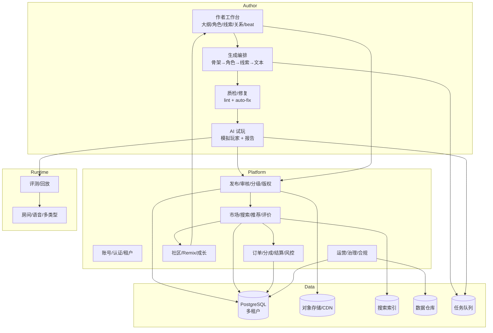
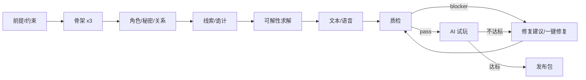

# 剧本杀 AI Agent V5 产品说明书：创作辅助与 UGC 平台

> 版本：V5.0（AI 共创）→ V5.5（UGC 平台）
> 基线：V4（多类型、通用 rubric、情感/表演评分、多结局已完成）
> 上游：[V4 说明书](V4_SPEC.md) · [V3 说明书](V3_SPEC.md) · [V2.5 说明书](V2.5_SPEC.md) · [V2 说明书](V2_SPEC.md) · [V2–V5 路线图](ROADMAP_V2_V5.md)
> 一句话：V5 把「玩家」变成「作者」，把「作者」变成「生态」：AI 陪作者从一句前提写到可玩 IR，质检/试玩/修复一条龙；作者能发布、分发、获得反馈与分成；平台能审核、分级、推荐、治理。

---

## 一、迭代背景与核心目标

### 1.1 为什么现在做创作与 UGC

V1–V4 解决的是「怎么玩」：单机 → 多人 → 语音 → 多类型。但内容供给始终是瓶颈：

- V2 只有 3 个本，V4 目标 40 个本；靠团队自研，速度跟不上玩家消耗。
- 剧本杀作者的核心痛点是「从想法到可玩本」的工程化：世界观、角色、时间线、线索、秘密、诡计、平衡、可解性、节奏，任何一环出错都会死本。
- 传统剧本杀平台（线下店/发行）依赖人工审稿、人工测试、人工排版，周期长、成本高。
- V2 的编译器、V2 的质检器、V2/V3 的评测、V4 的类型模板，已经具备「AI 辅助创作」的零件；V5 是把零件组装成工作台。
- 只有作者能持续供给，平台才有网络效应；UGC 是内容平台的终局，但必须先有「创作工具 + 质检 + 分发 + 治理」四件套。

### 1.2 V4 留下的、V5 必须解决的问题

| V4 遗留 | 证据 | V5 影响 |
|---|---|---|
| 创作工具是轻量模板 | V4 只做模板/关系图/beat 配置 | 作者仍要手写大量内容 |
| 编译器只做「抽取」 | `pipeline.py` 从文档抽 IR | 不能从零生成 |
| 质检是内部工具 | `lint.py`/`diagnostics` 面向研发 | 作者看不懂/不会修 |
| 试玩分析是内部评测 | `eval/harness.py` | 作者拿不到可操作建议 |
| 没有作者账号/权限 | 只有游客/房主 | 无法发布/分成/治理 |
| 没有分发/市场 | 剧本库只服务内部 | 作者没有流量/收益 |
| 没有版权/分级流水线 | V2 有基础指纹/分级 | 无法规模化审核 |
| 没有多租户/计费 | 单实例 | 无法平台化 |

### 1.3 核心目标（O1–O5）

| 目标 | 说明 | 可验收结果 |
|---|---|---|
| **O1 AI 共创** | 从一句前提生成可玩 IR 草稿 | 2 小时出可玩本；作者只改 30% |
| **O2 质检可操作** | 不只报错，还给修复建议/一键修复 | 0 blocker；作者能看懂 |
| **O3 试玩可指导** | 模拟玩家跑本，输出卡点/难度/结局分布 | 作者按报告改 1 轮，通关率 +10pp |
| **O4 发布可治理** | 上传/审核/分级/版权/上架/下架 | 审核 SLA <24h；侵权 0 |
| **O5 生态可循环** | 作者分成、玩家评价、推荐、remix | 1000 个 UGC 本；30% 发布转化 |

### 1.4 非目标

- 不做「一键生成爆款」；AI 是副驾驶，作者仍是最终决策者。
- 不做视频/虚拟形象/线下店 SaaS（可作为 V6）。
- 不做多语言（V6 之后）。
- 不做通用小说/影视创作；只做剧本杀 IR。
- 不做加密货币/数字藏品。
- 不开放底层模型/算力给作者；只开放创作与试玩接口。

### 1.5 两个里程碑

| 里程碑 | 主题 | 范围 | 退出条件 |
|---|---|---|---|
| **V5.0** | AI 共创工作台 | 作者侧：前提→大纲→角色→线索→真相→质检→试玩→导出 | 20 名作者 2 小时出可玩本 |
| **V5.5** | UGC 平台 | 账号、发布、审核、市场、评价、分成、治理 | 1000 个本、30% 发布转化、审核 SLA |

### 1.6 退出条件（Gate）

**V5.0：**

1. 20 名种子作者，每人 2 小时内从前提生成可玩本；人工修改量 <30%。
2. 生成本通过 V4 质检 0 blocker；AI 试玩完成率 ≥80%。
3. 作者满意度 ≥4/5；愿意继续使用 ≥70%。
4. 生成内容版权/分级/敏感内容 0 事故。
5. 单本生成成本 <¥20；单局成本 <¥3.5（沿用 V4 计费口径）。
6. 测试 ≥320 全绿。

**V5.5：**

1. 1000 个 UGC 本上架；30% 上传转发布；审核 SLA <24h。
2. 平台月活作者 ≥500；月活玩家 ≥5 万；次月留存 ≥25%。
3. 侵权投诉率 <0.5%；处理率 100%；重复侵权封禁。
4. 作者分成结算准确率 100%；提现成功率 >99%。
5. 推荐/搜索能让人均游玩本数 ≥3；UGC 本平均完成率 ≥75%。
6. 1000 房间 / 6000 连接并发压测通过（文本为主；语音容量另评估）；单局成本 <¥2.0（规模化后）。
7. 质量评审与人工标注 κ ≥0.65；UGC 质量分可解释。
8. 测试 ≥350 全绿；多租户/计费/审核进 CI。

---

## 二、依赖的上一版基础

### 2.1 直接复用的 V1–V4 资产

| 资产 | 位置 | V5 怎么用 | 改造 |
|---|---|---|---|
| IR / 编译器 | `schema/ir.py`、`compiler/` | 从「抽取」扩展为「生成」；复用校验/IR | 大 |
| 质检器 | `compiler/lint.py` | 作者侧质检 + 自动修复 | 大 |
| 类型模板 | V4 `GenrePlugin` | 生成时按类型选模板/rubric | 中 |
| 评测/试玩 | `eval/` | 作者侧模拟试玩 + 报告 | 大 |
| 剧本库/版本 | `storage/scripts.py` | UGC 发布/版本/回滚 | 大 |
| 内容安全 | V2/V4 分级/指纹 | 平台审核流水线 | 大 |
| 房间/语音 | V2.5/V3 | 试玩/正式游玩 | 小 |
| 多类型 rubric | V4 | 生成本评分/推荐 | 中 |
| 回放/复盘 | V2.5/V3 | 作者看试玩数据 | 中 |

### 2.2 V1–V4 已经打好的基础

- **IR 是结构化契约**：生成、校验、试玩、发布都围绕同一份 `Script`，不需要另造格式。
- **编译器有分段/抽取/置信度/source_span**：V5 可以复用「分段 + 结构化输出 + 校验」的工程经验。
- **质检有 blocker/warning + 可解性图**：V5 把它产品化为「作者能看懂的体检报告」。
- **评测有 persona/探针/不变量**：V5 把它变成「AI 试玩」。
- **类型插件**：V4 的 `GenrePlugin` 让生成器可以按类型选模板/约束/rubric。
- **内容分级/指纹**：V2 已做基础，V5 规模化。
- **剧本版本/发布门禁**：V2 的 `script_versions`/`publish` 可直接扩展。

### 2.3 必须改造的假设

| 假设 | 位置 | 问题 | V5 改造 |
|---|---|---|---|
| 编译器输入是「已有文档」 | `compiler/pipeline.py` | 生成没有源文档 | 新增「生成模式」：大纲/约束→IR |
| 质检面向研发 | `lint.py` | 作者看不懂 | 作者语言 + 修复建议 + 一键修复 |
| 评测面向内部 | `eval/harness.py` | 作者拿不到 | 作者侧试玩报告 |
| 单租户 | API/DB | 多作者/多团队 | 多租户 + 权限 + 配额 |
| 无账号 | 游客/房主 | 作者身份/收益 | 账号/实名/作者认证 |
| 无计费 | 无 | 分成/提现 | 钱包/订单/结算 |
| 无分发 | 剧本库 | 作者没流量 | 市场/搜索/推荐 |
| 无审核流水线 | 人工 | 规模化不可行 | 机器初筛 + 人工复核 + 申诉 |

---

## 三、新增与优化功能清单（核心）

> 标记：🆕 新增；🔧 迭代优化；🩹 修复。V5 分 V5.0（创作）与 V5.5（平台）两段。

### 3.1 V5.0：AI 共创工作台

#### F5-1 从前提生成故事骨架 🆕

**用户故事**：作为作者，我输入一句前提（「民国上海，一场婚礼上的毒杀，每个人都隐瞒了一段旧情」），选择类型/人数/时长/难度，AI 给我 3 个故事骨架：世界观、核心诡计、角色关系、三幕结构、真相。

**行为**：

1. 输入：前提、类型（本格/变格/情感/演绎/机制/恐怖）、人数（4–6，沿用 V2.5 席位上限）、时长（2–5h）、难度（1–5）、内容分级、必须包含/不能包含的要素。
2. 输出 3 个候选骨架：
   - 标题/一句话 logline；
   - 世界观/时代/地点；
   - 核心诡计/真相；
   - 角色列表（姓名/身份/目标/秘密方向）；
   - 三幕结构/关键 beat；
   - 情感线/阵营（按类型）；
   - 预估难度/时长。
3. 作者选择/混合/重生成；支持「锁定部分元素」（如锁定凶手/锁定某个角色）。
4. 约束检查：人数/性别/关系/时代/分级；不合规的候选不展示。
5. 版权检查：与库内/公开作品做指纹比对，避免「撞梗/抄袭」。
6. 版本：每次生成存 `outline_version`，可回滚。

**验收**：

- 3 个候选在 60s 内生成；作者选中率 ≥50%。
- 骨架通过类型/人数/分级约束；0 版权高撞车。
- 作者可在骨架上锁定元素再生成。

#### F5-2 角色、秘密与关系生成 🆕

**用户故事**：作为作者，我选中骨架后，AI 帮我生成每个角色的角色本、秘密、目标、关系、时间线，且互相不矛盾。

**行为**：

1. 角色本：public_profile、private_goals、persona_style、speech_constraints、秘密、false_beliefs、forbidden_topics。
2. 秘密：每人 1–3 个；秘密之间有关联/冲突；泄露面（leak_surfaces）自动生成。
3. 关系：亲缘/爱情/友情/仇恨/利益/上下级；双向一致；有张力。
4. 时间线：每个角色在各幕的位置/行为/可见性；与真相事件一致。
5. 认知切片：每个角色知道什么/不知道什么/误以为什么；不能全知。
6. 平衡：每个角色的信息量/戏份/秘密权重接近；避免边缘角色。
7. 作者可逐角色重生成/编辑/锁定。

**验收**：

- 生成的角色本通过 V4 质检（引用/秘密/关系/时间线）0 blocker。
- 角色信息量偏差 <20%；无「工具人」角色。
- 作者修改量 <30%。

#### F5-3 线索、诡计与可解性生成 🆕

**用户故事**：作为作者，AI 帮我设计线索链和诡计，并保证「有至少一条可解路径」，不会死本。

**行为**：

1. 线索：surface_text、truth_value、地点、幕、成本、前置、揭示事件/秘密、可见性、红鲱鱼。
2. 诡计：本格（时间/空间/身份/物证/心理）、变格（设定/规则）、情感（误会/隐瞒/牺牲）、机制（资源/阵营）。
3. 可解性：
   - 建图：线索→事件→秘密→指认/结局；
   - 计算最小成本路径 vs 幕预算；
   - 至少一条可解路径；最好 2–3 条；
   - 红鲱鱼数量/强度可调；
   - 关键证据链成本不超过预算的 80%。
4. 自动修复：
   - 预算超支 → 降成本/拆分线索/增加预算；
   - 不可达 → 加前置/换地点/加提示；
   - 多解 → 加区分证据/改秘密；
   - 红鲱鱼过多 → 删/弱化。
5. 作者可一键应用修复，或手动改。

**验收**：

- 生成本 100% 至少一条可解路径；关键链成本 ≤80% 预算。
- 自动修复后质检 0 blocker。
- 作者能看懂「为什么不可解/怎么修」。

#### F5-4 对话、信件与演出文本生成 🆕

**用户故事**：作为作者，AI 帮我写角色台词、信件、独白、语音线索文本，符合人设和时代。

**行为**：

1. 文本类型：角色本、私聊台词、公聊反应、信件/日记、语音线索 transcript、主持词、结局旁白。
2. 风格：按角色 persona/时代/类型；支持「更书面/更口语/更克制/更戏剧」。
3. 一致性：与角色秘密/关系/时间线一致；不泄露未授权信息。
4. 语音适配：分句/停顿/情绪标记，适配 V3 TTS。
5. 敏感内容：自动分级/替换/提示。
6. 作者可逐段重写/润色/扩写/缩写。

**验收**：

- 文本与角色人设一致率 ≥85%（人工）；无泄密。
- 语音线索可直接用于 V3 播放；字幕对齐。
- 敏感内容 0 漏检。

#### F5-5 作者工作台 🆕

**用户故事**：作为作者，我在一个界面里完成「大纲→角色→线索→时间线→关系图→beat→结局→试玩→发布」，不用在多个工具间跳。

**行为**：

1. 项目制：一个项目 = 一个剧本；支持多版本/分支。
2. 视图：
   - 大纲/beat 时间线；
   - 角色卡/关系图；
   - 线索板/依赖图；
   - 时间线/真相事件；
   - 结局/分支；
   - 质检报告；
   - 试玩报告；
   - 发布配置。
3. 编辑：表单 + 富文本 + 图编辑；实时校验；自动保存；版本 diff/回滚。
4. 协作：V5.0 用项目级邀请链接 + 临时角色 token（owner/editor/reviewer/playtester），不要求全局账号；V5.5 接入账号/RBAC。
5. 导入/导出：JSON IR、Markdown、PDF（角色本/主持手册）。
6. 模板：按类型/人数/时长。

**验收**：

- 作者 2 小时出可玩本；操作路径 <10 步到试玩。
- 多人协作不冲突；版本可回滚。
- 导出格式可直接用于线下/其他平台。

#### F5-6 AI 试玩与作者侧报告 🆕

**用户故事**：作为作者，我点「试玩」，AI 模拟 4–6 个玩家跑 10 局，告诉我哪里卡、哪里太简单、哪个角色边缘、结局分布如何。

**行为**：

1. 试玩配置：人数、persona 组合、模型、局数、是否语音。
2. 指标：
   - 完成率、通关率、平均时长、卡关点；
   - 线索发现率/漏掉率；
   - 角色信息量/发言机会/投票影响；
   - 结局分布；
   - 情感 beat 覆盖（V4）；
   - 表演分（V4）；
   - 泄密/不变量。
3. 报告：作者语言 + 证据 + 建议；可跳转到对应线索/角色/beat。
4. 对比：改版前后指标对比；A/B 两个版本。
5. 成本：试玩消耗算力；作者配额/付费。

**验收**：

- AI 快进试玩 10 局 <10 分钟；报告可操作。
- 作者按建议改 1 轮，通关率 +10pp 或卡关 -20%。
- 报告能定位「哪个角色边缘/哪条线索没人发现」。

#### F5-7 一键修复与发布前体检 🆕

**用户故事**：作为作者，发布前我点「体检」，系统告诉我所有 blocker/warning，并给出「一键修复」或「手动修复」；修完才能发布。

**行为**：

1. 体检项：结构/引用/时间线/可解性/平衡/分级/版权/文本质量/语音适配。
2. 修复：
   - 自动修复：低风险（补引用、调成本、加提示、改错别字）；
   - 建议修复：中风险（加线索、改秘密、调关系）；
   - 人工处理：高风险（版权、敏感内容、核心诡计）。
3. 发布门禁：0 blocker；高风险已处理；版权/分级/授权确认。
4. 发布包：IR + 角色本 + 主持手册 + 线索表 + 音频/素材 + 版本说明。
5. 回滚：发布后发现问题可下架/回滚版本。

**验收**：

- 体检 100% 覆盖 V4 质检项；自动修复成功率 ≥60%（低风险项）。
- 发布门禁阻断所有 blocker；0 漏放。
- 发布包可直接被 V5.5 上架。

#### F5-8 版权、分级与 AI 生成声明 🆕

**行为**：

1. 版权指纹：文本/角色/诡计/音频；与库内/公开作品比对。
2. AI 生成声明：标注哪些部分由 AI 生成/辅助；平台展示。
3. 授权：作者声明原创/授权改编；上传授权书/联系人。
4. 分级：V4 分级 + 平台规则；敏感内容人工复核。
5. 侵权处理：投诉→下架→申诉→恢复/封禁；重复侵权封号。
6. 训练数据：不使用作者私有本训练公共模型，除非作者显式授权；提供退出。

**验收**：

- 100% 发布本有 AI 声明/授权/分级。
- 侵权投诉 24h 内处理；重复侵权封禁。
- 作者可查看/撤回训练授权。

### 3.2 V5.5：UGC 平台

#### F5-9 账号、作者认证与多租户 🆕

**行为**：

1. 账号：手机/邮箱/第三方登录；实名（按法规）；未成年人保护。
2. 作者认证：身份/版权/收款信息；认证后解锁发布/分成。
3. 多租户：个人作者/工作室/发行商；团队/权限/配额。
4. 角色：玩家/作者/编辑/试玩者/审核员/运营/管理员。
5. 审计：所有发布/下架/分成/审核操作可追溯。

**验收**：

- 账号/认证/权限可用；越权 0。
- 多租户数据隔离；配额生效。
- 审计完整。

#### F5-10 发布、审核与上架 🆕

**行为**：

1. 发布流程：草稿→体检→提交审核→机器初筛→人工复核→上架/驳回→申诉。
2. 机器初筛：结构/分级/版权/敏感内容/质量分。
3. 人工复核：高风险/抽检；SLA <24h。
4. 上架配置：价格/免费/内购、人数、时长、类型、标签、封面、简介、试玩局。
5. 下架：作者主动/平台强制；已购玩家可继续玩/退款规则。
6. 版本：更新需重新审核；紧急修复可加急。

**验收**：

- 审核 SLA <24h；驳回原因可操作。
- 上架本 100% 有分级/版权/授权/AI 声明。
- 下架/退款规则清晰；0 资损事故。

#### F5-11 市场、搜索与推荐 🆕

**行为**：

1. 市场：首页/分类/榜单/新品/编辑推荐/作者主页。
2. 搜索：标题/作者/类型/人数/时长/难度/标签/评分；全文检索。
3. 推荐：基于玩家偏好/历史/相似本/社交关系；冷启动用编辑推荐。
4. 评价：评分/短评/长评/标签/剧透折叠；作者回复。
5. 试玩：免费试玩前 15 分钟/第一幕；转化付费。
6. 榜单：热度/口碑/新颖/情感/硬核；反刷榜。

**验收**：

- 搜索 <300ms；推荐 CTR 提升 ≥20%。
- 评价可举报/折叠；剧透不泄露。
- 试玩转化 ≥15%。

#### F5-12 购买、分成与结算 🆕

**行为**：

1. 定价：免费/单本/章节/订阅/房间票；作者可设。
2. 支付：微信/支付宝/应用内；订单/退款/发票。
3. 分成：平台/作者/发行；阶梯/独家；透明账单。
4. 结算：月结/提现；税务/合规；异常冻结。
5. 反作弊：刷单/刷评/盗版；风控。

**验收**：

- 支付成功率 >99%；退款 <24h。
- 分成账单准确率 100%；提现 >99%。
- 刷单/盗版 0 资损。

#### F5-13 社区、Remix 与作者成长 🆕

**行为**：

1. 社区：作者动态/教程/问答/活动/比赛。
2. Remix：授权 remix 模板/角色/诡计；分成/署名。
3. 作者成长：等级/徽章/流量扶持/培训/签约。
4. 玩家共创：测试团/反馈/投票；作者采纳有奖励。
5. 内容治理：社区规范/举报/禁言/封号。

**验收**：

- Remix 授权/署名/分成可追溯。
- 作者月活/留存提升；优质作者留存 ≥60%。
- 社区投诉 24h 处理。

#### F5-14 平台运营与治理 🆕

**行为**：

1. 内容治理：分级/审核/侵权/敏感/未成年/投诉。
2. 经济治理：定价/分成/退款/风控/反垄断。
3. 数据：作者/玩家/内容/收入/留存/推荐效果。
4. 合规：隐私/未成年人/算法备案/生成式 AI 合规。
5. 应急：下架/封禁/公告/客服。

**验收**：

- 治理 SLA 达标；0 重大合规事故。
- 数据看板可用；决策可追溯。

#### F5-15 开放 API 与生态 🆕

**行为**：

1. 作者 API：创建项目/生成/体检/试玩/发布/数据。
2. 玩家 API：搜索/开局/回放/评价。
3. 合作方：线下店/发行/教育/文旅；白标/嵌入。
4. 开发者：插件（类型/评分/推荐/审核）；沙箱/配额/审核。
5. 文档/SDK/沙盒/限流。

**验收**：

- API 文档完整；沙盒可用；限流/配额生效。
- 合作方接入 <1 周；0 越权。

### 3.3 对 V1–V4 功能的迭代优化

#### O5-1 编译器：抽取 → 生成 🔧

- **V2–V4 现状**：编译器从文档抽 IR；生成是空白。
- **V5 改造**：
  - 新增 `generate` 模式：约束→骨架→角色→线索→文本→IR；
  - 复用分段/结构化输出/校验/置信度；
  - 生成与抽取共用 IR 契约；
  - 生成结果必须过同一套 lint/试玩。
- **验收**：生成本与人工本用同一质检/试玩；0 特殊通道。

#### O5-2 质检：研发工具 → 作者产品 🔧

- **V2–V4 现状**：`lint.py` 输出 blocker/warning。
- **V5 改造**：
  - 作者语言、证据、修复建议、一键修复；
  - 质量分（可玩性/平衡/新颖/文本）；
  - 发布门禁。
- **验收**：作者看懂率 ≥90%；修复成功率 ≥60%。

#### O5-3 评测：内部 → 作者侧试玩 🔧

- **V2–V4 现状**：`harness.py` 内部跑分。
- **V5 改造**：
  - 作者可配置试玩；
  - 报告可操作；
  - 配额/计费；
  - 对比/AB。
- **验收**：试玩 <10 分钟；改 1 轮指标提升。

#### O5-4 内容安全：标签 → 流水线 🔧

- **V2–V4 现状**：分级/指纹基础。
- **V5 改造**：
  - 机器初筛 + 人工复核 + 申诉；
  - 版权/深度伪造/未成年/敏感；
  - 训练数据授权。
- **验收**：审核 SLA；侵权率；0 重大事故。

#### O5-5 存储：单租户 → 多租户 🔧

- **V2.5 现状**：Postgres 单实例。
- **V5 改造**：
  - 租户 ID/行级隔离/配额；
  - 对象存储/CDN；
  - 搜索（Postgres FTS/OpenSearch）；
  - 数据仓库。
- **验收**：隔离/配额/扩展；1000 本/5 万玩家。

#### O5-6 UI：作者工作台 + 市场 🔧

- **V4 现状**：轻量模板。
- **V5 改造**：
  - 完整工作台；
  - 市场/作者主页/评价；
  - 移动端。
- **验收**：作者 2 小时出本；玩家转化。

### 3.4 功能矩阵：V4 → V5

| 能力 | V4 | V5.0 | V5.5 | 类型 |
|---|---|---|---|---|
| 从前提生成 | 无 | 有 | 有 | 🆕 |
| 角色/秘密/关系生成 | 无 | 有 | 有 | 🆕 |
| 线索/诡计/可解性 | 质检 | 生成+修复 | 生成+修复 | 🆕 |
| 对话/信件/语音文本 | 无 | 有 | 有 | 🆕 |
| 作者工作台 | 轻量 | 完整 | 完整 | 🔧 |
| AI 试玩 | 内部 | 作者侧 | 作者侧 | 🔧 |
| 一键修复 | 无 | 有 | 有 | 🆕 |
| 发布/审核 | 内部 | 导出 | 平台 | 🆕 |
| 市场/推荐 | 无 | 无 | 有 | 🆕 |
| 账号/分成 | 无 | 无 | 有 | 🆕 |
| 社区/Remix | 无 | 无 | 有 | 🆕 |
| 开放 API | 内部 | 内部 | 有 | 🆕 |

### 3.5 明确不做 / 延后

| 项 | 原因 | 放到 |
|---|---|---|
| 视频/虚拟形象 | 非核心 | V6 |
| 线下店 SaaS | 需要 POS/预约/硬件 | V6 |
| 多语言 | 合规/内容成本 | V6 |
| 通用小说创作 | 偏离剧本杀 | 不做 |
| 数字藏品 | 合规/投机 | 不做 |
| 自研基础模型 | 成本/没必要 | 不做 |

---

## 四、技术演进与架构依赖

### 4.1 架构变化

### 4.2 数据模型变更

#### 新增表（V5.0）

| 表 | 用途 | 关键字段 |
|---|---|---|
| `projects` | 作者项目 | `project_id`、`tenant_id`（V5.0 固定 `default`）、`owner_key`（种子作者标识，非外键）、`title`、`genre`、`status`、`current_version` |
| `outline_versions` | 骨架版本 | `outline_id`、`project_id`、`version`、`content_json`、`created_by` |
| `generation_jobs` | 生成任务 | `job_id`、`project_id`、`stage`、`status`、`progress`、`cost`、`error` |
| `generation_artifacts` | 生成产物 | `artifact_id`、`job_id`、`kind`、`content_json`、`confidence` |
| `qa_reports` | 体检报告 | `report_id`、`project_id`、`version`、`blockers`、`warnings`、`score` |
| `fix_suggestions` | 修复建议 | `suggestion_id`、`report_id`、`risk`、`patch`、`status` |
| `playtest_runs` | 试玩 | `run_id`、`project_id`、`version`、`config`、`status` |
| `playtest_metrics` | 试玩指标 | `run_id`、`metric`、`value`、`detail` |

#### 新增表（V5.5）

| 表 | 用途 | 关键字段 |
|---|---|---|
| `tenants` | 租户 | `tenant_id`、`type`、`plan`、`quota` |
| `accounts` | 账号 | `account_id`、`tenant_id`、`role`、`verified` |
| `author_profiles` | 作者认证 | `account_id`、`real_name`、`payout_info`、`status` |
| `listings` | 上架 | `listing_id`、`script_id`、`price`、`status`、`rating` |
| `reviews` | 评价 | `review_id`、`listing_id`、`account_id`、`rating`、`spoiler` |
| `orders` | 订单 | `order_id`、`account_id`、`listing_id`、`amount`、`status` |
| `payouts` | 分成/提现 | `payout_id`、`author_id`、`period`、`amount`、`status` |
| `moderation_cases` | 审核 | `case_id`、`target`、`type`、`status`、`reviewer` |
| `copyright_claims` | 侵权 | `claim_id`、`listing_id`、`claimant`、`status` |
| `consents` | 授权 | `consent_id`、`account_id`、`type`、`scope`、`valid_to` |
| `audit_events` | 审计 | `actor`、`action`、`target`、`detail` |

#### 变更表

- `scripts`：增加 `tenant_id`（V5.0 固定 `default`，先不加外键，V5.5 建 `tenants` 后补 FK）、`project_id`、`author_key`（V5.0 种子作者标识）、`ai_generated`、`license`、`quality_score`；V5.5 回填 `author_id` 外键。
- `script_versions`：增加 `generation_job_id`、`qa_report_id`、`playtest_run_id`。
- `content_fingerprints`：增加 `tenant_id`、`scope`、`claim_id`。
- `games`：增加 `tenant_id`（V5.0 固定 `default`，先不加外键）、`listing_id`、`billing_id`。

### 4.3 组件引入

| 组件 | 选型 | 作用 | 备注 |
|---|---|---|---|
| 队列 | Redis Stream / Celery / Arq | 生成/试玩/审核异步 | 与 V2.5 复用 |
| 对象存储 | S3/MinIO + CDN | 音频/封面/导出 | 生命周期/签名 URL |
| 搜索 | Postgres FTS → OpenSearch | 剧本/作者/标签 | 先 PG，量大再 ES |
| 推荐 | 规则 → 协同过滤/向量 | 个性化 | 冷启动编辑推荐 |
| 支付 | 微信/支付宝/Stripe | 订单/退款 | 合规/对账 |
| 数据仓库 | ClickHouse/BigQuery | 运营/作者分析 | 先 PG 聚合 |
| 审核 | 分类模型 + LLM + 人工 | 内容/版权/分级 | 人机结合 |
| 版权指纹 | SimHash + 向量 + 音频指纹 | 查重 | 多模态 |
| 生成编排 | 自研 DAG/状态机 | 多阶段生成 | 可恢复/可重试 |

### 4.4 API 变更

#### 作者 API

| 方法 | 路径 | 作用 |
|---|---|---|
| POST | `/api/v5/projects` | 创建项目 |
| POST | `/api/v5/projects/{id}/outlines` | 生成骨架 |
| POST | `/api/v5/projects/{id}/generate` | 生成角色/线索/文本 |
| POST | `/api/v5/projects/{id}/qa` | 体检 |
| POST | `/api/v5/projects/{id}/fix` | 一键修复 |
| POST | `/api/v5/projects/{id}/playtest` | 试玩 |
| GET | `/api/v5/projects/{id}/reports` | 报告 |
| POST | `/api/v5/projects/{id}/submit` | 提交审核 |

#### 平台 API

| 方法 | 路径 | 作用 |
|---|---|---|
| GET | `/api/v5.5/listings` | 市场列表 |
| GET | `/api/v5.5/search` | 搜索 |
| POST | `/api/v5.5/orders` | 下单 |
| GET | `/api/v5.5/author/earnings` | 收益 |
| POST | `/api/v5.5/payouts` | 提现 |
| POST | `/api/v5.5/moderation/cases` | 审核 |
| POST | `/api/v5.5/copyright/claims` | 侵权投诉 |

### 4.5 生成编排

**原则**：

- 每一步都有结构化产物 + 置信度 + 可回滚。
- 生成不跳过质检/试玩；与人工本同一门禁。
- 失败可重试/局部重生成，不重跑全流程。
- 成本可见；作者配额/付费。

### 4.6 多租户与合规

| 维度 | 要求 |
|---|---|
| 数据隔离 | 行级 `tenant_id`；对象存储前缀；搜索过滤 |
| 权限 | RBAC + 资源级；越权测试 |
| 配额 | 生成/试玩/存储/API；超限降级/计费 |
| 隐私 | 个人信息最小化；删除/导出；日志脱敏 |
| 未成年人 | 实名/年龄门禁/时长/消费限制 |
| 生成式 AI | AI 声明/内容标识/算法备案/训练授权 |
| 版权 | 指纹/投诉/下架/申诉/重复侵权封禁 |
| 支付 | 资质/对账/退款/税务 |

### 4.7 迁移与兼容

1. **IR 2.x 保持**：V5 不破坏 V4 IR；新增字段可选。
2. **项目/剧本关系**：`project` 1:N `script_version`；发布时生成 `listing`。
3. **旧本迁移**：V1–V4 的剧本可导入为项目；作者/版权补录。
4. **多租户迁移**：V5.0 不建 `tenants`/`accounts`，用邀请码 + `owner_key` 标识种子作者，单租户固定 `tenant_id=default`；V5.5 建表后把 `owner_key` 回填为 `account_id`，现有数据挂到 `default` 租户。
5. **回滚**：生成/发布/分成均可回滚；保留审计。

### 4.8 非功能性要求

| 维度 | V5 要求 | 验证 |
|---|---|---|
| 生成时延 | 骨架 <60s；完整本 <30 分钟 | 20 作者 |
| 试玩 | AI 快进 10 局 <10 分钟 | 压测 |
| 市场 | 搜索 <300ms；首页 <1s | 压测 |
| 并发 | 1000 房间 / 6000 连接（文本为主；全语音容量按 GPU 池单独评估） | 压测 |
| 可用性 | 99.9% | 监控 |
| 支付 | 成功率 >99%；对账 0 差异 | 对账 |
| 审核 | SLA <24h | 工单 |
| 安全 | 越权 0；注入 0；盗版 0 | 渗透/审计 |
| 成本 | 单本生成 <¥20；单局 <¥2.0 | 看板 |

### 4.9 技术风险与应对

| 风险 | 概率 | 影响 | 应对 |
|---|---:|---:|---|
| 生成本同质化 | 高 | 玩家厌倦 | 多样性约束 + 作者风格 + 编辑推荐 |
| 生成本不可玩 | 高 | 作者流失 | 强制质检/试玩；不达标不发布 |
| 版权/抄袭 | 中 | 法律风险 | 指纹 + 人工 + 投诉/封禁 |
| 审核规模化 | 高 | 成本/漏放 | 机器初筛 + 抽样 + 申诉 |
| 分成资损 | 低 | 信任 | 对账/风控/审计 |
| 多租户越权 | 中 | 数据事故 | 行级隔离 + 渗透测试 |
| 算力成本 | 高 | 商业不可行 | 配额/付费/缓存/小模型 |
| 内容安全 | 中 | 合规 | 分级/未成年/敏感词/人工 |

---

## 五、预期价值与关键指标（KPI）

### 5.1 用户价值

| 角色 | V4 体验 | V5 体验 |
|---|---|---|
| 作者 | 手写 + 轻量模板 | 2 小时出可玩本；AI 生成/质检/试玩/修复 |
| 玩家 | 40 个本 | 1000+ UGC 本；搜索/推荐/评价/试玩 |
| 工作室 | 无平台 | 多租户/协作/发行/分成 |
| 平台 | 自研内容 | 内容生态/网络效应/收入 |

### 5.2 KPI 表

#### V5.0

| 指标 | V4 基线 | V5.0 目标 | 测量 |
|---|---:|---:|---|
| 作者出本时间 | 1 天（模板） | ≤2 小时 | 20 作者计时 |
| 人工修改量 | — | <30% | 字数/字段 diff |
| 生成本质检 | — | 0 blocker | lint |
| 试玩完成率 | — | ≥80% | AI 快进 10 局 |
| 作者满意度 | — | ≥4/5 | 问卷 |
| 继续使用意愿 | — | ≥70% | 问卷 |
| 单本生成成本 | — | <¥20 | 看板 |
| 单局成本 | <¥3.5 | <¥3.5（沿用 V4） | 看板 |
| 测试数 | ≥280 | ≥320 | CI |

#### V5.5

| 指标 | 目标 | 测量 |
|---|---:|---|
| UGC 上架本 | ≥1000 | 平台 |
| 上传转发布 | ≥30% | 漏斗 |
| 审核 SLA | <24h | 工单 |
| 月活作者 | ≥500 | 平台 |
| 月活玩家 | ≥5 万 | 平台 |
| 次月留存 | ≥25% |  cohort |
| 人均游玩本数 | ≥3 | 行为 |
| UGC 平均完成率 | ≥75% | 事件 |
| 质量评审 κ | ≥0.65 | 人工标注 |
| 侵权投诉率 | <0.5% | 投诉/上架 |
| 投诉处理率 | 100% | 工单 |
| 分成准确率 | 100% | 对账 |
| 提现成功率 | >99% | 支付 |
| 单局成本 | <¥2.0 | 看板（规模化） |
| 并发 | 1000 房间 / 6000 连接（文本为主；语音另评估） | 压测 |
| 测试数 | ≥350 | CI |

### 5.3 验收门禁

**V5.0：**

- [ ] 20 作者 2 小时出本；修改量 <30%。
- [ ] 生成本 0 blocker；AI 试玩完成率 ≥80%。
- [ ] 作者满意度 ≥4/5；继续使用 ≥70%。
- [ ] 版权/分级/敏感 0 事故。
- [ ] 单本生成成本 <¥20；单局成本 <¥3.5。
- [ ] `pytest` ≥320 全绿。

**V5.5：**

- [ ] 1000 本上架；30% 发布转化；审核 SLA <24h。
- [ ] 月活作者 ≥500；月活玩家 ≥5 万；次月留存 ≥25%。
- [ ] 人均游玩 ≥3；UGC 完成率 ≥75%。
- [ ] 侵权投诉 <0.5%；处理 100%；重复侵权封禁。
- [ ] 分成 100% 准确；提现 >99%。
- [ ] 多租户越权 0；支付资损 0。
- [ ] 1000 房间 / 6000 连接并发压测通过（文本为主；语音容量另评估）；单局成本 <¥2.0。
- [ ] 质量评审与人工 κ ≥0.65；质量分可解释。
- [ ] `pytest` ≥350 全绿。

### 5.4 上线策略

**V5.0：**

| 阶段 | 范围 | 退出条件 |
|---|---|---|
| 内测 | 5 名作者 | 2 小时出本；0 blocker |
| 封测 | 20 名作者 | 满意度 ≥4；修改量 <30% |
| 公测 | 100 名作者 | 成本/稳定性达标 |

**V5.5：**

| 阶段 | 范围 | 退出条件 |
|---|---|---|
| 邀请制 | 50 作者 / 1000 玩家 | 审核/支付/分成跑通 |
| 公测 | 500 作者 / 1 万玩家 | SLA/留存/投诉达标 |
| GA | 全量 | 全部 Gate |

**灰度**：`v5.generation`、`v5.playtest`、`v5.marketplace`、`v5.billing`、`v5.moderation` 按租户/作者/地区。

### 5.5 风险与兜底

- **生成本不可玩**：强制质检/试玩；不达标不发布；作者可退回人工。
- **同质化**：多样性约束 + 作者风格 + 编辑推荐 + 比赛。
- **版权风险**：指纹 + 人工 + 投诉/封禁 + 保险/法务。
- **审核成本**：机器初筛 + 抽样 + 作者信用分；高风险全检。
- **算力成本**：配额/付费/缓存/小模型；免费额度。
- **平台冷启动**：先自营/签约作者；编辑推荐；线下店合作。

### 5.6 本版之后（V6 候选）

| 方向 | 说明 |
|---|---|
| 线下店 SaaS | 预约/开房/收银/ DM 辅助/多店管理 |
| 视频/虚拟形象 | 角色形象/口型/虚拟空间 |
| 多语言/出海 | 英文/日文/东南亚；文化适配 |
| IP 合作 | 影视/动漫/游戏 IP 改编 |
| 教育/文旅 | 研学/团建/景区剧本 |
| 实时视频 | 真人 DM + 远程玩家 |

> **V5 的成功标准：一个没写过剧本杀的玩家，2 小时能做出一个别人愿意玩完的本；一个作者能靠分成活下去；平台不需要人工逐本审就能守住底线。**
